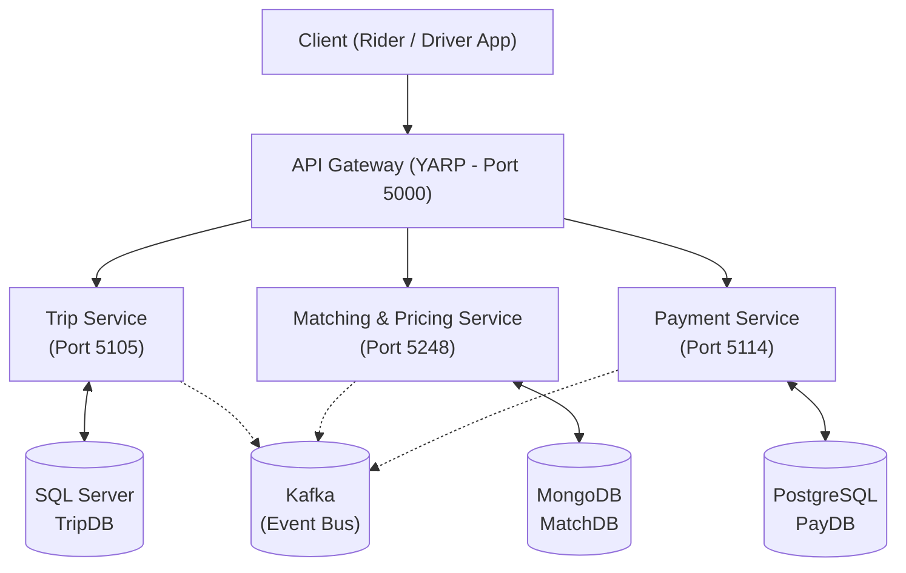

# SwiftRide - Microservices Architecture

Hệ thống đặt xe công nghệ (Ride-Hailing Platform) kết nối Rider (khách hàng) và Driver (tài xế), được xây dựng trên nền tảng **.NET 10** theo kiến trúc **Microservices** và nguyên lý **Polyglot Persistence**.

> **Tài liệu đặc tả & Hướng dẫn kỹ thuật:**
> - Tài liệu kiến trúc gốc: [`docs/RideLite-KienTrucPhanMem.pdf`](docs/RideLite-KienTrucPhanMem.pdf)
> - Phân rã chức năng & 15 Sơ đồ trình tự: [`docs/FUNCTIONAL_DECOMPOSITION_AND_SEQUENCE_DIAGRAMS.md`](docs/FUNCTIONAL_DECOMPOSITION_AND_SEQUENCE_DIAGRAMS.md)
> - Thiết kế CSDL chi tiết (SQL Server, MongoDB, PostgreSQL): [`docs/DATABASE_DESIGN.md`](docs/DATABASE_DESIGN.md)
> - Hợp đồng API 23 Endpoints & Tích hợp Realtime SignalR: [`docs/API_CONTRACT_AND_FE_INTEGRATION.md`](docs/API_CONTRACT_AND_FE_INTEGRATION.md)

---

## 🏛️ Kiến trúc tổng quan

Hệ thống tuân thủ mô hình **Database-per-Service**, giao tiếp đồng bộ qua REST (thông qua API Gateway) và giao tiếp bất đồng bộ qua **Apache Kafka (MassTransit Kafka Rider)**.



### Danh sách các dịch vụ cốt lõi

| Dịch vụ             |       Cổng       |      Cơ sở dữ liệu      | Vai trò chính & Design Pattern                                                                            |
| :------------------ | :--------------: | :---------------------: | :-------------------------------------------------------------------------------------------------------- |
| **ApiGateway**      |      `5000`      |         _Không_         | Reverse Proxy (YARP), chứng thực JWT, Rate-limit, định tuyến yêu cầu.                                     |
| **TripService**     |      `5105`      | **SQL Server** (`1433`) | Quản lý vòng đời chuyến đi (**State Pattern**), lưu trữ giao dịch cần tính ACID cao.                      |
| **MatchingService** |      `5248`      |  **MongoDB** (`27017`)  | Tìm tài xế gần nhất (**Geo-spatial index**), tính giá cước linh hoạt (**Strategy Pattern**).              |
| **PaymentService**  |      `5114`      | **PostgreSQL** (`5432`) | Sổ cái giao dịch kép (**Double-entry Ledger**), hỗ trợ **Idempotency**, thanh toán (**Factory Pattern**). |
| **Kafka**           |      `9092`      |    _Message Broker_     | Truyền nhận event bất đồng bộ qua Kafka Rider.                                      |

---

## 💻 Yêu cầu hệ thống (Prerequisites)

Trước khi cài đặt, hãy đảm bảo máy tính của bạn đã cài đặt các công cụ sau:

1. **[.NET 10 SDK](https://dotnet.microsoft.com/download/dotnet/10.0)** (kiểm tra bằng lệnh `dotnet --version` $\ge 10.0.x$).
2. **[Docker Desktop](https://www.docker.com/products/docker-desktop/)** hoặc Docker Engine + Docker Compose v2+.
3. **[Git](https://git-scm.com/)**.
4. **IDE khuyến nghị**:
   - Visual Studio 2026 (hỗ trợ .NET 10).
   - Visual Studio Code (kèm extension _C# Dev Kit_).
   - JetBrains Rider 2026+.

---

## 🚀 Hướng dẫn cài đặt nhanh cho thành viên mới (Quickstart)

### Bước 1: Clone repository về máy

```bash
git clone <URL_REPOSITORY_CUA_TEAM>
cd SwiftRide
```

### Bước 2: Khởi động các cơ sở dữ liệu & Message Broker qua Docker

Dự án đã chuẩn bị sẵn file `docker-compose.yml` cấu hình đầy đủ **SQL Server, MongoDB, PostgreSQL, Redis và Kafka**. Ba backend tạo các topic Kafka còn thiếu khi khởi động.

```bash
cp -n .env.example .env
docker compose up -d --build --remove-orphans
```

Kiểm tra trạng thái các container đang chạy:

```bash
docker compose ps
```

Khi chạy backend bằng `dotnet run`, đặt `Kafka__BootstrapServers=localhost:9092`. [Hướng dẫn kiểm thử API](docs/API_TESTING_GUIDE.md)

#### Chạy nhiều replica backend

```bash
docker compose up -d --build \
  --scale trip-service=2 \
  --scale matching-service=2 \
  --scale payment-service=2
docker compose ps
```

Client vẫn truy cập Gateway tại `http://localhost:5000`. YARP lấy danh sách replica từ DNS nội bộ của Docker và cập nhật mỗi 5 giây. Các kết nối SignalR sử dụng cookie `SwiftRide.TripHub` để duy trì cùng một replica trong quá trình kết nối.

Các replica của cùng backend dùng chung cơ sở dữ liệu, Redis và consumer group Kafka. Số replica có thể cùng đọc một topic trong một group phụ thuộc vào số partition của topic đó.

#### Cấu hình từng topic Kafka

Mỗi topic có một mục trong [kafka-topics.json](src/Shared.Messaging/kafka-topics.json). Chỉnh `numPartitions` và `replicationFactor` cho cấu trúc của topic khi tạo mới. Các thuộc tính trong `configs` là cấu hình Kafka của riêng topic đó, ví dụ `retention.ms` tính bằng mili giây. Backend đồng bộ các thuộc tính đã khai báo khi khởi động, kể cả với topic đã tồn tại.

### Bước 3: Restore dependencies và Build mã nguồn

```bash
dotnet restore SwiftRide.slnx
dotnet build SwiftRide.slnx
```

---

## 🌐 Thông số kết nối & Cổng dịch vụ (Service Registry)

### Hạ tầng (Infrastructure)

| Dịch vụ hạ tầng         | Địa chỉ / Cổng           | Tài khoản / Mật khẩu            | Ghi chú                    |
| :---------------------- | :----------------------- | :------------------------------ | :------------------------- |
| **SQL Server**          | `localhost:1433`         | `sa` / `Password123!`           | Dành cho TripService       |
| **MongoDB**             | `localhost:27017`        | Mặc định (no auth)              | DB: `MatchDB`              |
| **PostgreSQL**          | `localhost:5432`         | `postgres` / `postgrespassword` | DB: `PayDB`                |
| **Kafka**               | `localhost:9092`        | PLAINTEXT (local)              | Kafka KRaft cho phát triển |

### Microservices (.NET Apps)

Khi chạy Compose, gọi API qua Gateway. Các cổng backend dưới đây dùng khi chạy bằng IDE hoặc `dotnet run`.

| Dịch vụ             | URL HTTP (Local)        | Swagger / OpenAPI                       |
| :------------------ | :---------------------- | :-------------------------------------- |
| **ApiGateway**      | `http://localhost:5000` | Cổng vào chung của toàn hệ thống        |
| **TripService**     | `http://localhost:5105` | `http://localhost:5105/openapi/v1.json` |
| **MatchingService** | `http://localhost:5248` | `http://localhost:5248/openapi/v1.json` |
| **PaymentService**  | `http://localhost:5114` | `http://localhost:5114/openapi/v1.json` |

---

## 🏃 Hướng dẫn chạy các Microservices

### Cách 1: Sử dụng Visual Studio (Khuyến nghị)

1. Mở file solution `SwiftRide.slnx`.
2. Click chuột phải vào **Solution 'SwiftRide'** $\rightarrow$ chọn **Configure Startup Projects...**
3. Chọn **Multiple startup projects** và đặt **Action = Start** cho cả 4 projects (`ApiGateway`, `TripService`, `MatchingService`, `PaymentService`).
4. Nhấn **F5** để khởi chạy toàn bộ.

### Cách 2: Sử dụng dòng lệnh (CLI / Terminal)

Mở 4 tab terminal riêng biệt và chạy từng dịch vụ:

```bash
# Terminal 1: Trip Service
dotnet run --project src/TripService

# Terminal 2: Matching Service
dotnet run --project src/MatchingService

# Terminal 3: Payment Service
dotnet run --project src/PaymentService

# Terminal 4: API Gateway
dotnet run --project src/ApiGateway
```

---

## 📁 Cấu trúc thư mục dự án (Project Structure)

Mỗi service được tổ chức theo kiến trúc Clean Architecture / Onion Architecture thu gọn:

```text
SwiftRide/
├── docs/                                  # Tài liệu kiến trúc và tài liệu dự án
│   ├── RideLite-KienTrucPhanMem.pdf       # Tài liệu kiến trúc phần mềm đặc tả
│   ├── FUNCTIONAL_DECOMPOSITION_AND_SEQUENCE_DIAGRAMS.md # Phân rã chức năng & 15 Sequence Diagrams
│   ├── DATABASE_DESIGN.md                 # Thiết kế chi tiết CSDL (TripDB, MatchDB, PayDB)
│   └── API_CONTRACT_AND_FE_INTEGRATION.md # Hợp đồng 23 APIs & SignalR Realtime Hub
├── src/
│   ├── ApiGateway/                        # Reverse Proxy (YARP) & JWT Auth
│   ├── TripService/                       # Quản lý chuyến đi (SQL Server)
│   │   ├── Domain/                        # Entities, State pattern (TripState)
│   │   ├── Application/                   # Services, CQRS/Handlers, DTOs
│   │   ├── Infrastructure/                # TripDbContext, Repositories
│   │   └── Api/                           # Controllers / Minimal APIs
│   ├── MatchingService/                   # Ghép xe & Tính giá (MongoDB)
│   │   ├── Domain/                        # Strategy pattern (IPricingStrategy)
│   │   ├── Application/                   # Matching logic, DTOs
│   │   ├── Infrastructure/                # MongoDbContext, Geo-queries
│   │   └── Api/
│   └── PaymentService/                    # Thanh toán & Sổ cái (PostgreSQL)
│       ├── Domain/                        # Factory pattern (PaymentMethod), Ledger
│       ├── Application/                   # Payment processing, Idempotency
│       ├── Infrastructure/                # PaymentDbContext, Outbox
│       └── Api/
├── tests/
│   └── TripService.Tests/                 # Unit tests (xUnit, Moq)
├── docker-compose.yml                     # Cấu hình container hạ tầng
├── SwiftRide.slnx                         # Solution file (.NET 10)
└── README.md
```
