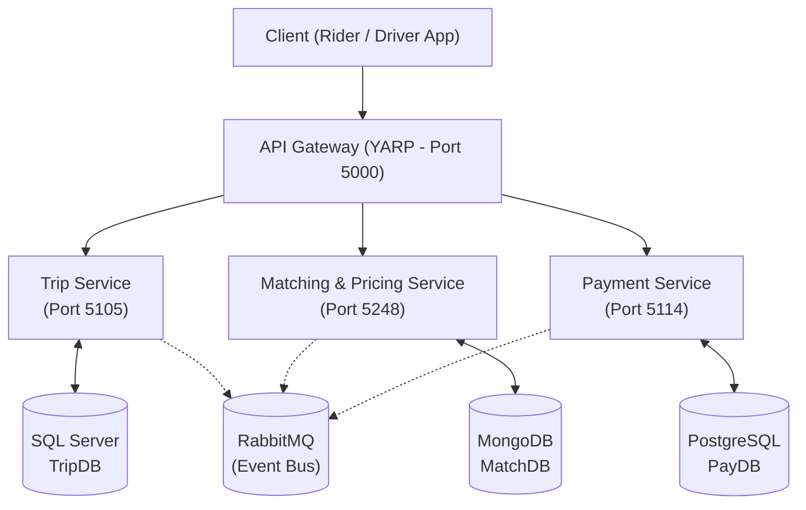

# SwiftRide - Microservices Architecture

Hệ thống đặt xe công nghệ (Ride-Hailing Platform) kết nối Rider (khách hàng) và Driver (tài xế), được xây dựng trên nền tảng **.NET 10** theo kiến trúc **Microservices** và nguyên lý **Polyglot Persistence**.

> Chi tiết tài liệu kiến trúc phần mềm đầy đủ nằm tại: [`docs/RideLite-KienTrucPhanMem.pdf`](docs/RideLite-KienTrucPhanMem.pdf).

---

## 🏛️ Kiến trúc tổng quan

Hệ thống tuân thủ mô hình **Database-per-Service**, giao tiếp đồng bộ qua REST (thông qua API Gateway) và giao tiếp bất đồng bộ qua **RabbitMQ (MassTransit)**.



### Danh sách các dịch vụ cốt lõi

| Dịch vụ             |       Cổng       |      Cơ sở dữ liệu      | Vai trò chính & Design Pattern                                                                            |
| :------------------ | :--------------: | :---------------------: | :-------------------------------------------------------------------------------------------------------- |
| **ApiGateway**      |      `5000`      |         _Không_         | Reverse Proxy (YARP), chứng thực JWT, Rate-limit, định tuyến yêu cầu.                                     |
| **TripService**     |      `5105`      | **SQL Server** (`1433`) | Quản lý vòng đời chuyến đi (**State Pattern**), lưu trữ giao dịch cần tính ACID cao.                      |
| **MatchingService** |      `5248`      |  **MongoDB** (`27017`)  | Tìm tài xế gần nhất (**Geo-spatial index**), tính giá cước linh hoạt (**Strategy Pattern**).              |
| **PaymentService**  |      `5114`      | **PostgreSQL** (`5432`) | Sổ cái giao dịch kép (**Double-entry Ledger**), hỗ trợ **Idempotency**, thanh toán (**Factory Pattern**). |
| **RabbitMQ**        | `5672` / `15672` |    _Message Broker_     | Truyền nhận domain events bất đồng bộ (**Pub/Sub** qua MassTransit).                                      |

---

## 💻 Yêu cầu hệ thống (Prerequisites)

Trước khi cài đặt, hãy đảm bảo máy tính của bạn đã cài đặt các công cụ sau:

1. **[.NET 10 SDK](https://dotnet.microsoft.com/download/dotnet/10.0)** (kiểm tra bằng lệnh `dotnet --version` $\ge 10.0.x$).
2. **[Docker Desktop](https://www.docker.com/products/docker-desktop/)** hoặc Docker Engine + Docker Compose v2+.
3. **[Git](https://git-scm.com/)**.
4. **IDE khuyến nghị**:
   - Visual Studio 2026 (hỗ trợ .NET 10).
   - Visual Studio Code (kèm extension _C# Dev Kit_).
   - JetBrains Rider 2026+.

---

## 🚀 Hướng dẫn cài đặt nhanh cho thành viên mới (Quickstart)

### Bước 1: Clone repository về máy

```bash
git clone <URL_REPOSITORY_CUA_TEAM>
cd SwiftRide
```

### Bước 2: Khởi động các cơ sở dữ liệu & Message Broker qua Docker

Dự án đã chuẩn bị sẵn file `docker-compose.yml` cấu hình đầy đủ **SQL Server, MongoDB, PostgreSQL, RabbitMQ**:

```bash
docker compose up -d
```

Kiểm tra trạng thái các container đang chạy:

```bash
docker compose ps
```

### Bước 3: Restore dependencies và Build mã nguồn

```bash
dotnet restore SwiftRide.slnx
dotnet build SwiftRide.slnx
```

---

## 🌐 Thông số kết nối & Cổng dịch vụ (Service Registry)

### Hạ tầng (Infrastructure)

| Dịch vụ hạ tầng         | Địa chỉ / Cổng           | Tài khoản / Mật khẩu            | Ghi chú                    |
| :---------------------- | :----------------------- | :------------------------------ | :------------------------- |
| **SQL Server**          | `localhost:1433`         | `sa` / `Password123!`           | Dành cho TripService       |
| **MongoDB**             | `localhost:27017`        | Mặc định (no auth)              | DB: `MatchDB`              |
| **PostgreSQL**          | `localhost:5432`         | `postgres` / `postgrespassword` | DB: `PayDB`                |
| **RabbitMQ Management** | `http://localhost:15672` | `guest` / `guest`               | Giao diện quản lý hàng đợi |
| **RabbitMQ AMQP**       | `amqp://localhost:5672`  | `guest` / `guest`               | Cổng kết nối bus           |

### Microservices (.NET Apps)

| Dịch vụ             | URL HTTP (Local)        | Swagger / OpenAPI                       |
| :------------------ | :---------------------- | :-------------------------------------- |
| **ApiGateway**      | `http://localhost:5000` | Cổng vào chung của toàn hệ thống        |
| **TripService**     | `http://localhost:5105` | `http://localhost:5105/openapi/v1.json` |
| **MatchingService** | `http://localhost:5248` | `http://localhost:5248/openapi/v1.json` |
| **PaymentService**  | `http://localhost:5114` | `http://localhost:5114/openapi/v1.json` |

---

## 🏃 Hướng dẫn chạy các Microservices

### Cách 1: Sử dụng Visual Studio (Khuyến nghị)

1. Mở file solution `SwiftRide.slnx`.
2. Click chuột phải vào **Solution 'SwiftRide'** $\rightarrow$ chọn **Configure Startup Projects...**
3. Chọn **Multiple startup projects** và đặt **Action = Start** cho cả 4 projects (`ApiGateway`, `TripService`, `MatchingService`, `PaymentService`).
4. Nhấn **F5** để khởi chạy toàn bộ.

### Cách 2: Sử dụng dòng lệnh (CLI / Terminal)

Mở 4 tab terminal riêng biệt và chạy từng dịch vụ:

```bash
# Terminal 1: Trip Service
dotnet run --project src/TripService

# Terminal 2: Matching Service
dotnet run --project src/MatchingService

# Terminal 3: Payment Service
dotnet run --project src/PaymentService

# Terminal 4: API Gateway
dotnet run --project src/ApiGateway
```

---

## 📁 Cấu trúc thư mục dự án (Project Structure)

Mỗi service được tổ chức theo kiến trúc Clean Architecture / Onion Architecture thu gọn:

```text
SwiftRide/
├── docs/                                  # Tài liệu kiến trúc và tài liệu dự án
│   └── RideLite-KienTrucPhanMem.pdf
├── src/
│   ├── ApiGateway/                        # Reverse Proxy (YARP) & JWT Auth
│   ├── TripService/                       # Quản lý chuyến đi (SQL Server)
│   │   ├── Domain/                        # Entities, State pattern (TripState)
│   │   ├── Application/                   # Services, CQRS/Handlers, DTOs
│   │   ├── Infrastructure/                # TripDbContext, Repositories
│   │   └── Api/                           # Controllers / Minimal APIs
│   ├── MatchingService/                   # Ghép xe & Tính giá (MongoDB)
│   │   ├── Domain/                        # Strategy pattern (IPricingStrategy)
│   │   ├── Application/                   # Matching logic, DTOs
│   │   ├── Infrastructure/                # MongoDbContext, Geo-queries
│   │   └── Api/
│   └── PaymentService/                    # Thanh toán & Sổ cái (PostgreSQL)
│       ├── Domain/                        # Factory pattern (PaymentMethod), Ledger
│       ├── Application/                   # Payment processing, Idempotency
│       ├── Infrastructure/                # PaymentDbContext, Outbox
│       └── Api/
├── tests/
│   └── TripService.Tests/                 # Unit tests (xUnit, Moq)
├── docker-compose.yml                     # Cấu hình container hạ tầng
├── SwiftRide.slnx                         # Solution file (.NET 10)
└── README.md
```
