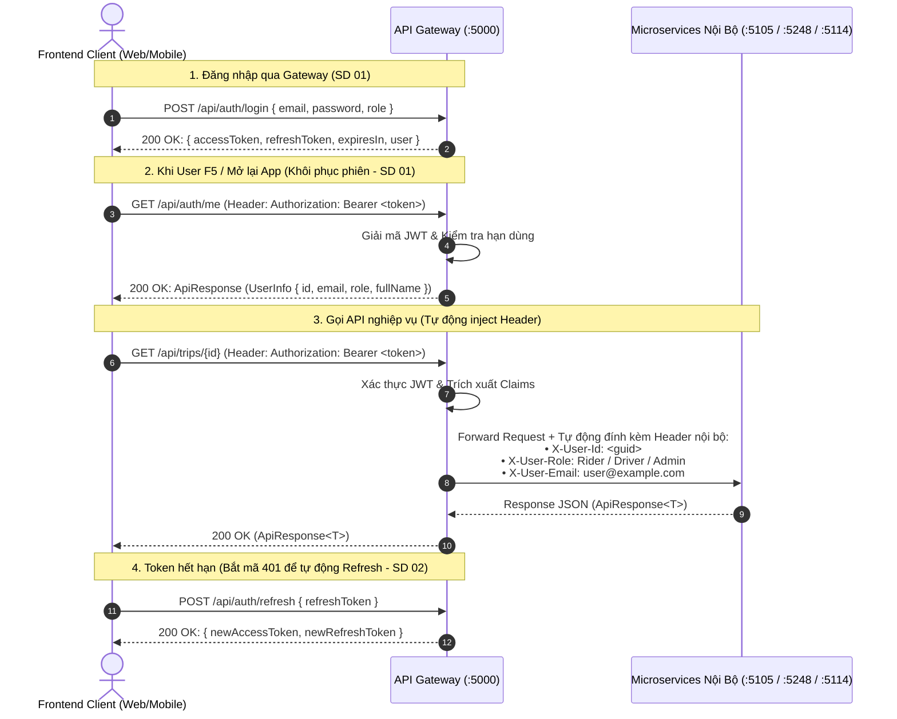
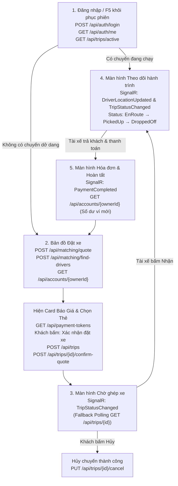
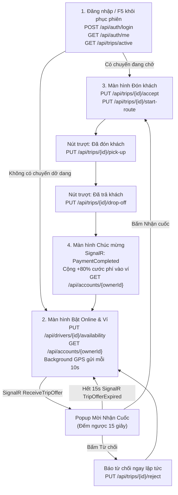

# 📡 SwiftRide - Hợp Đồng Giao Tiếp API & Cẩm Nang Tích Hợp Frontend (API Contract & FE Integration Guide)

> **Căn cứ tài liệu kiến trúc:** [`docs/RideLite-KienTrucPhanMem.pdf`](RideLite-KienTrucPhanMem.pdf) (Kịch bản cốt lõi Mục 2.2, Flowchart vòng đời chuyến đi Mục 4, Chi tiết 3 microservices Mục 5).  
> **Tài liệu tham chiếu trực tiếp:**
>
> - Bảng điều phối tổng quan: [`README.md`](../README.md)
> - Sơ đồ phân rã chức năng & 15 Sơ đồ trình tự: [`docs/FUNCTIONAL_DECOMPOSITION_AND_SEQUENCE_DIAGRAMS.md`](FUNCTIONAL_DECOMPOSITION_AND_SEQUENCE_DIAGRAMS.md)
> - Thiết kế CSDL chi tiết: [`docs/DATABASE_DESIGN.md`](DATABASE_DESIGN.md)
> **Cổng vào API duy nhất (Gateway):** `http://localhost:5000`

---

## 📑 MỤC LỤC

1. [Điểm Kết Nối Gateway (:5000) & Scalar UI (/scalar/v1)](#1-điểm-kết-nối-gateway-5000--scalar-ui-scalarv1)
2. [Khung Phản Hồi Dữ Liệu Chuẩn Bắt Buộc (`ApiResponse<T>`)](#2-khung-phản-hồi-dữ-liệu-chuẩn-bắt-buộc-apiresponset)
3. [Cơ Chế Xác Thực JWT & Chuyển Tiếp Header Tại Gateway](#3-cơ-chế-xác-thực-jwt--chuyển-tiếp-header-tại-gateway)
4. [Bảng Tra Cứu Core API Endpoints & Kênh Realtime SignalR](#4-bảng-tra-cứu-core-api-endpoints--kênh-realtime-signalr)
   - 4.1. [Bảng Tra Cứu Nhanh 23 Core REST Endpoints](#41-bảng-tra-cứu-nhanh-23-core-rest-endpoints)
   - 4.2. [Bảng Tra Cứu 5 Sự Kiện Realtime SignalR Hub (`/hubs/trips`)](#42-bảng-tra-cứu-5-sự-kiện-realtime-signalr-hub-hubstrips)
5. [Bộ Định Nghĩa TypeScript Types / Interfaces (Sẵn Sàng Copy)](#5-bộ-định-nghĩa-typescript-types--interfaces-sẵn-sàng-copy)
6. [Sơ Đồ Luồng Màn Hình Ứng Dụng (Screen Flow Architecture)](#6-sơ-đồ-luồng-màn-hình-ứng-dụng-screen-flow-architecture)
7. [Ánh Xạ 10 Trạng Thái Backend Sang Giao Diện UI (State Machine Mapping)](#7-ánh-xạ-10-trạng-thái-backend-sang-giao-diện-ui-state-machine-mapping)
8. [Hai Quy Tắc Kỹ Thuật Bắt Buộc Cho FE (Idempotency Key & Realtime Hub)](#8-hai-quy-tắc-kỹ-thuật-bắt-buộc-cho-fe-idempotency-key--realtime-hub)
9. [Chi Tiết Danh Mục 23 API Endpoints Kèm Payload Mẫu](#9-chi-tiết-danh-mục-23-api-endpoints-kèm-payload-mẫu)
10. [Từ Điển Mã Lỗi Nghiệp Vụ Chuẩn Hóa (`ErrorCodes` & Gợi Ý UI)](#10-từ-điển-mã-lỗi-nghiệp-vụ-chuẩn-hóa-errorcodes--gợi-ý-ui)
11. [Mẫu Cấu Hình Axios Client Chuẩn (Có Auto-Token & Refresh 401)](#11-mẫu-cấu-hình-axios-client-chuẩn-có-auto-token--refresh-401)
12. [Đặc Tả Tích Hợp Realtime Với ASP.NET Core SignalR Hub (`/hubs/trips`)](#12-đặc-tả-tích-hợp-realtime-với-aspnet-core-signalr-hub-hubstrips)

---

## 1. Điểm Kết Nối Gateway (:5000) & Scalar UI (/scalar/v1)

Theo nguyên tắc Client Architecture trong tài liệu kiến trúc PDF, ứng dụng Client (Web App, Mobile Rider App, Mobile Driver App) **tuyệt đối không gọi trực tiếp** vào cổng nội bộ của các microservice (`5105`, `5248`, `5114`), mà **CHỈ GỌI QUA DUY NHẤT API GATEWAY**:

- **Base URL API Gateway:** `http://localhost:5000`
- **Cấu hình CORS:** Backend mở sẵn CORS cho mọi domain local của FE:
  - Web: `http://localhost:3000`, `http://localhost:5173`
  - Mobile Emulator: `http://10.0.2.2:5000` (Android Studio) hoặc `http://localhost:5000` (iOS Simulator)

### 📖 Trang Tra Cứu OpenAPI / Scalar UI Trực Tiếp

FE có thể mở trình duyệt xem toàn bộ schema DTO và test thử API trực tiếp tại:

- **Module Chuyến đi (Trip Service):** `http://localhost:5105/scalar/v1`
- **Module Tìm xe & Báo giá (Matching Service):** `http://localhost:5248/scalar/v1`
- **Module Thanh toán & Ví (Payment Service):** `http://localhost:5114/scalar/v1`

---

## 2. Khung Phản Hồi Dữ Liệu Chuẩn Bắt Buộc (`ApiResponse<T>`)

Mọi phản hồi HTTP từ Gateway và các Microservices đều được bao bọc bởi cấu trúc JSON generic thống nhất:

### 2.1. Phản hồi thành công cho một đối tượng (200 OK / 201 Created)

```json
{
  "statusCode": 200,
  "message": "Success",
  "data": {
    "id": "c1f7b7d8-21d4-4e2b-a48e-2e457e5b1234",
    "status": "DriverAccepted",
    "estimatedFare": 65000.0
  },
  "meta": null,
  "errors": null,
  "traceId": "00-4bf92f3577b34da6a3ce929d0e0e4736-00"
}
```

### 2.2. Phản hồi lỗi nghiệp vụ hoặc validation (400, 401, 404, 409, 422, 500)

```json
{
  "statusCode": 422,
  "message": "Dữ liệu yêu cầu không hợp lệ",
  "data": null,
  "meta": null,
  "errors": [
    {
      "field": "pickupLatitude",
      "code": "VALIDATION_ERROR",
      "message": "Tọa độ điểm đón nằm ngoài phạm vi phục vụ"
    }
  ],
  "traceId": "00-4bf92f3577b34da6a3ce929d0e0e4736-00"
}
```

_(FE dựa vào mảng `errors` và trường `field` để hiển thị dòng chữ đỏ báo lỗi ngay dưới ô input tương ứng)._

---

## 3. Cơ Chế Xác Thực JWT & Chuyển Tiếp Header Tại Gateway

Bám sát **SD 01 (F1.1)** và **SD 02 (F1.2)** trong tài liệu Phân rã chức năng:



### Các quy tắc triển khai:

1. **Phía Frontend:** Chỉ cần lưu `accessToken` vào Secure Storage và gửi header:  
   `Authorization: Bearer <accessToken>`
2. **Khôi phục phiên khi F5 / Mở App:** Khi Client khởi chạy lại, gọi `GET /api/auth/me` để nạp lại `UserInfo` vào Auth State và kiểm tra token còn hiệu lực hay không.
3. **Phía Backend (Gateway Header Injection):** Gateway đảm nhiệm toàn bộ việc giải mã JWT. Khi chuyển tiếp vào microservice nội bộ, Gateway tự động đính kèm `X-User-Id`, `X-User-Role`, `X-User-Email`. Microservice nội bộ chỉ cần đọc Header mà không cần giải mã lại token.
4. **Custom Header Bắt Buộc Khi Thanh Toán:**  
   `X-Idempotency-Key: <UUID>`: Bắt buộc gửi khi gọi API thanh toán (`POST /api/payments/process`) để chống trừ tiền 2 lần khi mạng lag.

---

## 4. Bảng Tra Cứu Core API Endpoints & Kênh Realtime SignalR

### 4.1. Bảng Tra Cứu Nhanh 23 Core REST Endpoints

Tập trung 100% vào **Hành trình cốt lõi End-to-End** từ Đặt xe → Ghép tài xế → Đón trả khách → Thanh toán sổ cái kép (không ôm đồm các API CRUD phụ):

|  STT   | Phân Hệ  | Method | Endpoint Route                         | Service Phụ Trách & CSDL |  Mã Chức Năng  |  Sơ Đồ Trình Tự  | Mục Đích Nghiệp Vụ Cốt Lõi                                  |
| :----: | :------- | :----: | :------------------------------------- | :----------------------- | :------------: | :--------------: | :---------------------------------------------------------- |
| **1**  | Auth     | `POST` | `/api/auth/login`                      | API Gateway              |    **F1.1**    |    **SD 01**     | Đăng nhập tài khoản & nhận JWT token                        |
| **2**  | Auth     | `POST` | `/api/auth/refresh`                    | API Gateway              |    **F1.2**    |    **SD 02**     | Cấp mới Access Token khi token cũ hết hạn                   |
| **3**  | Auth     | `GET`  | `/api/auth/me`                         | API Gateway              |    **F1.1**    |    **SD 01**     | Lấy profile user hiện tại (Khôi phục Auth State khi F5 / mở app) |
| **4**  | Pricing  | `POST` | `/api/matching/quote`                  | Matching (MongoDB)       |    **F3.1**    |    **SD 09**     | Ước lượng cước phí động theo công thức kèm TTL 10m          |
| **5**  | Matching | `POST` | `/api/matching/find-drivers`           | Matching (MongoDB)       |    **F3.3**    |    **SD 11**     | Quét tìm danh sách tài xế khả dụng quanh tọa độ đón         |
| **6**  | Driver   | `GET`  | `/api/drivers/{id}/location`           | Matching (MongoDB)       |    **F3.2**    |    **SD 10**     | Rider lấy tọa độ GPS mới nhất của xe tài xế đang đến đón    |
| **7**  | Driver   | `PUT`  | `/api/drivers/{id}/location`           | Matching (MongoDB)       |    **F3.2**    |    **SD 10**     | Driver gửi GPS chu kỳ mỗi 10s (index `2dsphere`)            |
| **8**  | Driver   | `PUT`  | `/api/drivers/{id}/availability`       | Matching (MongoDB)       |    **F3.2**    |    **SD 10**     | Driver bật / tắt trạng thái nhận chuyến (`is_available`)    |
| **9**  | Trip     | `POST` | `/api/trips`                           | TripService (SQL Server) |    **F2.1**    |    **SD 03**     | Khách tạo chuyến mới (`Requested` + Transactional Outbox)   |
| **10** | Trip     | `POST` | `/api/trips/{id}/confirm-quote`        | TripService (SQL Server) |    **F2.2**    |    **SD 04**     | Khách xác nhận đồng ý giá cước để kích hoạt tìm tài xế      |
| **11** | Trip     | `GET`  | `/api/trips/active`                    | TripService (SQL Server) | **F1.1, F2.6** | **SD 01, SD 06** | Lấy chuyến đi đang chạy dở của User (F5 / khôi phục hành trình) |
| **12** | Trip     | `GET`  | `/api/trips/{id}`                      | TripService (SQL Server) | **F2.4, F2.6** | **SD 06, SD 08** | Polling tra cứu chi tiết và trạng thái cuốc xe (mỗi 3s)     |
| **13** | Trip     | `PUT`  | `/api/trips/{id}/accept`               | TripService (SQL Server) |    **F2.3**    |    **SD 05**     | Tài xế nhận cuốc xe (khóa lạc quan `RowVersion`)            |
| **14** | Trip     | `PUT`  | `/api/trips/{id}/reject`               | TripService (SQL Server) | **F2.3, F3.3** | **SD 05, SD 11** | Tài xế từ chối cuốc xe (tăng biến đếm, thử lại ≤ k lần)     |
| **15** | Trip     | `PUT`  | `/api/trips/{id}/start-route`          | TripService (SQL Server) |    **F2.4**    |    **SD 06**     | Tài xế bắt đầu đi tới điểm đón (chuyển `EnRoute`)           |
| **16** | Trip     | `PUT`  | `/api/trips/{id}/pick-up`              | TripService (SQL Server) |    **F2.4**    |    **SD 06**     | Xác nhận đã đón khách lên xe (chuyển `PickedUp`)            |
| **17** | Trip     | `PUT`  | `/api/trips/{id}/drop-off`             | TripService (SQL Server) |    **F2.4**    |    **SD 06**     | Trả khách tại đích (`DroppedOff` + Outbox Event thanh toán) |
| **18** | Trip     | `PUT`  | `/api/trips/{id}/cancel`               | TripService (SQL Server) |    **F2.5**    |    **SD 07**     | Hủy chuyến trước khi đón (`Cancelled` + hoàn lại tài xế)    |
| **19** | Payment  | `POST` | `/api/payments/process`                | Payment (PostgreSQL)     | **F4.1, F4.2** | **SD 12, SD 13** | Quyết toán Sổ cái kép Debit/Credit + Idempotency            |
| **20** | Payment  | `POST` | `/api/payments/{transactionId}/refund` | Payment (PostgreSQL)     |    **F4.3**    |    **SD 14**     | Hoàn tiền & Giao dịch bồi thường Saga (Đảo sổ cái)          |
| **21** | Payment  | `POST` | `/api/payment-tokens`                  | Payment (PostgreSQL)     |    **F4.4**    |    **SD 15**     | Liên kết nguồn tiền & Lưu Token mã hóa chuẩn PCI-DSS        |
| **22** | Payment  | `GET`  | `/api/payment-tokens`                  | Payment (PostgreSQL)     |    **F4.4**    |    **SD 15**     | Lấy danh sách thẻ/ví đã liên kết của người dùng             |
| **23** | Payment  | `GET`  | `/api/accounts/{ownerId}`              | Payment (PostgreSQL)     |    **F4.1**    | **SD 12, SD 13** | Tra cứu số dư tài khoản ví Khách hàng / Tài xế              |

### 4.2. Bảng Tra Cứu 5 Sự Kiện Realtime SignalR Hub (`/hubs/trips`)

Cung cấp đường truyền 2 chiều độ trễ cực thấp (sub-second latency) thay thế triệt để Polling cho các tính năng tương tác trực tiếp theo thời gian thực:

|  STT   | Tên Sự Kiện (Event Name) | Chiều Truyền | Group / Kênh Nhận | Trigger Nghiệp Vụ Phát Sinh | Sơ Đồ Trình Tự | Dữ Liệu Payload Chính | Hành Vi & Phản Ứng Phía Frontend Client |
| :----: | :----------------------- | :----------: | :---------------- | :-------------------------- | :------------: | :-------------------- | :-------------------------------------- |
| **1**  | `ReceiveTripOffer`       | Server → Client | `driver_{driverId}` | Matching Service quét trúng tài xế phù hợp | **SD 11** | `tripId`, `pickupAddress`, `dropoffAddress`, `estimatedFare`, `countdownSeconds: 15` | **Driver App:** Bật Modal đếm ngược 15s kèm âm thanh cảnh báo, hiển thị nút "Nhận cuốc" và "Từ chối". |
| **2**  | `TripOfferExpired`       | Server → Client | `driver_{driverId}` | Quá hạn 15s mà tài xế không bấm Nhận | **SD 11** | `tripId`, `message: "Cuốc xe đã hết thời gian phản hồi"` | **Driver App:** Tự động đóng popup mời cuốc, đưa app về lại trạng thái chờ cuốc xe mới. |
| **3**  | `TripStatusChanged`      | Server → Client | `trip_{tripId}` | Trạng thái chuyến đi thay đổi (`DriverAccepted`, `EnRoute`, `PickedUp`, `DroppedOff`, `Completed`, `Cancelled`, `Failed`) | **SD 05, SD 06, SD 07, SD 08, SD 11** | `tripId`, `newStatus`, `driverInfo`, `cancellationReason`, `timestamp` | **Rider & Driver App:** Chuyển đổi màn hình lập tức theo State Machine (Mục 7) mà không cần chờ chu kỳ polling. |
| **4**  | `DriverLocationUpdated`  | Server → Client | `trip_{tripId}` | Driver App gửi GPS định kỳ 10s khi đang đi đón / chở khách | **SD 10** | `driverId`, `latitude`, `longitude`, `bearing`, `speed`, `updatedAt` | **Rider App:** Di chuyển mượt mà (smooth animation interpolation) icon xe tài xế trên bản đồ và tính toán lại ETA. |
| **5**  | `PaymentCompleted`       | Server → Client | `trip_{tripId}` | Payment Service thanh toán tự động qua Sổ cái kép thành công | **SD 08, SD 12** | `tripId`, `transactionId`, `amount`, `paymentMethod`, `netEarnings`, `status: "Success"` | **Rider:** Hiển thị Màn hình Hóa đơn & trừ tiền ví;<br/>**Driver:** Hiển thị Doanh thu cuốc xe thực nhận (+80%). |

---

## 5. Bộ Định Nghĩa TypeScript Types / Interfaces (Sẵn Sàng Copy)

Được chuẩn hóa đồng bộ 100% với các Entity C# .NET và Schema CSDL trong [`docs/DATABASE_DESIGN.md`](DATABASE_DESIGN.md):

```typescript
// ==================== 1. KHUNG DỮ LIỆU CHUNG (COMMON) ====================
export interface ApiResponse<T> {
  statusCode: number;
  message: string;
  data: T | null;
  meta: null;
  errors: ApiError[] | null;
  traceId?: string;
}

export interface ApiError {
  field?: string;
  code: string;
  message: string;
}

// ==================== 2. XÁC THỰC (AUTH) ====================
export interface UserInfo {
  id: string;
  email: string;
  role: "Rider" | "Driver" | "Admin";
  fullName: string;
}

export interface LoginResponse {
  accessToken: string;
  refreshToken: string;
  expiresIn: number;
  user: UserInfo;
}

// ==================== 3. VÒNG ĐỜI CHUYẾN ĐI (10 TRẠNG THÁI) ====================
export type TripStatus =
  | "Requested" // 0: Khách vừa tạo yêu cầu
  | "DriverAccepted" // 1: Tài xế đã bấm nhận
  | "EnRoute" // 2: Tài xế đang đến điểm đón
  | "PickedUp" // 3: Khách đã lên xe
  | "DroppedOff" // 4: Đã trả khách tại đích đến
  | "PaymentPending" // 5: Lỗi trừ tiền tạm thời, chờ xử lý
  | "Paid" // 6: Đã trừ tiền thành công
  | "Completed" // 7: Kết thúc hoàn tất toàn bộ cuốc xe
  | "Cancelled" // 8: Khách hoặc tài xế hủy trước khi đón
  | "Failed"; // 9: Tài xế từ chối vượt quá k lần thử

export interface TripDto {
  id: string;
  riderId: string;
  driverId: string | null;
  status: TripStatus;
  pickupLatitude: number;
  pickupLongitude: number;
  pickupAddress: string;
  dropoffLatitude: number;
  dropoffLongitude: number;
  dropoffAddress: string;
  distanceKm: number;
  estimatedDurationMinutes: number;
  estimatedFare: number;
  actualFare: number | null;
  fareConfirmed: boolean;
  driverRejectionCount: number;
  createdAt: string;
  acceptedAt?: string | null;
  pickedUpAt?: string | null;
  droppedOffAt?: string | null;
  completedAt?: string | null;
  cancellationReason?: string | null;
}

export interface CreateTripRequest {
  pickupLatitude: number;
  pickupLongitude: number;
  pickupAddress: string;
  dropoffLatitude: number;
  dropoffLongitude: number;
  dropoffAddress: string;
  distanceKm: number;
  estimatedDurationMinutes: number;
  estimatedFare: number;
}

export interface ConfirmQuoteRequest {
  quoteId: string;
}

export interface RejectTripRequest {
  reason?: string;
}

export interface CancelTripRequest {
  reason: string;
}

// ==================== 4. BÁO GIÁ & ĐỊNH VỊ (MATCHING & PRICING) ====================
export type VehicleType = "Bike" | "Car4" | "Car7";

export interface TripQuoteRequest {
  pickupLatitude: number;
  pickupLongitude: number;
  dropoffLatitude: number;
  dropoffLongitude: number;
  vehicleType: VehicleType;
}

export interface PricingBreakdown {
  distanceCost: number; // cd * d
  timeCost: number; // ct * t
  surgeMultiplier: number; // s
  tollFee: number; // cm
  discountRate: number; // η
  taxRate: number; // T
}

export interface TripQuoteResponse {
  quoteId: string;
  distanceKm: number;
  estimatedDurationMinutes: number;
  pricingBreakdown: PricingBreakdown;
  totalFare: number; // p = ((cd*d + ct*t)*s + cm) * η * (1 + T)
  expiresAt: string; // Hết hạn sau 10 phút (TTL)
}

export interface FindNearbyDriversRequest {
  pickupLatitude: number;
  pickupLongitude: number;
  radiusKm?: number;
  limit?: number;
}

export interface NearbyDriverDto {
  driverId: string;
  latitude: number;
  longitude: number;
  distanceKm: number;
  rating: number;
  vehicleType: VehicleType;
}

export interface DriverLocationDto {
  driverId: string;
  latitude: number;
  longitude: number;
  lastLocationUpdatedAt: string;
}

export interface DriverLocationUpdateRequest {
  latitude: number;
  longitude: number;
}

export interface DriverAvailabilityUpdateRequest {
  isAvailable: boolean;
}

// ==================== 5. THANH TOÁN & SỔ CÁI (PAYMENT & LEDGER) ====================
export interface ProcessPaymentRequest {
  tripId: string;
  riderId: string;
  driverId: string;
  amount: number;
  paymentMethod: "Wallet" | "Momo" | "Card";
  paymentTokenId?: string;
}

export interface PaymentResponse {
  transactionId: string;
  tripId: string;
  status: "Success" | "PaymentPending" | "Failed" | "Refunded";
  totalAmount: number;
  riderDebitAmount: number; // 100% cước
  driverCreditAmount: number; // 80% cước
  platformFeeAmount: number; // 20% phí sàn
  description: string;
  createdAt: string;
}

export interface RefundPaymentRequest {
  reason: string;
}

export interface RefundPaymentResponse {
  transactionId: string;
  refundAmount: number;
  status: "Refunded";
  refundedAt: string;
}

export interface CreatePaymentTokenRequest {
  provider: "Momo" | "VNPay" | "Card";
  token: string;
  isDefault?: boolean;
}

export interface PaymentTokenDto {
  id: string;
  provider: "Momo" | "VNPay" | "Card";
  maskedToken: string;
  isDefault: boolean;
  createdAt: string;
}

export interface AccountDto {
  id: string;
  ownerId: string;
  ownerType: "Rider" | "Driver" | "Platform";
  accountType: "WalletLiability" | "PlatformRevenue" | "EscrowHolding";
  currency: string;
  balance: number;
  updatedAt?: string | null;
}

// ==================== 6. DỮ LIỆU REALTIME SIGNALR HUB (/hubs/trips) ====================
export interface TripOfferEventPayload {
  tripId: string;
  pickupAddress: string;
  pickupLatitude: number;
  pickupLongitude: number;
  dropoffAddress: string;
  dropoffLatitude: number;
  dropoffLongitude: number;
  estimatedFare: number;
  distanceKm: number;
  durationMinutes: number;
  countdownSeconds: number; // 15 giây
  expiresAt: string;
}

export interface TripOfferExpiredPayload {
  tripId: string;
  message: string;
}

export interface TripStatusChangedPayload {
  tripId: string;
  newStatus: TripStatus;
  driverInfo?: DriverLocationDto | null;
  cancellationReason?: string | null;
  timestamp: string;
}

export interface DriverLocationUpdatedPayload {
  driverId: string;
  latitude: number;
  longitude: number;
  bearing: number;
  speed: number;
  updatedAt: string;
}

export interface PaymentCompletedPayload {
  tripId: string;
  transactionId: string;
  totalAmount: number;
  paymentMethod: "Momo" | "VNPay" | "Card" | "Wallet";
  netEarnings?: number; // Dành cho Driver (+80% cước phí)
  status: "Success";
  completedAt: string;
}
```

---

## 6. Sơ Đồ Luồng Màn Hình Ứng Dụng (Screen Flow Architecture)

Cả hai ứng dụng Rider và Driver được thiết kế tối giản, tập trung 100% vào luồng nghiệp vụ cốt lõi:

### 📱 6.1. Luồng Màn Hình Khách Hàng (Rider App - 3 Màn Hình Chính)



### 🏍️ 6.2. Luồng Màn Hình Tài Xế (Driver App - 3 Màn Hình Chính)



---

## 7. Ánh Xạ 10 Trạng Thái Backend Sang Giao Diện UI (State Machine Mapping)

Bảng quy ước phản ứng giao diện theo từng trạng thái của `TripDto.status`:

| `TripStatus`     | Giao Diện Khách Hàng (Rider App)                | Giao Diện Tài Xế (Driver App)          | Nút Thao Tác Hợp Lệ (Action Buttons)       |
| :--------------- | :---------------------------------------------- | :------------------------------------- | :----------------------------------------- |
| `Requested`      | Radar xoay: _"Đang tìm tài xế gần bạn..."_      | Nhận thông báo mời cuốc                | Khách có nút **[Hủy chuyến]**              |
| `DriverAccepted` | Card tài xế: Tên, Biển số, Loại xe              | Màn hình bản đồ: _"Đang tới điểm đón"_ | Tài xế bấm **[Bắt đầu đi đón]**            |
| `EnRoute`        | Xe tài xế di chuyển trên bản đồ tới điểm đón    | Điều hướng GPS tới điểm đón            | Tài xế bấm **[Đã tới điểm đón]**           |
| `PickedUp`       | Bản đồ lộ trình di chuyển về điểm đích          | Điều hướng GPS đưa khách về điểm trả   | Tài xế bấm **[Đã trả khách]**              |
| `DroppedOff`     | Màn hình khóa: _"Đang quyết toán cước..."_      | Màn hình: _"Đang chờ kết toán..."_     | Hệ thống tự động trừ tiền qua Sổ cái kép   |
| `PaymentPending` | Thông báo: _"Đang kết nối lại cổng thanh toán"_ | Thông báo: _"Chờ kết toán lại..."_     | Hệ thống tự động retry với Idempotency Key |
| `Paid`           | Màn hình Hóa đơn: _"Thanh toán thành công"_     | Màn hình: _"Đã nhận tiền vào ví"_      | Chuyển tiếp sang đóng cuốc xe              |
| `Completed`      | Màn hình Tổng kết & Cảm ơn                      | Màn hình Doanh thu cuốc xe (+80%)      | Nút **[Về trang chủ]**                     |
| `Cancelled`      | Thông báo: _"Cuốc xe đã được hủy"_              | Thông báo: _"Cuốc xe đã bị hủy"_       | Nút **[Đặt chuyến mới]**                   |
| `Failed`         | Thông báo: _"Không tìm thấy tài xế sau k lần"_  | Ẩn popup mời cuốc xe                   | Nút **[Thử tìm lại]**                      |

---

## 8. Hai Quy Tắc Kỹ Thuật Bắt Buộc Cho FE (Idempotency Key & Realtime Hub)

### Quy Tắc 1: Gửi Header `X-Idempotency-Key` Khi Thanh Toán (SD 12, SD 13)

- **Mục đích:** Ngăn chặn việc người dùng nhấn nút thanh toán 2 lần liên tiếp dẫn đến bị trừ tiền 2 lần.
- **Cách FE làm:** Trước khi gửi request `POST /api/payments/process`, sinh một chuỗi UUID v4 ngẫu nhiên:
  ```typescript
  const idempotencyKey = crypto.randomUUID();
  headers: {
    'Authorization': `Bearer ${accessToken}`,
    'X-Idempotency-Key': idempotencyKey
  }
  ```
- Nếu request gặp lỗi timeout mạng và phải gửi lại (retry), **bắt buộc phải gửi lại đúng cùng một `idempotencyKey` cũ**. Backend sẽ tự động nhận diện và trả về kết quả đã xử lý trước đó mà không trừ tiền thêm.

### Quy Tắc 2: Cơ Chế Realtime SignalR Hub (`/hubs/trips`) Kết Hợp Fallback Polling (SD 05, SD 06, SD 08, SD 10, SD 11)

- **Phương thức chính (Primary - Full Realtime):** Kết nối WebSocket Realtime đến SignalR Hub `http://localhost:5000/hubs/trips` qua Gateway YARP ngay khi người dùng đăng nhập.
  - **Driver:** Khi bật Online, tự động join room cá nhân `driver_{driverId}` để nhận thông báo mời cuốc tức thì (`ReceiveTripOffer`) với hạn đếm ngược 15 giây.
  - **Rider & Driver:** Khi cuốc xe được khởi tạo / nhận cuốc, tự động join room `trip_{tripId}` để nhận:
    1. `TripStatusChanged`: Chuyển đổi trạng thái ngay lập tức (`DriverAccepted`, `EnRoute`, `PickedUp`, `DroppedOff`, `Completed`, `Cancelled`, `Failed`).
    2. `DriverLocationUpdated`: Stream tọa độ GPS xe tài xế (5s - 10s) để render chuyển động mượt mà trên bản đồ của khách.
    3. `PaymentCompleted`: Nhận biên lai và doanh thu ngay khi hệ thống hoàn tất trừ tiền.
- **Phương thức dự phòng (Fallback Graceful Degradation):** Nếu kết nối WebSocket bị gián đoạn mạng (rớt mạng, chập chờn, reconnecting), Frontend tự động kích hoạt Polling `GET /api/trips/{currentTripId}` mỗi 3 giây để đảm bảo giao diện không bao giờ bị treo. Khi SignalR tái kết nối thành công, Polling sẽ tự động hủy:

  ```typescript
  // Cơ chế Fallback Polling khi SignalR mất kết nối tạm thời
  if (signalRService.getConnectionState() !== "Connected") {
    const pollTimer = setInterval(async () => {
      const res = await apiClient.get<ApiResponse<TripDto>>(`/api/trips/${tripId}`);
      const trip = res.data.data;
      if (!trip) return;

      if (trip.status === "DriverAccepted") {
        clearInterval(pollTimer);
        navigateToScreen("ActiveTripScreen", { trip });
      } else if (trip.status === "Completed") {
        clearInterval(pollTimer);
        navigateToScreen("ReceiptScreen", { trip });
      } else if (trip.status === "Cancelled" || trip.status === "Failed") {
        clearInterval(pollTimer);
        showErrorDialog(trip.cancellationReason || "Chuyến đi không thành công");
      }
    }, 3000);
  }
  ```

---

## 9. Chi Tiết Danh Mục 23 API Endpoints Kèm Payload Mẫu

### 9.1. Nhóm Xác Thực (Auth - Gateway)

#### 1. Đăng nhập (`POST /api/auth/login`) - SD 01

- **Request Body:**
  ```json
  {
    "email": "rider@swiftride.vn",
    "password": "Password123!",
    "role": "Rider"
  }
  ```
- **Response (200 OK):**
  ```json
  {
    "statusCode": 200,
    "message": "Login successful",
    "data": {
      "accessToken": "eyJhbGciOiJIUzI1NiIsInR5cCI6IkpXVCJ9...",
      "refreshToken": "7c9e6679-7425-40de-944b-e07fc1f90ae7",
      "expiresIn": 900,
      "user": {
        "id": "11111111-1111-1111-1111-111111111111",
        "email": "rider@swiftride.vn",
        "role": "Rider",
        "fullName": "Nguyễn Văn Khách Hàng"
      }
    }
  }
  ```

#### 2. Làm mới Access Token (`POST /api/auth/refresh`) - SD 02

- **Request Body:** `{"refreshToken": "7c9e6679-7425-40de-944b-e07fc1f90ae7"}`
- **Response (200 OK):** Trả về cặp `accessToken` và `refreshToken` mới.

#### 3. Lấy thông tin tài khoản hiện tại (`GET /api/auth/me`) - SD 01

- **Mục đích nghiệp vụ:** Dùng cho Auth Guard / Session Hydration khi người dùng F5 tải lại trang web hoặc mở lại app di động từ trạng thái tắt. Gateway giải mã JWT từ header để trả về thông tin `user` mới nhất mà không bắt user phải đăng nhập lại.
- **Headers:** `Authorization: Bearer <accessToken>`
- **Response (200 OK):**
  ```json
  {
    "statusCode": 200,
    "message": "User profile fetched successfully",
    "data": {
      "id": "11111111-1111-1111-1111-111111111111",
      "email": "rider@swiftride.vn",
      "role": "Rider",
      "fullName": "Nguyễn Văn Khách Hàng"
    },
    "meta": null,
    "errors": null,
    "traceId": "00-4bf92f3577b34da6a3ce929d0e0e4736-00"
  }
  ```

---

### 9.2. Nhóm Báo Giá & Định Vị (Matching & Pricing Service)

#### 4. Ước lượng cước phí động (`POST /api/matching/quote`) - SD 09

- **Request Body:**
  ```json
  {
    "pickupLatitude": 10.776889,
    "pickupLongitude": 106.700806,
    "dropoffLatitude": 10.762887,
    "dropoffLongitude": 106.682145,
    "vehicleType": "Bike"
  }
  ```
- **Response (200 OK):**
  ```json
  {
    "statusCode": 200,
    "message": "Quote generated successfully",
    "data": {
      "quoteId": "6a9e1e3e-4fa0-459f-bb24-9b2f6efc8721",
      "distanceKm": 4.8,
      "estimatedDurationMinutes": 14,
      "pricingBreakdown": {
        "distanceCost": 48000.0,
        "timeCost": 14000.0,
        "surgeMultiplier": 1.3,
        "tollFee": 0.0,
        "discountRate": 1.0,
        "taxRate": 0.1
      },
      "totalFare": 65000.0,
      "expiresAt": "2026-10-18T12:40:00Z"
    }
  }
  ```

#### 5. Quét tìm tài xế lân cận trên bản đồ (`POST /api/matching/find-drivers`) - SD 11

- **Mục đích nghiệp vụ:** Cho phép Client quét các xe khả dụng quanh tọa độ đón để vẽ icon xe động trên bản đồ radar (Mục 5.2 PDF).
- **Request Body:**
  ```json
  {
    "pickupLatitude": 10.776889,
    "pickupLongitude": 106.700806,
    "radiusKm": 5.0,
    "limit": 5
  }
  ```
- **Response (200 OK):**
  ```json
  {
    "statusCode": 200,
    "message": "Found 2 nearby drivers",
    "data": [
      {
        "driverId": "22222222-2222-2222-2222-222222222222",
        "latitude": 10.7755,
        "longitude": 106.699,
        "distanceKm": 0.42,
        "rating": 4.9,
        "vehicleType": "Bike"
      },
      {
        "driverId": "33333333-3333-3333-3333-333333333333",
        "latitude": 10.7782,
        "longitude": 106.7025,
        "distanceKm": 0.65,
        "rating": 4.8,
        "vehicleType": "Bike"
      }
    ]
  }
  ```

#### 6. Rider tra cứu tọa độ trực tiếp của tài xế (`GET /api/drivers/{id}/location`) - SD 10

- **Mục đích nghiệp vụ:** Khi tài xế đang trên đường tới điểm đón (`EnRoute`) hoặc đang chở khách (`PickedUp`), Rider App gọi API này định kỳ (polling) để lấy tọa độ GPS thời gian thực từ MongoDB và vẽ icon xe di chuyển trên bản đồ.
- **Headers:** `Authorization: Bearer <token>`
- **Response (200 OK):**
  ```json
  {
    "statusCode": 200,
    "message": "Driver location fetched successfully",
    "data": {
      "driverId": "22222222-2222-2222-2222-222222222222",
      "latitude": 10.7755,
      "longitude": 106.699,
      "lastLocationUpdatedAt": "2026-10-18T12:44:30Z"
    }
  }
  ```

#### 7. Driver gửi GPS định kỳ 10s (`PUT /api/drivers/{id}/location`) - SD 10

- **Request Body:** `{"latitude": 10.762887, "longitude": 106.682145}`
- **Response (200 OK):** `{"statusCode": 200, "message": "Location updated"}`

#### 8. Driver bật/tắt nhận chuyến (`PUT /api/drivers/{id}/availability`) - SD 10

- **Request Body:** `{"isAvailable": true}`
- **Response (200 OK):** `{"statusCode": 200, "message": "Availability updated"}`

---

### 9.3. Nhóm Quản Lý Vòng Đời Chuyến Đi (Trip Service)

#### 9. Tạo yêu cầu cuốc xe mới (`POST /api/trips`) - SD 03

- **Request Body:**
  ```json
  {
    "pickupLatitude": 10.776889,
    "pickupLongitude": 106.700806,
    "pickupAddress": "Chợ Bến Thành, Quận 1",
    "dropoffLatitude": 10.762887,
    "dropoffLongitude": 106.682145,
    "dropoffAddress": "280 An Dương Vương, Quận 5",
    "distanceKm": 4.8,
    "estimatedDurationMinutes": 14,
    "estimatedFare": 65000.0
  }
  ```
- **Response (201 Created):** `TripDto` với `status: "Requested"`, `fareConfirmed: false`.

#### 10. Khách xác nhận báo giá (`POST /api/trips/{id}/confirm-quote`) - SD 04

- **Request Body:** `{"quoteId": "6a9e1e3e-4fa0-459f-bb24-9b2f6efc8721"}`
- **Response (200 OK):** `TripDto` với `fareConfirmed: true`, kích hoạt Outbox điều phối tìm tài xế.

#### 11. Lấy chuyến đi đang hoạt động của User (`GET /api/trips/active`) - SD 01, SD 06

- **Mục đích nghiệp vụ:** Phục vụ khôi phục hành trình khi người dùng (Rider hoặc Driver) F5 tải lại trang web hoặc mở lại app di động từ trạng thái tắt. Backend dựa vào `X-User-Id` để kiểm tra có cuốc xe nào đang ở trạng thái `Requested`, `DriverAccepted`, `EnRoute`, `PickedUp` hay không. Nếu có thì trả về `TripDto` để FE tự động nhảy vào màn hình cuốc xe đang chạy, nếu không có trả về `data: null`.
- **Headers:** `Authorization: Bearer <token>`
- **Response (200 OK):**
  ```json
  {
    "statusCode": 200,
    "message": "Active trip fetched successfully",
    "data": {
      "id": "f47ac10b-58cc-4372-a567-0e02b2c3d479",
      "riderId": "11111111-1111-1111-1111-111111111111",
      "driverId": "22222222-2222-2222-2222-222222222222",
      "status": "EnRoute",
      "pickupAddress": "Chợ Bến Thành, Quận 1",
      "dropoffAddress": "280 An Dương Vương, Quận 5",
      "distanceKm": 4.8,
      "estimatedDurationMinutes": 14,
      "estimatedFare": 65000.0,
      "actualFare": null,
      "fareConfirmed": true,
      "driverRejectionCount": 0,
      "createdAt": "2026-10-18T12:30:00Z"
    }
  }
  ```

#### 12. Tra cứu chi tiết & Polling trạng thái (`GET /api/trips/{id}`) - SD 06, SD 08

- **Response (200 OK):** `TripDto` chứa thông tin tài xế và trạng thái hiện hành.

#### 13. Tài xế nhận cuốc xe (`PUT /api/trips/{id}/accept`) - SD 05

- **Header:** `Authorization: Bearer <token_driver>`
- **Response (200 OK):** `TripDto` chuyển sang `status: "DriverAccepted"`.

#### 14. Tài xế từ chối cuốc xe (`PUT /api/trips/{id}/reject`) - SD 05, SD 11

- **Mục đích nghiệp vụ:** Tài xế chủ động bấm nút "Từ chối" trên Popup mời cuốc (Mục 2.2 Bước 5 và Flowchart Mục 4 PDF). Hệ thống lập tức tăng `DriverRejectionCount += 1`. Nếu chưa quá $k$ lần thử sẽ tìm tài xế khác tiếp theo ngay mà không bắt khách hàng phải chờ hết 15 giây đếm ngược; nếu quá $k$ lần sẽ đóng cuốc xe với trạng thái `Failed`.
- **Header:** `Authorization: Bearer <token_driver>`
- **Request Body (Tùy chọn):** `{"reason": "Tài xế đang bận không nhận chuyến"}`
- **Response (200 OK):**
  ```json
  {
    "statusCode": 200,
    "message": "Trip rejected by driver",
    "data": {
      "id": "f47ac10b-58cc-4372-a567-0e02b2c3d479",
      "status": "Requested",
      "driverRejectionCount": 1
    }
  }
  ```

#### 15. Tài xế bắt đầu đi đón (`PUT /api/trips/{id}/start-route`) - SD 06

- **Response (200 OK):** `TripDto` chuyển sang `status: "EnRoute"`.

#### 16. Xác nhận đã đón khách lên xe (`PUT /api/trips/{id}/pick-up`) - SD 06

- **Response (200 OK):** `TripDto` chuyển sang `status: "PickedUp"`.

#### 17. Xác nhận đã trả khách tại đích (`PUT /api/trips/{id}/drop-off`) - SD 06

- **Response (200 OK):** `TripDto` chuyển sang `status: "DroppedOff"`, kích hoạt Outbox phát sự kiện thanh toán.

#### 18. Hủy chuyến đi (`PUT /api/trips/{id}/cancel`) - SD 07

- **Request Body:** `{"reason": "Chờ tài xế quá 15 phút"}`
- **Response (200 OK):** `TripDto` chuyển sang `status: "Cancelled"`.

---

### 9.4. Nhóm Quyết Toán & Sổ Cái Kép (Payment Service)

#### 19. Xử lý thanh toán cước chuyến đi (`POST /api/payments/process`) - SD 12, SD 13

- **Headers:** `X-Idempotency-Key: c1f7b7d8-21d4-4e2b-a48e-2e457e5b9999`
- **Request Body:**
  ```json
  {
    "tripId": "f47ac10b-58cc-4372-a567-0e02b2c3d479",
    "riderId": "11111111-1111-1111-1111-111111111111",
    "driverId": "22222222-2222-2222-2222-222222222222",
    "amount": 65000.0,
    "paymentMethod": "Wallet"
  }
  ```
- **Response (200 OK):**
  ```json
  {
    "statusCode": 200,
    "message": "Payment processed successfully",
    "data": {
      "transactionId": "9b1deb4d-3b7d-4bad-9bdd-2b0d7b3dcb6d",
      "tripId": "f47ac10b-58cc-4372-a567-0e02b2c3d479",
      "status": "Success",
      "totalAmount": 65000.0,
      "riderDebitAmount": 65000.0,
      "driverCreditAmount": 52000.0,
      "platformFeeAmount": 13000.0,
      "description": "Thanh toán cuốc xe f47ac10b",
      "createdAt": "2026-10-18T12:45:00Z"
    }
  }
  ```

#### 20. Hoàn tiền bồi thường Saga (`POST /api/payments/{transactionId}/refund`) - SD 14

- **Mục đích nghiệp vụ:** Kích hoạt giao dịch bồi thường Saga (Compensating Transaction) khi hủy chuyến có lỗi hoặc sự cố bất khả kháng (Mục 5.3 PDF). Payment Service đảo 3 bút toán Sổ cái kép và hoàn tiền cho khách.
- **Request Body:**
  ```json
  {
    "reason": "Saga bù trừ do chuyến đi bị sự cố bất khả kháng"
  }
  ```
- **Response (200 OK):**
  ```json
  {
    "statusCode": 200,
    "message": "Hoàn tiền bồi thường thành công",
    "data": {
      "transactionId": "9b1deb4d-3b7d-4bad-9bdd-2b0d7b3dcb6d",
      "refundAmount": 65000.0,
      "status": "Refunded",
      "refundedAt": "2026-10-18T13:00:00Z"
    }
  }
  ```

#### 21. Liên kết thẻ & Token hóa thanh toán PCI-DSS (`POST /api/payment-tokens`) - SD 15

- **Mục đích nghiệp vụ:** Nhận token ủy quyền từ cổng thanh toán đối tác (Momo/Stripe/VNPay) để lưu vào CSDL, tuyệt đối không lưu thông tin thẻ thô (Mục 5.3 PDF).
- **Headers:** `Authorization: Bearer <rider_token>`
- **Request Body:**
  ```json
  {
    "provider": "Momo",
    "token": "tok_momo_88a91b2c3d",
    "isDefault": true
  }
  ```
- **Response (201 Created):**
  ```json
  {
    "statusCode": 201,
    "message": "Liên kết phương thức thanh toán thành công",
    "data": {
      "id": "e7b0a708-3bb8-4fc1-a589-cf7320b7a8a1",
      "provider": "Momo",
      "maskedToken": "**** 5678",
      "isDefault": true,
      "createdAt": "2026-10-18T12:00:00Z"
    }
  }
  ```

#### 22. Lấy danh sách phương thức thanh toán đã liên kết (`GET /api/payment-tokens`) - SD 15

- **Mục đích nghiệp vụ:** Trả về danh sách thẻ ngân hàng / ví điện tử đã được token hóa (PCI-DSS) của người dùng để hiển thị trên màn hình chọn nguồn tiền thanh toán.
- **Headers:** `Authorization: Bearer <rider_token>`
- **Response (200 OK):**
  ```json
  {
    "statusCode": 200,
    "message": "Payment tokens retrieved successfully",
    "data": [
      {
        "id": "e7b0a708-3bb8-4fc1-a589-cf7320b7a8a1",
        "provider": "Momo",
        "maskedToken": "**** 5678",
        "isDefault": true,
        "createdAt": "2026-10-18T12:00:00Z"
      }
    ]
  }
  ```

#### 23. Tra cứu số dư tài khoản ví (`GET /api/accounts/{ownerId}`) - SD 12, SD 13

- **Mục đích nghiệp vụ:** Khách hàng hoặc Tài xế tra cứu số dư khả dụng trong ví hệ thống (bảng `accounts`) sau khi kết thúc chuyến đi.
- **Headers:** `Authorization: Bearer <token>`
- **Response (200 OK):**
  ```json
  {
    "statusCode": 200,
    "message": "Tra cứu số dư thành công",
    "data": {
      "id": "a3b4c5d6-e7f8-4901-abcd-ef0123456789",
      "ownerId": "11111111-1111-1111-1111-111111111111",
      "ownerType": "Rider",
      "accountType": "WalletLiability",
      "currency": "VND",
      "balance": 250000.0,
      "updatedAt": "2026-10-18T12:45:00Z"
    }
  }
  ```

---

## 10. Từ Điển Mã Lỗi Nghiệp Vụ Chuẩn Hóa (`ErrorCodes` & Gợi Ý UI)

| Mã Lỗi (`code`)             | HTTP Status | Giải Thích Ngữ Cảnh & Gợi Ý UI (Toast / Dialog)                             |
| :-------------------------- | :---------: | :-------------------------------------------------------------------------- |
| `VALIDATION_ERROR`          |     422     | "Dữ liệu không hợp lệ. Vui lòng kiểm tra lại thông tin đã nhập."            |
| `UNAUTHORIZED`              |     401     | "Phiên đăng nhập đã hết hạn. Hệ thống đang tự động kết nối lại..."          |
| `FORBIDDEN`                 |     403     | "Bạn không có quyền thực hiện thao tác này."                                |
| `TRIP_NOT_FOUND`            |     404     | "Không tìm thấy thông tin chuyến đi này."                                   |
| `TRIP_INVALID_TRANSITION`   |     409     | "Thao tác không hợp lệ với trạng thái hiện tại của chuyến đi."              |
| `TRIP_ALREADY_ACCEPTED`     |     409     | "Cuốc xe đã được một tài xế khác nhận trước đó."                            |
| `TRIP_CONCURRENCY_CONFLICT` |     409     | "Dữ liệu bị thay đổi bởi phiên khác, vui lòng thử lại."                     |
| `NO_DRIVERS_NEARBY`         |     404     | "Hiện không có tài xế nào quanh khu vực này. Vui lòng thử lại sau ít phút." |
| `DRIVER_NOT_AVAILABLE`      |     422     | "Tài xế hiện đang bận hoặc đã tắt nhận cuốc."                               |
| `QUOTE_EXPIRED`             |     410     | "Báo giá cước đã hết hạn (quá 10 phút). Vui lòng tải lại báo giá mới."      |
| `INSUFFICIENT_BALANCE`      |     422     | "Số dư trong ví không đủ để thanh toán. Vui lòng nạp thêm tiền."            |
| `PAYMENT_DUPLICATE`         |     409     | "Giao dịch này đang được xử lý, vui lòng không nhấn thanh toán nhiều lần."  |
| `LEDGER_UNBALANCED`         |     500     | "Lỗi kế toán hệ thống: Bút toán không cân bằng. Vui lòng liên hệ CSKH."     |

---

## 11. Mẫu Cấu Hình Axios Client Chuẩn (Có Auto-Token & Refresh 401)

Team Frontend có thể copy trực tiếp file cấu hình `src/services/apiClient.ts` này để gọi API thông suốt:

```typescript
import axios from "axios";

const apiClient = axios.create({
  baseURL: "http://localhost:5000", // API Gateway YARP
  timeout: 10000,
  headers: {
    "Content-Type": "application/json",
  },
});

// 1. Request Interceptor: Tự động đính kèm JWT Bearer Token
apiClient.interceptors.request.use(
  (config) => {
    const token = localStorage.getItem("accessToken");
    if (token) {
      config.headers.Authorization = `Bearer ${token}`;
    }
    return config;
  },
  (error) => Promise.reject(error),
);

// 2. Response Interceptor: Tự động bắt mã lỗi 401 để Refresh Token
apiClient.interceptors.response.use(
  (response) => response,
  async (error) => {
    const originalRequest = error.config;

    if (error.response?.status === 401 && !originalRequest._retry) {
      originalRequest._retry = true;
      try {
        const refreshToken = localStorage.getItem("refreshToken");
        if (!refreshToken) throw new Error("No refresh token");

        // Gọi API Gateway để cấp token mới
        const res = await axios.post("http://localhost:5000/api/auth/refresh", {
          refreshToken,
        });
        const { accessToken, refreshToken: newRefreshToken } = res.data.data;

        localStorage.setItem("accessToken", accessToken);
        localStorage.setItem("refreshToken", newRefreshToken);

        // Gửi lại request ban đầu với token mới
        originalRequest.headers.Authorization = `Bearer ${accessToken}`;
        return apiClient(originalRequest);
      } catch (refreshErr) {
        // Refresh token cũng hết hạn -> Điều hướng về màn hình Login
        localStorage.clear();
        window.location.href = "/login";
        return Promise.reject(refreshErr);
      }
    }

    return Promise.reject(error);
  },
);

export default apiClient;
```

### 11.2. Mẫu Khôi Phục Phiên Đăng Nhập Khi F5 / Khởi Động App (Auth Hydration Hook)

Khi người dùng nhấn F5 tải lại trang web hoặc mở lại ứng dụng Mobile, Frontend sử dụng hook này tại `App.tsx` hoặc Root Component để xác thực token còn sống và nạp lại thông tin người dùng vào State:

```typescript
// src/hooks/useAuthInit.ts
import { useEffect, useState } from "react";
import apiClient from "../services/apiClient";
import { ApiResponse, UserInfo, TripDto } from "../types";

export function useAuthInit() {
  const [user, setUser] = useState<UserInfo | null>(null);
  const [activeTrip, setActiveTrip] = useState<TripDto | null>(null);
  const [loading, setLoading] = useState<boolean>(true);

  useEffect(() => {
    async function hydrateSession() {
      const token = localStorage.getItem("accessToken");
      if (!token) {
        setLoading(false);
        return;
      }

      try {
        // 1. Xác thực token và lấy profile người dùng mới nhất
        const userRes = await apiClient.get<ApiResponse<UserInfo>>("/api/auth/me");
        setUser(userRes.data.data);

        // 2. Khôi phục chuyến đi đang hoạt động (nếu có: Requested, DriverAccepted, EnRoute, PickedUp)
        const tripRes = await apiClient.get<ApiResponse<TripDto>>("/api/trips/active");
        setActiveTrip(tripRes.data.data);
      } catch (err) {
        // Token không hợp lệ hoặc đã bị thu hồi -> dọn dẹp storage
        localStorage.clear();
        setUser(null);
        setActiveTrip(null);
      } finally {
        setLoading(false);
      }
    }

    hydrateSession();
  }, []);

  return { user, activeTrip, loading };
}
```

---

## 12. Đặc Tả Tích Hợp Realtime Với ASP.NET Core SignalR Hub (`/hubs/trips`)

Để hiện thực hóa **Phương Án 2 (Full Realtime)** theo yêu cầu kiến trúc, ứng dụng Client (Web/Mobile) sử dụng thư viện chuẩn `@microsoft/signalr` kết nối với ASP.NET Core SignalR Hub được host qua API Gateway YARP tại route duy nhất:
`http://localhost:5000/hubs/trips`

### 12.1. Cơ Chế Bắt Tay JWT (Handshake via Access Token Query Param)

Do giao thức WebSocket trong môi trường trình duyệt không cho phép can thiệp vào HTTP Authorization Header tùy biến trong pha bắt tay (Handshake), ASP.NET Core SignalR chuẩn hóa việc truyền token qua tham số query string:
`?access_token=<JWT_TOKEN>`

Backend .NET cấu hình `JwtBearerEvents` để tự động đọc `access_token` từ Query String:

```csharp
// Program.cs - Cấu hình xác thực SignalR trên ASP.NET Core
builder.Services.AddAuthentication(JwtBearerDefaults.AuthenticationScheme)
    .AddJwtBearer(options =>
    {
        options.Events = new JwtBearerEvents
        {
            OnMessageReceived = context =>
            {
                var accessToken = context.Request.Query["access_token"];
                var path = context.HttpContext.Request.Path;
                if (!string.IsNullOrEmpty(accessToken) && path.StartsWithSegments("/hubs/trips"))
                {
                    context.Token = accessToken;
                }
                return Task.CompletedTask;
            }
        };
    });
```

### 12.2. Quản Lý Rooms / Groups Trong SignalR Hub

SignalR sử dụng mô hình Hub Groups để định tuyến sự kiện chính xác tới đúng người nhận:

| Tên Nhóm (Group Name) | Thành Viên Tham Gia | Thời Điểm Gia Nhập (Join) | Thời Điểm Rời Nhóm (Leave) | Các Sự Kiện Đẩy Vào Nhóm |
| :-------------------- | :------------------ | :------------------------ | :------------------------- | :----------------------- |
| `driver_{driverId}`   | Tài xế cụ thể       | Khi tài xế bật Online (`is_available = true`) | Khi tài xế tắt Online hoặc Đăng xuất | `ReceiveTripOffer`, `TripOfferExpired` |
| `trip_{tripId}`       | Khách & Tài xế cuốc | Ngay khi cuốc xe được tạo (`Requested`) hoặc tài xế bấm `accept` | Khi chuyến đi hoàn tất (`Completed`) hoặc bị hủy (`Cancelled`/`Failed`) | `TripStatusChanged`, `DriverLocationUpdated`, `PaymentCompleted` |

Client gọi các phương thức RPC lên Hub để quản lý Group:
- `await connection.invoke("JoinDriverRoom", driverId)`
- `await connection.invoke("LeaveDriverRoom", driverId)`
- `await connection.invoke("JoinTripRoom", tripId)`
- `await connection.invoke("LeaveTripRoom", tripId)`

### 12.3. Danh Mục Các Sự Kiện Lắng Nghe (Server-to-Client Listeners)

#### 1. Sự kiện `ReceiveTripOffer` (15s Countdown Popup cho Tài Xế)
Được kích hoạt khi Matching Engine quét trúng tài xế phù hợp (SD 11).

```typescript
connection.on("ReceiveTripOffer", (payload: TripOfferEventPayload) => {
  // 1. Phát âm thanh chuông báo có cuốc mới
  playNotificationSound();
  // 2. Mở popup modal hiển thị thông tin cuốc xe
  showTripOfferModal({
    tripId: payload.tripId,
    pickup: payload.pickupAddress,
    dropoff: payload.dropoffAddress,
    fare: payload.estimatedFare,
    distanceKm: payload.distanceKm,
    durationMinutes: payload.durationMinutes,
    countdownSeconds: payload.countdownSeconds || 15, // 15 giây đếm ngược
  });
});
```

#### 2. Sự kiện `TripOfferExpired` (Đóng Popup Khi Quá Hạn 15s)
Được kích hoạt khi hết hạn 15 giây mà tài xế không phản hồi:

```typescript
connection.on("TripOfferExpired", (payload: TripOfferExpiredPayload) => {
  // Tự động đóng modal nếu modal của cuốc xe này vẫn đang mở
  closeTripOfferModal(payload.tripId);
});
```

#### 3. Sự kiện `TripStatusChanged` (Cập Nhật Trạng Thái Hành Trình)
Được kích hoạt khi cuốc xe chuyển trạng thái: `DriverAccepted`, `EnRoute`, `PickedUp`, `DroppedOff`, `Completed`, `Cancelled`, `Failed`.

```typescript
connection.on("TripStatusChanged", (payload: TripStatusChangedPayload) => {
  console.log(`[SignalR] Chuyến đi ${payload.tripId} đổi sang ${payload.newStatus}`);
  // Cập nhật State và chuyển màn hình tương ứng
  updateTripState(payload.newStatus, payload.driverInfo);
});
```

#### 4. Sự kiện `DriverLocationUpdated` (Stream GPS Di Chuyển Xe Mượt Mà)
Tài xế gửi GPS mỗi 10s (SD 10), Hub phân phối đến phòng `trip_{tripId}`:

```typescript
connection.on("DriverLocationUpdated", (payload: DriverLocationUpdatedPayload) => {
  // Animate Marker xe tài xế trên Google Maps / Mapbox
  animateDriverMarker({
    lat: payload.latitude,
    lng: payload.longitude,
    bearing: payload.bearing,
    speed: payload.speed,
  });
});
```

#### 5. Sự kiện `PaymentCompleted` (Hóa Đơn & Quyết Toán Sổ Cái)
Được kích hoạt khi Payment Service trừ tiền tự động và ghi sổ cái kép thành công (SD 08, SD 12):

```typescript
connection.on("PaymentCompleted", (payload: PaymentCompletedPayload) => {
  if (userRole === "Rider") {
    showInvoiceModal(payload);
  } else if (userRole === "Driver") {
    showEarningsSummary(payload.netEarnings);
  }
});
```

### 12.4. Mã Nguồn Mẫu Hoàn Chỉnh: `src/services/signalrService.ts`

Team Frontend có thể sao chép trực tiếp file service Singleton này vào dự án (`npm install @microsoft/signalr`):

```typescript
import {
  HubConnection,
  HubConnectionBuilder,
  HubConnectionState,
  LogLevel,
} from "@microsoft/signalr";
import {
  TripOfferEventPayload,
  TripOfferExpiredPayload,
  TripStatusChangedPayload,
  DriverLocationUpdatedPayload,
  PaymentCompletedPayload,
} from "../types";

class SignalRService {
  private static instance: SignalRService;
  private connection: HubConnection | null = null;
  private readonly hubUrl = "http://localhost:5000/hubs/trips";

  private constructor() {}

  public static getInstance(): SignalRService {
    if (!SignalRService.instance) {
      SignalRService.instance = new SignalRService();
    }
    return SignalRService.instance;
  }

  // Khởi tạo kết nối với JWT Access Token
  public async startConnection(): Promise<void> {
    if (this.connection && this.connection.state === HubConnectionState.Connected) {
      return;
    }

    const token = localStorage.getItem("accessToken");
    if (!token) {
      console.warn("[SignalR] Không tìm thấy Access Token. Bỏ qua kết nối.");
      return;
    }

    this.connection = new HubConnectionBuilder()
      .withUrl(this.hubUrl, {
        accessTokenFactory: () => localStorage.getItem("accessToken") || "",
      })
      .withAutomaticReconnect([0, 2000, 5000, 10000, 30000]) // Tự động kết nối lại khi mất mạng
      .configureLogging(LogLevel.Information)
      .build();

    this.connection.onreconnecting((error) => {
      console.warn(`[SignalR] Đang thử kết nối lại: ${error?.message}`);
    });

    this.connection.onreconnected((connectionId) => {
      console.log(`[SignalR] Kết nối lại thành công. Id: ${connectionId}`);
    });

    this.connection.onclose((error) => {
      console.error(`[SignalR] Kết nối đã đóng: ${error?.message}`);
    });

    try {
      await this.connection.start();
      console.log("[SignalR] Đã kết nối thành công tới Hub /hubs/trips");
    } catch (err) {
      console.error("[SignalR] Lỗi khởi động kết nối:", err);
      // Kích hoạt cơ chế Fallback Polling nếu không kết nối được
    }
  }

  public async stopConnection(): Promise<void> {
    if (this.connection) {
      await this.connection.stop();
      this.connection = null;
    }
  }

  public getConnectionState(): HubConnectionState {
    return this.connection ? this.connection.state : HubConnectionState.Disconnected;
  }

  // Quản lý Room Tài xế
  public async joinDriverRoom(driverId: string): Promise<void> {
    if (this.connection?.state === HubConnectionState.Connected) {
      await this.connection.invoke("JoinDriverRoom", driverId);
    }
  }

  public async leaveDriverRoom(driverId: string): Promise<void> {
    if (this.connection?.state === HubConnectionState.Connected) {
      await this.connection.invoke("LeaveDriverRoom", driverId);
    }
  }

  // Quản lý Room Chuyến đi
  public async joinTripRoom(tripId: string): Promise<void> {
    if (this.connection?.state === HubConnectionState.Connected) {
      await this.connection.invoke("JoinTripRoom", tripId);
    }
  }

  public async leaveTripRoom(tripId: string): Promise<void> {
    if (this.connection?.state === HubConnectionState.Connected) {
      await this.connection.invoke("LeaveTripRoom", tripId);
    }
  }

  // Đăng ký Event Handlers
  public onTripOffer(callback: (payload: TripOfferEventPayload) => void): void {
    this.connection?.on("ReceiveTripOffer", callback);
  }

  public onTripOfferExpired(callback: (payload: TripOfferExpiredPayload) => void): void {
    this.connection?.on("TripOfferExpired", callback);
  }

  public onTripStatusChanged(callback: (payload: TripStatusChangedPayload) => void): void {
    this.connection?.on("TripStatusChanged", callback);
  }

  public onDriverLocationUpdated(callback: (payload: DriverLocationUpdatedPayload) => void): void {
    this.connection?.on("DriverLocationUpdated", callback);
  }

  public onPaymentCompleted(callback: (payload: PaymentCompletedPayload) => void): void {
    this.connection?.on("PaymentCompleted", callback);
  }

  // Hủy đăng ký Event Handlers để tránh memory leak
  public offTripEvents(): void {
    this.connection?.off("ReceiveTripOffer");
    this.connection?.off("TripOfferExpired");
    this.connection?.off("TripStatusChanged");
    this.connection?.off("DriverLocationUpdated");
    this.connection?.off("PaymentCompleted");
  }
}

export default SignalRService.getInstance();
```

### 12.5. Mẫu React Hook Quản Lý Realtime Trong Màn Hình Hành Trình (`useTripRealtime`)

```typescript
// src/hooks/useTripRealtime.ts
import { useEffect, useState, useRef } from "react";
import signalRService from "../services/signalrService";
import apiClient from "../services/apiClient";
import {
  TripStatus,
  TripDto,
  DriverLocationDto,
  PaymentCompletedPayload,
  ApiResponse,
} from "../types";

export function useTripRealtime(tripId: string | null) {
  const [tripStatus, setTripStatus] = useState<TripStatus | null>(null);
  const [driverLocation, setDriverLocation] = useState<DriverLocationDto | null>(null);
  const [paymentResult, setPaymentResult] = useState<PaymentCompletedPayload | null>(null);
  const pollingRef = useRef<NodeJS.Timeout | null>(null);

  useEffect(() => {
    if (!tripId) return;

    let isSubscribed = true;

    async function initRealtime() {
      // 1. Khởi động kết nối SignalR
      await signalRService.startConnection();
      await signalRService.joinTripRoom(tripId);

      // 2. Lắng nghe cập nhật trạng thái cuốc xe
      signalRService.onTripStatusChanged((payload) => {
        if (!isSubscribed || payload.tripId !== tripId) return;
        setTripStatus(payload.newStatus);
        if (payload.driverInfo) {
          setDriverLocation(payload.driverInfo);
        }
      });

      // 3. Lắng nghe tọa độ GPS xe di chuyển
      signalRService.onDriverLocationUpdated((payload) => {
        if (!isSubscribed) return;
        setDriverLocation({
          driverId: payload.driverId,
          latitude: payload.latitude,
          longitude: payload.longitude,
          bearing: payload.bearing,
          speed: payload.speed,
          lastUpdatedAt: payload.updatedAt,
        });
      });

      // 4. Lắng nghe kết quả thanh toán hoàn tất
      signalRService.onPaymentCompleted((payload) => {
        if (!isSubscribed || payload.tripId !== tripId) return;
        setPaymentResult(payload);
        setTripStatus("Completed");
      });

      // 5. Fallback Polling nếu mạng rớt (Graceful Degradation)
      if (signalRService.getConnectionState() !== "Connected") {
        console.warn("[Realtime] Bật Fallback Polling mỗi 3 giây");
        pollingRef.current = setInterval(async () => {
          try {
            const res = await apiClient.get<ApiResponse<TripDto>>(`/api/trips/${tripId}`);
            if (isSubscribed && res.data.data) {
              setTripStatus(res.data.data.status);
            }
          } catch (err) {
            console.error("Lỗi polling:", err);
          }
        }, 3000);
      }
    }

    initRealtime();

    // Dọn dẹp listener và rời phòng khi unmount màn hình
    return () => {
      isSubscribed = false;
      if (pollingRef.current) {
        clearInterval(pollingRef.current);
      }
      signalRService.leaveTripRoom(tripId);
      signalRService.offTripEvents();
    };
  }, [tripId]);

  return { tripStatus, driverLocation, paymentResult };
}
```

