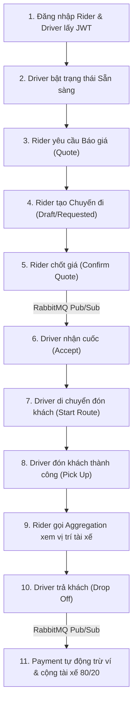

# 🚀 SwiftRide - Cẩm Nang Khởi Chạy & Hướng Dẫn Kiểm Thử Từng API (API Testing Guide)

> **Cổng vào tập trung (API Gateway):** `http://localhost:5000`  
> **Căn cứ kế hoạch kiến trúc:** [`docs/api_contract_and_fe_integration.md`](api_contract_and_fe_integration.md) (23 Core REST Endpoints + 5 Kênh SignalR) & [`docs/planai/swiftride_fix_guide.md`](planai/swiftride_fix_guide.md) (Gateway Aggregation Endpoint)  
> **Giao thức xác thực:** JWT Bearer (`Authorization: Bearer <TOKEN>`)  
> **Định dạng dữ liệu:** JSON chuẩn hóa theo mẫu `ApiResponse<T>`  
> **SignalR Realtime Hub:** `ws://localhost:5000/hubs/trips?access_token=<TOKEN>`

---

## 📑 Mục lục
1. [Chuẩn bị môi trường & Khởi chạy hệ thống](#1-chuẩn-bị-môi-trường--khởi-chạy-hệ-thống)
2. [Bảng đối chiếu 100% API theo kế hoạch (API Coverage Matrix)](#2-bảng-đối-chiếu-100-api-theo-kế-hoạch-api-coverage-matrix)
3. [Tài khoản kiểm thử có sẵn (Seeded Users)](#3-tài-khoản-kiểm-thử-có-sẵn-seeded-users)
4. [Kịch bản kiểm thử luồng nghiệp vụ hoàn chỉnh (End-to-End Happy Path)](#4-kịch-bản-kiểm-thử-luồng-nghiệp-vụ-hoàn-chỉnh-end-to-end-happy-path)
5. [Chi tiết cách gọi & Test từng API (cURL Commands)](#5-chi-tiết-cách-gọi--test-từng-api-curl-commands)
   - [5.1. Nhóm Xác thực & Danh tính (Auth APIs - #01 đến #03)](#51-nhóm-xác-thực--danh-tính-auth-apis---01-đến-03)
   - [5.2. Nhóm Báo giá & Ghép tài xế (Matching APIs - #04 đến #08)](#52-nhóm-báo-giá--ghép-tài-xế-matching-apis---04-đến-08)
   - [5.3. Nhóm Quản lý vòng đời chuyến đi (Trip APIs - #09 đến #18)](#53-nhóm-quản-lý-vòng-đời-chuyến-đi-trip-apis---09-đến-18)
   - [5.4. Nhóm Gateway Aggregation (#19)](#54-nhóm-gateway-aggregation---19)
   - [5.5. Nhóm Thanh toán, Ví & Sổ cái (Payment APIs - #20 đến #24)](#55-nhóm-thanh-toán-ví--sổ-cái-payment-apis---20-đến-24)
   - [5.6. Endpoint giả lập môi trường Dev (#25)](#56-endpoint-giả-lập-môi-trường-dev---25)
   - [5.7. Nhóm Kết nối Realtime SignalR Hub (5 Sự kiện)](#57-nhóm-kết-nối-realtime-signalr-hub-5-sự-kiện)
6. [Kiểm thử các kịch bản ngoại lệ & Bảo mật (Edge Cases)](#6-kiểm-thử-các-kịch-bản-ngoại-lệ--bảo-mật-edge-cases)

---

## 1. Chuẩn bị môi trường & Khởi chạy hệ thống

### Cách A: Khởi chạy toàn bộ bằng Docker (Khuyến nghị - 1 lệnh duy nhất)

Cách này sẽ tự động nạp biến môi trường từ `.env`, build 4 ứng dụng .NET và chạy 8 container trong cùng một mạng Docker:

```bash
# 1. Khởi chạy toàn bộ hệ thống
docker compose up -d --build

# 2. Kiểm tra trạng thái các container (phải đảm bảo 8/8 container running)
docker compose ps
```

### Cách B: Chạy kết hợp Docker (Databases & RabbitMQ) + `dotnet run` (Dành cho Dev / Debug)

```bash
# Bước 1: Khởi động 4 container hạ tầng (SQL Server, MongoDB, PostgreSQL, RabbitMQ)
docker compose up -d sqlserver mongodb postgres rabbitmq

# Bước 2: Chạy 4 microservices trên 4 terminal riêng biệt:
# Terminal 1:
dotnet run --project src/TripService

# Terminal 2:
dotnet run --project src/MatchingService

# Terminal 3:
dotnet run --project src/PaymentService

# Terminal 4:
dotnet run --project src/ApiGateway
```

> **Health Check nhanh:**  
> Truy cập `http://localhost:5000/` trả về `{"service":"ApiGateway","status":"Running"}` là Gateway đã sẵn sàng đón nhận request.

---

## 2. Bảng đối chiếu 100% API theo kế hoạch (API Coverage Matrix)

Toàn bộ **23 Core REST Endpoints** trong tài liệu đặc tả [`docs/api_contract_and_fe_integration.md`](api_contract_and_fe_integration.md) (Mục 4.1), cùng với **Endpoint Aggregation (FIX-05)** và **Endpoint Dev Simulator** đều được liệt kê đầy đủ dưới đây:

| STT | Phân Hệ | Method | Endpoint Route | Route Alias trong PDF (Mục 5) | Mục Đích Nghiệp Vụ | Trạng Thái Trong Hướng Dẫn |
| :-: | :--- | :-: | :--- | :--- | :--- | :-: |
| **#01** | Auth | `POST` | `/api/auth/login` | — | Đăng nhập tài khoản & nhận JWT token | ✅ Có cURL mẫu |
| **#02** | Auth | `POST` | `/api/auth/refresh` | — | Cấp mới Access Token khi token cũ hết hạn | ✅ Có cURL mẫu |
| **#03** | Auth | `GET` | `/api/auth/me` | — | Lấy profile user hiện tại (Khôi phục Auth State khi F5) | ✅ Có cURL mẫu |
| **#04** | Pricing | `POST` | `/api/matching/quote` | `POST /quote` | Ước lượng cước phí động kèm TTL | ✅ Có cURL mẫu |
| **#05** | Matching | `POST` | `/api/matching/find-drivers` | `POST /match` | Quét tìm danh sách tài xế khả dụng quanh điểm đón | ✅ Có cURL mẫu |
| **#06** | Driver | `GET` | `/api/drivers/{id}/location` | — | Rider lấy tọa độ GPS mới nhất của xe tài xế | ✅ Có cURL mẫu |
| **#07** | Driver | `PUT` | `/api/drivers/{id}/location` | — | Driver gửi GPS (`lat`, `lng`, `bearing`, `speed`) mỗi 10s | ✅ Có cURL mẫu |
| **#08** | Driver | `PUT` | `/api/drivers/{id}/availability` | — | Driver bật / tắt trạng thái nhận chuyến (`is_available`) | ✅ Có cURL mẫu |
| **#09** | Trip | `POST` | `/api/trips` | `POST /trips` | Khách tạo chuyến mới ở trạng thái `Requested` | ✅ Có cURL mẫu |
| **#10** | Trip | `POST` | `/api/trips/{id}/confirm-quote` | — | Khách xác nhận chốt giá -> Phát `TripRequestedEvent` | ✅ Có cURL mẫu |
| **#11** | Trip | `GET` | `/api/trips/active` | — | Lấy chuyến đi đang chạy dở của User (F5 khôi phục) | ✅ Có cURL mẫu |
| **#12** | Trip | `GET` | `/api/trips/{id}` | — | Tra cứu chi tiết và Fallback Polling cuốc xe | ✅ Có cURL mẫu |
| **#13** | Trip | `PUT` | `/api/trips/{id}/accept` | `POST /trips/{id}/driver-accept` | Tài xế nhận cuốc xe (khóa lạc quan `RowVersion`) | ✅ Có cURL mẫu |
| **#14** | Trip | `PUT` | `/api/trips/{id}/reject` | — | Tài xế từ chối cuốc (tăng retry, thêm ExcludedDrivers) | ✅ Có cURL mẫu |
| **#15** | Trip | `PUT` | `/api/trips/{id}/start-route` | — | Tài xế bắt đầu đi tới điểm đón (`DriverArriving`) | ✅ Có cURL mẫu |
| **#16** | Trip | `PUT` | `/api/trips/{id}/pick-up` | `POST /trips/{id}/pickup` | Xác nhận đã đón khách lên xe (`PickedUp`) | ✅ Có cURL mẫu |
| **#17** | Trip | `PUT` | `/api/trips/{id}/drop-off` | `POST /trips/{id}/dropoff` | Trả khách (`DroppedOff` + Outbox Event thanh toán) | ✅ Có cURL mẫu |
| **#18** | Trip | `PUT` | `/api/trips/{id}/cancel` | — | Hủy chuyến trước khi đón (`Cancelled` + hoàn tài xế) | ✅ Có cURL mẫu |
| **#19** | Gateway | `GET` | `/api/trips/{id}/overview` | — | **Gateway Aggregation**: Gom Trip Info + Vị trí tài xế | ✅ Có cURL mẫu |
| **#20** | Payment | `POST` | `/api/payments/process` | `POST /payments` | Thanh toán lại thủ công khi `PaymentPending` | ✅ Có cURL mẫu |
| **#21** | Payment | `POST` | `/api/payments/{transactionId}/refund` | `POST /payments/{id}/refund` | Hoàn tiền & Giao dịch bồi thường Saga (Đảo sổ cái) | ✅ Có cURL mẫu |
| **#22** | Payment | `POST` | `/api/payment-tokens` | — | Liên kết nguồn tiền (`Momo`/`VNPay`/`Stripe`) PCI-DSS | ✅ Có cURL mẫu |
| **#23** | Payment | `GET` | `/api/payment-tokens` | — | Lấy danh sách thẻ/ví đã liên kết của người dùng | ✅ Có cURL mẫu |
| **#24** | Payment | `GET` | `/api/accounts/{ownerId}` | — | Tra cứu số dư tài khoản ví Khách hàng / Tài xế | ✅ Có cURL mẫu |
| **#25** | Dev | `POST` | `/dev/simulate-trip-requested` | — | Giả lập phát sự kiện `TripRequestedEvent` vào RabbitMQ | ✅ Có cURL mẫu |

---

## 3. Tài khoản kiểm thử có sẵn (Seeded Users)

Hệ thống đã nạp sẵn các tài khoản kiểm thử mặc định với mật khẩu dùng chung là `Password123!`:

| Vai trò | Email đăng nhập | Mật khẩu | User ID (GUID) | Số dư ví ban đầu |
| :--- | :--- | :--- | :--- | :--- |
| **Rider** (Khách) | `rider@swiftride.vn` | `Password123!` | `11111111-1111-1111-1111-111111111111` | `500,000 VND` |
| **Driver 1** (Tài xế) | `driver1@swiftride.vn` | `Password123!` | `22222222-2222-2222-2222-222222222222` | `100,000 VND` |
| **Driver 2** (Tài xế) | `driver2@swiftride.vn` | `Password123!` | `33333333-3333-3333-3333-333333333333` | `100,000 VND` |
| **Driver 3** (Tài xế) | `driver3@swiftride.vn` | `Password123!` | `44444444-4444-4444-4444-444444444444` | `100,000 VND` |
| **Admin** (Quản trị) | `admin@swiftride.vn` | `Password123!` | `99999999-9999-9999-9999-999999999999` | Tài khoản sàn |

---

## 4. Kịch bản kiểm thử luồng nghiệp vụ hoàn chỉnh (End-to-End Happy Path)

Dưới đây là kịch bản 11 bước kiểm thử toàn bộ hành trình đặt xe:



---

## 5. Chi tiết cách gọi & Test từng API (cURL Commands)

### 5.1. Nhóm Xác thực & Danh tính (Auth APIs - #01 đến #03)

#### API #01: Đăng nhập Rider lấy Access Token (`POST /api/auth/login`)
```bash
export RIDER_TOKEN=$(curl -s -X POST http://localhost:5000/api/auth/login \
  -H "Content-Type: application/json" \
  -d '{
    "email": "rider@swiftride.vn",
    "password": "Password123!",
    "role": "Rider"
  }' | jq -r '.data.accessToken')

echo "Rider Token: $RIDER_TOKEN"
```

Đăng nhập Driver 1 lấy Access Token:
```bash
export DRIVER_TOKEN=$(curl -s -X POST http://localhost:5000/api/auth/login \
  -H "Content-Type: application/json" \
  -d '{
    "email": "driver1@swiftride.vn",
    "password": "Password123!",
    "role": "Driver"
  }' | jq -r '.data.accessToken')

echo "Driver Token: $DRIVER_TOKEN"
```

#### API #02: Làm mới Token khi hết hạn (`POST /api/auth/refresh`)
```bash
# Lấy Refresh Token từ bước đăng nhập
REFRESH_TOKEN=$(curl -s -X POST http://localhost:5000/api/auth/login \
  -H "Content-Type: application/json" \
  -d '{"email":"rider@swiftride.vn","password":"Password123!"}' | jq -r '.data.refreshToken')

curl -s -X POST http://localhost:5000/api/auth/refresh \
  -H "Content-Type: application/json" \
  -d "{
    \"refreshToken\": \"$REFRESH_TOKEN\"
  }" | jq .
```

#### API #03: Lấy thông tin tài khoản hiện tại (`GET /api/auth/me`)
```bash
curl -s -X GET http://localhost:5000/api/auth/me \
  -H "Authorization: Bearer $RIDER_TOKEN" | jq .
```

---

### 5.2. Nhóm Báo giá & Ghép tài xế (Matching APIs - #04 đến #08)

#### API #04: Tính toán cước phí chuyến đi (`POST /api/matching/quote`)
*(Hoặc dùng alias `POST /quote`)*
```bash
curl -s -X POST http://localhost:5000/api/matching/quote \
  -H "Authorization: Bearer $RIDER_TOKEN" \
  -H "Content-Type: application/json" \
  -d '{
    "pickupLatitude": 10.7769,
    "pickupLongitude": 106.7009,
    "pickupAddress": "Chợ Bến Thành, Quận 1, TP.HCM",
    "dropoffLatitude": 10.7829,
    "dropoffLongitude": 106.6989,
    "dropoffAddress": "Nhà thờ Đức Bà, Quận 1, TP.HCM",
    "vehicleType": "Bike"
  }' | jq .
```

#### API #05: Tìm danh sách tài xế khả dụng quanh điểm đón (`POST /api/matching/find-drivers`)
*(Hoặc dùng alias `POST /match`)*
```bash
curl -s -X POST http://localhost:5000/api/matching/find-drivers \
  -H "Authorization: Bearer $RIDER_TOKEN" \
  -H "Content-Type: application/json" \
  -d '{
    "pickupLatitude": 10.7769,
    "pickupLongitude": 106.7009,
    "radiusKm": 5.0,
    "vehicleType": "Bike",
    "limit": 10
  }' | jq .
```

#### API #06: Tra cứu vị trí hiện tại của tài xế (`GET /api/drivers/{id}/location`)
```bash
curl -s -X GET http://localhost:5000/api/drivers/22222222-2222-2222-2222-222222222222/location \
  -H "Authorization: Bearer $RIDER_TOKEN" | jq .
```

#### API #07: Tài xế cập nhật tọa độ GPS (`PUT /api/drivers/{id}/location`)
```bash
curl -s -X PUT http://localhost:5000/api/drivers/22222222-2222-2222-2222-222222222222/location \
  -H "Authorization: Bearer $DRIVER_TOKEN" \
  -H "Content-Type: application/json" \
  -d '{
    "latitude": 10.7772,
    "longitude": 106.7015,
    "bearing": 90.0,
    "speed": 25.5
  }' | jq .
```

#### API #08: Tài xế bật/tắt trạng thái nhận chuyến (`PUT /api/drivers/{id}/availability`)
```bash
curl -s -X PUT http://localhost:5000/api/drivers/22222222-2222-2222-2222-222222222222/availability \
  -H "Authorization: Bearer $DRIVER_TOKEN" \
  -H "Content-Type: application/json" \
  -d '{
    "isAvailable": true
  }' | jq .
```

---

### 5.3. Nhóm Quản lý vòng đời chuyến đi (Trip APIs - #09 đến #18)

#### API #09: Khách hàng tạo chuyến đi (`POST /api/trips`)
*(Hoặc dùng alias `POST /trips`)*
```bash
export TRIP_ID=$(curl -s -X POST http://localhost:5000/api/trips \
  -H "Authorization: Bearer $RIDER_TOKEN" \
  -H "Content-Type: application/json" \
  -d '{
    "pickupLatitude": 10.7769,
    "pickupLongitude": 106.7009,
    "pickupAddress": "Bến Thành, Quận 1",
    "dropoffLatitude": 10.7829,
    "dropoffLongitude": 106.6989,
    "dropoffAddress": "Nhà thờ Đức Bà, Quận 1",
    "distanceKm": 2.5,
    "estimatedDurationMinutes": 8,
    "estimatedFare": 35000,
    "vehicleType": "Bike"
  }' | jq -r '.data.id')

echo "Created Trip ID: $TRIP_ID"
```

#### API #10: Khách hàng chốt báo giá (`POST /api/trips/{id}/confirm-quote`)
```bash
curl -s -X POST http://localhost:5000/api/trips/$TRIP_ID/confirm-quote \
  -H "Authorization: Bearer $RIDER_TOKEN" | jq .
```

#### API #11: Tra cứu chuyến đi đang hoạt động (`GET /api/trips/active`)
```bash
curl -s -X GET http://localhost:5000/api/trips/active \
  -H "Authorization: Bearer $RIDER_TOKEN" | jq .
```

#### API #12: Tra cứu chi tiết chuyến đi (`GET /api/trips/{id}`)
```bash
curl -s -X GET http://localhost:5000/api/trips/$TRIP_ID \
  -H "Authorization: Bearer $RIDER_TOKEN" | jq .
```

#### API #13: Tài xế chấp nhận cuốc xe (`PUT /api/trips/{id}/accept`)
*(Hoặc dùng alias `POST /trips/{id}/driver-accept`)*
```bash
curl -s -X PUT http://localhost:5000/api/trips/$TRIP_ID/accept \
  -H "Authorization: Bearer $DRIVER_TOKEN" | jq .
```

#### API #14: Tài xế từ chối cuốc xe (`PUT /api/trips/{id}/reject`)
*(Nếu tài xế không muốn nhận chuyến, hệ thống tăng biến đếm retry và tìm tài xế khác)*
```bash
curl -s -X PUT http://localhost:5000/api/trips/$TRIP_ID/reject \
  -H "Authorization: Bearer $DRIVER_TOKEN" \
  -H "Content-Type: application/json" \
  -d '{
    "reason": "Tài xế đang bận đổ xăng"
  }' | jq .
```

#### API #15: Tài xế bắt đầu di chuyển đón khách (`PUT /api/trips/{id}/start-route`)
```bash
curl -s -X PUT http://localhost:5000/api/trips/$TRIP_ID/start-route \
  -H "Authorization: Bearer $DRIVER_TOKEN" | jq .
```

#### API #16: Tài xế đón khách lên xe (`PUT /api/trips/{id}/pick-up`)
*(Hoặc dùng alias `POST /trips/{id}/pickup`)*
```bash
curl -s -X PUT http://localhost:5000/api/trips/$TRIP_ID/pick-up \
  -H "Authorization: Bearer $DRIVER_TOKEN" | jq .
```

#### API #17: Tài xế trả khách tại đích đến (`PUT /api/trips/{id}/drop-off`)
*(Hoặc dùng alias `POST /trips/{id}/dropoff` - Tự động phát sinh thanh toán ví qua RabbitMQ)*
```bash
curl -s -X PUT http://localhost:5000/api/trips/$TRIP_ID/drop-off \
  -H "Authorization: Bearer $DRIVER_TOKEN" \
  -H "Content-Type: application/json" \
  -d '{
    "paymentMethod": "Wallet"
  }' | jq .
```

#### API #18: Khách hàng / Tài xế hủy chuyến đi (`PUT /api/trips/{id}/cancel`)
```bash
curl -s -X PUT http://localhost:5000/api/trips/$TRIP_ID/cancel \
  -H "Authorization: Bearer $RIDER_TOKEN" \
  -H "Content-Type: application/json" \
  -d '{
    "reason": "Khách đổi lộ trình di chuyển"
  }' | jq .
```

---

### 5.4. Nhóm Gateway Aggregation (#19)

#### API #19: Gateway Aggregation xem tổng quan chuyến + Vị trí tài xế (`GET /api/trips/{id}/overview`)
*(API Aggregation tại Gateway giúp Mobile App chỉ cần gọi 1 API duy nhất với timeout 5s để cập nhật màn hình theo dõi)*
```bash
curl -s -X GET http://localhost:5000/api/trips/$TRIP_ID/overview \
  -H "Authorization: Bearer $RIDER_TOKEN" | jq .
```

---

### 5.5. Nhóm Thanh toán, Ví & Sổ cái (Payment APIs - #20 đến #24)

#### API #20: Thanh toán thủ công có Idempotency Key (`POST /api/payments/process`)
*(Hoặc dùng alias `POST /payments` - dùng để thanh toán lại cuốc xe khi rơi vào trạng thái `PaymentPending`)*
```bash
curl -s -X POST http://localhost:5000/api/payments/process \
  -H "Authorization: Bearer $RIDER_TOKEN" \
  -H "X-Idempotency-Key: pay-idempotency-key-001" \
  -H "Content-Type: application/json" \
  -d '{
    "tripId": "11111111-2222-3333-4444-555555555555",
    "riderId": "11111111-1111-1111-1111-111111111111",
    "driverId": "22222222-2222-2222-2222-222222222222",
    "amount": 50000,
    "paymentMethod": "Wallet"
  }' | jq .
```

#### API #21: Hoàn tiền Saga & Bút toán sổ cái đảo (`POST /api/payments/{transactionId}/refund`)
*(Hoặc dùng alias `POST /payments/{id}/refund`)*
```bash
curl -s -X POST http://localhost:5000/api/payments/<TRANSACTION_ID>/refund \
  -H "Authorization: Bearer $RIDER_TOKEN" \
  -H "Content-Type: application/json" \
  -d '{
    "reason": "Hoàn tiền cho khách theo chính sách khiếu nại"
  }' | jq .
```

#### API #22: Liên kết nguồn tiền PCI-DSS (`POST /api/payment-tokens`)
```bash
curl -s -X POST http://localhost:5000/api/payment-tokens \
  -H "Authorization: Bearer $RIDER_TOKEN" \
  -H "Content-Type: application/json" \
  -d '{
    "provider": "Momo",
    "token": "momo_token_test_abc123456",
    "isDefault": true
  }' | jq .
```

#### API #23: Lấy danh sách nguồn tiền đã liên kết (`GET /api/payment-tokens`)
```bash
curl -s -X GET http://localhost:5000/api/payment-tokens \
  -H "Authorization: Bearer $RIDER_TOKEN" | jq .
```

#### API #24: Tra cứu số dư tài khoản ví (`GET /api/accounts/{ownerId}`)
- Kiểm tra số dư ví Rider (`11111111-1111-1111-1111-111111111111`):
```bash
curl -s -X GET http://localhost:5000/api/accounts/11111111-1111-1111-1111-111111111111 \
  -H "Authorization: Bearer $RIDER_TOKEN" | jq .
```

- Kiểm tra số dư ví Driver 1 (`22222222-2222-2222-2222-222222222222`):
```bash
curl -s -X GET http://localhost:5000/api/accounts/22222222-2222-2222-2222-222222222222 \
  -H "Authorization: Bearer $DRIVER_TOKEN" | jq .
```

---

### 5.6. Endpoint giả lập môi trường Dev (#25)

#### API #25: Bắn giả lập sự kiện `TripRequestedEvent` vào Message Bus (`POST /dev/simulate-trip-requested`)
*(Chỉ khả dụng trong môi trường Development tại `MatchingService :5248`, dùng để kiểm thử độc lập luồng matching mà không cần gọi qua `TripService`)*
```bash
curl -s -X POST http://localhost:5248/dev/simulate-trip-requested \
  -H "Content-Type: application/json" \
  -d '{
    "tripId": "99998888-7777-6666-5555-444433332222",
    "riderId": "11111111-1111-1111-1111-111111111111",
    "pickupLatitude": 10.7769,
    "pickupLongitude": 106.7009,
    "pickupAddress": "Điểm đón test",
    "dropoffLatitude": 10.7829,
    "dropoffLongitude": 106.6989,
    "dropoffAddress": "Điểm trả test",
    "distanceKm": 3.0,
    "estimatedDurationMinutes": 10,
    "estimatedFare": 45000,
    "vehicleType": "Bike"
  }' | jq .
```

---

### 5.7. Nhóm Kết nối Realtime SignalR Hub (5 Sự kiện)

Ứng dụng kết nối WebSocket qua Gateway tại:
`ws://localhost:5000/hubs/trips?access_token=<YOUR_JWT_TOKEN>`

#### Các sự kiện phía Client lắng nghe:
1. `ReceiveTripOffer`: Nhận lời mời cuốc xe mới (dành cho Driver).
2. `TripOfferExpired`: Thông báo cuốc xe đã hết thời gian phản hồi (15s).
3. `TripStatusChanged`: Trạng thái cuốc xe thay đổi theo State Machine.
4. `DriverLocationUpdated`: Tọa độ GPS tài xế di chuyển định kỳ 10s.
5. `PaymentCompleted`: Thanh toán thành công qua sổ cái kép.

---

## 6. Kiểm thử các kịch bản ngoại lệ & Bảo mật (Edge Cases)

### 6.1. Test Bảo mật: Tài xế khác cố tình can thiệp chuyến đi (403 Forbidden)
Nếu dùng token của **Driver 2** để bấm Nhận/Bắt đầu/Đón khách một chuyến đi đã được gán cho **Driver 1**:
```bash
export DRIVER2_TOKEN=$(curl -s -X POST http://localhost:5000/api/auth/login -H "Content-Type: application/json" -d '{"email":"driver2@swiftride.vn","password":"Password123!"}' | jq -r '.data.accessToken')

curl -s -X PUT http://localhost:5000/api/trips/$TRIP_ID/start-route \
  -H "Authorization: Bearer $DRIVER2_TOKEN" | jq .
```
*Kết quả kỳ vọng (HTTP 403 Forbidden):*
```json
{
  "statusCode": 403,
  "message": "Bạn không phải là tài xế được phân công cho chuyến đi này.",
  "errors": [
    {
      "code": "FORBIDDEN_TRIP_ACCESS",
      "message": "Bạn không phải là tài xế được phân công cho chuyến đi này."
    }
  ]
}
```

### 6.2. Test Tài xế đang được giữ chỗ cố bật lại trạng thái rảnh (409 Conflict)
Khi tài xế đang giữ chỗ cho một cuốc (`ReservedTripId != null`), nếu cố tình gọi `PUT /api/drivers/{id}/availability` với `isAvailable: true`:
```bash
curl -s -X PUT http://localhost:5000/api/drivers/22222222-2222-2222-2222-222222222222/availability \
  -H "Authorization: Bearer $DRIVER_TOKEN" \
  -H "Content-Type: application/json" \
  -d '{"isAvailable": true}' | jq .
```
*Kết quả kỳ vọng (HTTP 409 Conflict):*
```json
{
  "statusCode": 409,
  "message": "Tài xế đang được giữ cho một chuyến đi khác.",
  "errors": [
    {
      "code": "DRIVER_RESERVED",
      "message": "Tài xế đang được giữ cho một chuyến đi khác."
    }
  ]
}
```

### 6.3. Test Cơ chế chống trùng lặp thanh toán (Idempotency Key Check)
Gửi 2 request thanh toán liên tiếp với **cùng một `X-Idempotency-Key`**:
```bash
KEY="idempotency-test-$(date +%s)"

# Lần 1
curl -s -X POST http://localhost:5000/api/payments/process \
  -H "Authorization: Bearer $RIDER_TOKEN" \
  -H "X-Idempotency-Key: $KEY" \
  -H "Content-Type: application/json" \
  -d '{"tripId":"11111111-2222-3333-4444-555555555555","riderId":"11111111-1111-1111-1111-111111111111","driverId":"22222222-2222-2222-2222-222222222222","amount":10000,"paymentMethod":"Wallet"}' | jq .

# Lần 2 (Gửi lại ngay lập tức)
curl -s -X POST http://localhost:5000/api/payments/process \
  -H "Authorization: Bearer $RIDER_TOKEN" \
  -H "X-Idempotency-Key: $KEY" \
  -H "Content-Type: application/json" \
  -d '{"tripId":"11111111-2222-3333-4444-555555555555","riderId":"11111111-1111-1111-1111-111111111111","driverId":"22222222-2222-2222-2222-222222222222","amount":10000,"paymentMethod":"Wallet"}' | jq .
```
*Kết quả:* Lần 2 trả về ngay kết quả đã lưu mà **không thực hiện trừ tiền hai lần**.

### 6.4. Test Chặn Spam / Rate Limiting (429 Too Many Requests)
Thử gửi 15 request đăng nhập liên tiếp trong vòng 10 giây (vượt ngưỡng 10 requests/phút của auth rate limiter):
```bash
for i in {1..12}; do
  curl -s -o /dev/null -w "%{http_code}\n" -X POST http://localhost:5000/api/auth/login \
    -H "Content-Type: application/json" \
    -d '{"email":"rider@swiftride.vn","password":"WrongPassword"}'
done
```
*Kết quả:* Các request từ thứ 11 trở đi sẽ nhận về HTTP **`429 Too Many Requests`** kèm thông báo `"Bạn đã gửi quá nhiều yêu cầu. Vui lòng thử lại sau."`.
