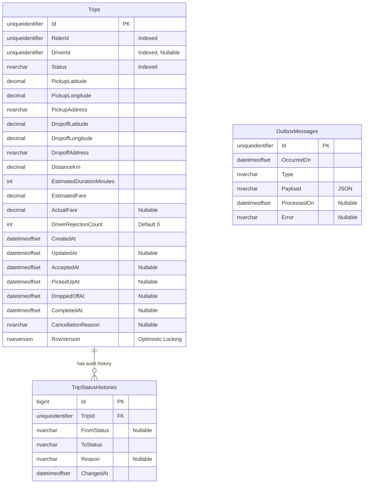
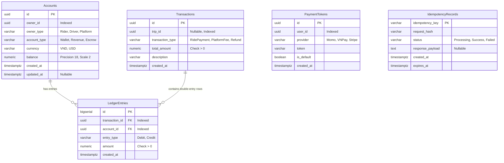

# SwiftRide - Thiết kế Cơ sở dữ liệu (Database Architecture & Design)

Tài liệu thiết kế cơ sở dữ liệu cho hệ thống **SwiftRide**, bám sát đặc tả kiến trúc tại [`docs/RideLite-KienTrucPhanMem.pdf`](RideLite-KienTrucPhanMem.pdf).

Hệ thống áp dụng mô hình **Database-per-Service** và nguyên lý **Polyglot Persistence**:
- **Trip Service**: Sử dụng **SQL Server** (RDBMS) – Đảm bảo tính ACID cao, quản lý State Machine và lịch sử chuyến đi.
- **Matching & Pricing Service**: Sử dụng **MongoDB** (Document / NoSQL) – Tối ưu cho dữ liệu vị trí động của tài xế với **Geo-spatial Index (`2dsphere`)**, đọc/ghi nhanh và schema linh hoạt.
- **Payment Service**: Sử dụng **PostgreSQL** (RDBMS) – Hệ thống **Sổ cái kép (Double-entry Ledger)**, đảm bảo tính nhất quán tuyệt đối trong kế toán, hỗ trợ **Idempotency** và bảo mật chuẩn PCI-DSS (chỉ lưu token thanh toán).

---

## 1. Kiến trúc tổng thể CSDL (Polyglot Persistence)

```mermaid
flowchart TD
    subgraph TripService_Scope["1. Trip Service (SQL Server - TripDB)"]
        direction TB
        Trips["Trips (Bảng chính - State Machine)"]
        TripStatusHistories["TripStatusHistories (Lịch sử trạng thái)"]
        OutboxMessages["OutboxMessages (Transactional Outbox)"]
        Trips --> TripStatusHistories
        Trips -.-> OutboxMessages
    end

    subgraph MatchingService_Scope["2. Matching & Pricing Service (MongoDB - MatchDB)"]
        direction TB
        Drivers[("Drivers (GeoJSON 2dsphere)")]
        PricingConfigs[("PricingConfigs (Biểu phí gốc)")]
        SurgeZones[("SurgeZones (Vùng giá động)")]
        TripQuotes[("TripQuotes (Báo giá tạm thời)")]
    end

    subgraph PaymentService_Scope["3. Payment Service (PostgreSQL - PayDB)"]
        direction TB
        Accounts["Accounts (Tài khoản ví / sàn)"]
        Transactions["Transactions (Giao dịch tài chính)"]
        LedgerEntries["LedgerEntries (Bút toán sổ cái kép Debit/Credit)"]
        PaymentTokens["PaymentTokens (Token thẻ / ví liên kết)"]
        IdempotencyRecords["IdempotencyRecords (Chống trừ tiền trùng lặp)"]
        
        Transactions --> LedgerEntries
        Accounts --> LedgerEntries
    end
```



---

## 2. Chi tiết CSDL Trip Service (SQL Server - `TripDB`)

### 2.1. Mục đích & Lý do chọn
- Trạng thái chuyến đi là một máy trạng thái (State Machine): `Requested` $\rightarrow$ `DriverAccepted` $\rightarrow$ `EnRoute` $\rightarrow$ `PickedUp` $\rightarrow$ `DroppedOff` $\rightarrow$ `PaymentPending` $\rightarrow$ `Paid` / `Completed` (nhánh kết thúc: `Cancelled`, `Failed`).
- Yêu cầu tính toàn vẹn dữ liệu, ràng buộc quan hệ chặt chẽ và tính **ACID** cao.
- Áp dụng **Transactional Outbox Pattern** để đảm bảo việc cập nhật trạng thái và phát sự kiện sang RabbitMQ diễn ra tin cậy trong cùng transaction.

### 2.2. Sơ đồ thực thể ERD



### 2.3. Bảng dữ liệu chi tiết

#### Bảng `Trips`
| Tên cột | Kiểu dữ liệu | Ràng buộc | Mô tả |
| :--- | :--- | :--- | :--- |
| `Id` | `UNIQUEIDENTIFIER` | PK | Mã định danh chuyến đi |
| `RiderId` | `UNIQUEIDENTIFIER` | NOT NULL, Index | Mã hành khách đặt xe |
| `DriverId` | `UNIQUEIDENTIFIER` | NULL, Index | Mã tài xế nhận cuốc |
| `Status` | `NVARCHAR(50)` | NOT NULL, Index | Trạng thái hiện tại theo State Pattern |
| `PickupLatitude` | `DECIMAL(9, 6)` | NOT NULL | Vĩ độ điểm đón |
| `PickupLongitude` | `DECIMAL(9, 6)` | NOT NULL | Kinh độ điểm đón |
| `PickupAddress` | `NVARCHAR(255)` | NOT NULL | Địa chỉ điểm đón |
| `DropoffLatitude` | `DECIMAL(9, 6)` | NOT NULL | Vĩ độ điểm đến |
| `DropoffLongitude` | `DECIMAL(9, 6)` | NOT NULL | Kinh độ điểm đến |
| `DropoffAddress` | `NVARCHAR(255)` | NOT NULL | Địa chỉ điểm đến |
| `DistanceKm` | `DECIMAL(8, 2)` | NOT NULL | Quãng đường ước tính (km) |
| `EstimatedDurationMinutes` | `INT` | NOT NULL | Thời gian di chuyển dự kiến (phút) |
| `EstimatedFare` | `DECIMAL(18, 2)` | NOT NULL | Giá cước ước tính ban đầu |
| `ActualFare` | `DECIMAL(18, 2)` | NULL | Giá cước thực tế sau chuyến đi |
| `DriverRejectionCount`| `INT` | NOT NULL, DEFAULT 0 | Số lần tài xế từ chối (tối đa $k$ lần) |
| `CreatedAt` | `DATETIMEOFFSET` | NOT NULL | Thời điểm yêu cầu |
| `UpdatedAt` | `DATETIMEOFFSET` | NULL | Thời điểm cập nhật cuối |
| `AcceptedAt` | `DATETIMEOFFSET` | NULL | Thời điểm tài xế nhận chuyến |
| `PickedUpAt` | `DATETIMEOFFSET` | NULL | Thời điểm đón khách |
| `DroppedOffAt` | `DATETIMEOFFSET` | NULL | Thời điểm trả khách |
| `CompletedAt` | `DATETIMEOFFSET` | NULL | Thời điểm hoàn tất thanh toán |
| `CancellationReason` | `NVARCHAR(255)` | NULL | Lý do hủy chuyến nếu có |
| `RowVersion` | `ROWVERSION` | NOT NULL | Khóa lạc quan (Optimistic Concurrency Control) |

#### Bảng `TripStatusHistories`
| Tên cột | Kiểu dữ liệu | Ràng buộc | Mô tả |
| :--- | :--- | :--- | :--- |
| `Id` | `BIGINT` | PK, IDENTITY(1,1) | Khóa chính tăng tự động |
| `TripId` | `UNIQUEIDENTIFIER` | FK (`Trips.Id`) | Khóa ngoại liên kết chuyến đi |
| `FromStatus` | `NVARCHAR(50)` | NULL | Trạng thái trước khi chuyển |
| `ToStatus` | `NVARCHAR(50)` | NOT NULL | Trạng thái mới |
| `Reason` | `NVARCHAR(255)` | NULL | Ghi chú hoặc lý do chuyển trạng thái |
| `ChangedAt` | `DATETIMEOFFSET` | NOT NULL | Thời điểm ghi nhận |

#### Bảng `OutboxMessages` (Transactional Outbox)
| Tên cột | Kiểu dữ liệu | Ràng buộc | Mô tả |
| :--- | :--- | :--- | :--- |
| `Id` | `UNIQUEIDENTIFIER` | PK | Mã message |
| `OccurredOn` | `DATETIMEOFFSET` | NOT NULL | Thời điểm phát sinh sự kiện domain |
| `Type` | `NVARCHAR(255)` | NOT NULL | Tên kiểu sự kiện (vd: `TripAcceptedEvent`) |
| `Payload` | `NVARCHAR(MAX)` | NOT NULL | Nội dung sự kiện serialize JSON |
| `ProcessedOn` | `DATETIMEOFFSET` | NULL, Index | Thời điểm đã publish lên RabbitMQ |
| `Error` | `NVARCHAR(MAX)` | NULL | Lỗi nếu publish thất bại |

---

## 3. Chi tiết CSDL Matching & Pricing Service (MongoDB - `MatchDB`)

### 3.1. Mục đích & Lý do chọn
- Lưu trữ vị trí không gian địa lý thời gian thực của hàng ngàn tài xế.
- Cần chỉ mục không gian địa lý **`2dsphere`** để truy vấn tài xế rảnh gần điểm đón nhất với độ trễ cực thấp (`$nearSphere` / `$geoNear`).
- Schema Document linh hoạt, dễ mở rộng thông tin phương tiện, đặc tính tài xế và các tham số tính giá động theo khu vực (Surge Zones).

### 3.2. Cấu trúc Collections chi tiết

#### Collection `Drivers`
```json
{
  "_id": "ObjectId",
  "driver_id": "c1f7b7d8-21d4-4e2b-a48e-2e457e5b1234",
  "name": "Nguyen Van A",
  "phone": "0901234567",
  "vehicle": {
    "make": "Honda",
    "model": "Vision",
    "license_plate": "59-A1 123.45",
    "type": "Bike" // Bike, Car4, Car7
  },
  "is_active": true,
  "is_available": true,
  "rating": 4.9,
  "location": {
    "type": "Point",
    "coordinates": [106.682145, 10.762887] // [Kinh độ (Longitude), Vĩ độ (Latitude)]
  },
  "last_location_updated_at": "2026-10-10T06:30:00Z"
}
```
**Chỉ mục (Indexes):**
- Index 1: `{ "driver_id": 1 }` (Unique)
- Index 2: `{ "location": "2dsphere" }` (**Bắt buộc cho truy vấn tìm tài xế gần nhất**)
- Index 3: `{ "is_active": 1, "is_available": 1, "vehicle.type": 1 }` (Compound Index lọc nhanh tài xế sẵn sàng)

#### Collection `PricingConfigs` (Biểu phí cấu hình)
Lưu các tham số cho công thức tính giá:
$$p = ((c_d \cdot d + c_t \cdot t) \cdot s + c_m) \cdot \eta \cdot (1 + T)$$
```json
{
  "_id": "ObjectId",
  "vehicle_type": "Bike",
  "base_distance_rate": 10000.0, // c_d (đồng/km)
  "base_time_rate": 1000.0,     // c_t (đồng/phút)
  "base_toll_fee": 0.0,         // c_m (phí phụ mặc định)
  "tax_rate": 0.10,             // T (10% VAT)
  "is_active": true,
  "effective_from": "2026-01-01T00:00:00Z"
}
```

#### Collection `SurgeZones` (Khu vực giá động)
```json
{
  "_id": "ObjectId",
  "zone_name": "Quan 1 Cao Diem",
  "surge_multiplier": 1.4, // s: hệ số giá động
  "boundary": {
    "type": "Polygon",
    "coordinates": [
      [
        [106.690, 10.770],
        [106.705, 10.770],
        [106.705, 10.785],
        [106.690, 10.785],
        [106.690, 10.770]
      ]
    ]
  },
  "is_active": true,
  "expires_at": "2026-10-10T12:00:00Z"
}
```
**Chỉ mục:** `{ "boundary": "2dsphere" }` để xác định tọa độ đón xe có nằm trong vùng nhân hệ số giá $s$ hay không.

#### Collection `TripQuotes` (Lưu trữ báo giá tạm)
Lưu báo giá để Rider xác nhận trong vòng 5–10 phút:
```json
{
  "_id": "6a9e1e3e-4fa0-459f-bb24-9b2f6efc8721",
  "rider_id": "b2f56789-9876-4321-aaaa-111122223333",
  "distance_km": 5.2,
  "estimated_duration_minutes": 15,
  "surge_multiplier": 1.2,
  "toll_fee": 0.0,
  "discount_rate": 0.9, // η: giảm giá 10%
  "tax_rate": 0.1,
  "total_fare": 65000.0,
  "created_at": "2026-10-10T06:30:00Z",
  "expires_at": "2026-10-10T06:40:00Z"
}
```
**Chỉ mục:** TTL Index trên trường `expires_at` để tự động dọn dẹp các báo giá hết hạn.

---

## 4. Chi tiết CSDL Payment Service (PostgreSQL - `PayDB`)

### 4.1. Mục đích & Lý do chọn
- Xử lý các giao dịch tiền tệ đòi hỏi độ chính xác tuyệt đối.
- Áp dụng mô hình **Sổ cái kép (Double-entry Bookkeeping)**: Đảm bảo dòng tiền vào và ra luôn cân bằng ($\sum \text{Debit} = \sum \text{Credit}$), phục vụ đối soát, kiểm toán tài chính (Auditing).
- Hỗ trợ **Idempotency**: Ngăn chặn tình trạng trừ tiền hai lần khi mạng chập chờn hoặc retry từ client/broker.
- Tuân thủ bảo mật thanh toán: **Không lưu số thẻ/CVV**, chỉ lưu Token được mã hóa từ cổng thanh toán đối tác (Momo, VNPay, Stripe).

### 4.2. Sơ đồ thực thể ERD (PostgreSQL)



### 4.3. Bảng dữ liệu chi tiết

#### Bảng `accounts` (Tài khoản ví / sàn)
| Tên cột | Kiểu dữ liệu | Ràng buộc | Mô tả |
| :--- | :--- | :--- | :--- |
| `id` | `UUID` | PK | Khóa chính tài khoản |
| `owner_id` | `UUID` | NOT NULL, Index | Mã chủ sở hữu (RiderId, DriverId, hoặc PlatformId) |
| `owner_type` | `VARCHAR(50)` | NOT NULL | Phân loại: `Rider`, `Driver`, `Platform` |
| `account_type` | `VARCHAR(50)` | NOT NULL | Loại tài khoản: `Wallet_Liability`, `Platform_Revenue`, `Escrow_Holding` |
| `currency` | `VARCHAR(3)` | NOT NULL, DEFAULT 'VND'| Đơn vị tiền tệ |
| `balance` | `NUMERIC(18, 2)` | NOT NULL, DEFAULT 0.00| Số dư hiện tại |
| `created_at` | `TIMESTAMPTZ` | NOT NULL | Thời điểm tạo |
| `updated_at` | `TIMESTAMPTZ` | NULL | Thời điểm cập nhật cuối |

#### Bảng `transactions` (Giao dịch tài chính)
| Tên cột | Kiểu dữ liệu | Ràng buộc | Mô tả |
| :--- | :--- | :--- | :--- |
| `id` | `UUID` | PK | Khóa chính giao dịch |
| `trip_id` | `UUID` | NULL, Index | Mã chuyến đi liên quan |
| `transaction_type` | `VARCHAR(50)` | NOT NULL | Loại giao dịch: `RidePayment`, `PlatformCommission`, `Refund` |
| `total_amount` | `NUMERIC(18, 2)` | NOT NULL, CHECK > 0 | Tổng số tiền giao dịch |
| `description` | `VARCHAR(255)` | NOT NULL | Nội dung chi tiết giao dịch |
| `created_at` | `TIMESTAMPTZ` | NOT NULL | Thời điểm thực hiện |

#### Bảng `ledger_entries` (Sổ cái ghi kép)
*Mỗi giao dịch thanh toán cuốc xe ví dụ 100,000 VND gồm:*
1. **Debit** Rider Wallet: 100,000 VND
2. **Credit** Driver Wallet: 80,000 VND
3. **Credit** Platform Revenue: 20,000 VND
$\Rightarrow \sum Debit (100,000) = \sum Credit (80,000 + 20,000)$.

| Tên cột | Kiểu dữ liệu | Ràng buộc | Mô tả |
| :--- | :--- | :--- | :--- |
| `id` | `BIGSERIAL` | PK | Khóa chính tự tăng |
| `transaction_id` | `UUID` | NOT NULL, FK (`transactions.id`), Index | Thuộc giao dịch nào |
| `account_id` | `UUID` | NOT NULL, FK (`accounts.id`), Index | Tài khoản ghi nhận |
| `entry_type` | `VARCHAR(10)` | NOT NULL, CHECK in (`Debit`, `Credit`) | Bút toán Nợ hoặc Có |
| `amount` | `NUMERIC(18, 2)` | NOT NULL, CHECK > 0 | Số tiền ghi nhận |
| `created_at` | `TIMESTAMPTZ` | NOT NULL | Thời điểm ghi sổ |

#### Bảng `payment_tokens` (Phương thức thanh toán đã liên kết)
| Tên cột | Kiểu dữ liệu | Ràng buộc | Mô tả |
| :--- | :--- | :--- | :--- |
| `id` | `UUID` | PK | Khóa chính phương thức |
| `user_id` | `UUID` | NOT NULL, Index | Mã người dùng (Rider) |
| `provider` | `VARCHAR(50)` | NOT NULL | Đơn vị cổng: `Momo`, `VNPay`, `Stripe` |
| `token` | `VARCHAR(255)` | NOT NULL | Mã token bảo mật đã tokenize |
| `is_default` | `BOOLEAN` | NOT NULL, DEFAULT FALSE | Phương thức mặc định |
| `created_at` | `TIMESTAMPTZ` | NOT NULL | Thời điểm liên kết |

#### Bảng `idempotency_records` (Kiểm soát trùng lặp)
| Tên cột | Kiểu dữ liệu | Ràng buộc | Mô tả |
| :--- | :--- | :--- | :--- |
| `idempotency_key` | `VARCHAR(255)` | PK | Khóa Idempotency do client gửi trong header |
| `request_hash` | `VARCHAR(255)` | NOT NULL | Hash nội dung request để phát hiện sai khác payload |
| `status` | `VARCHAR(50)` | NOT NULL | Trạng thái: `Processing`, `Success`, `Failed` |
| `response_payload` | `TEXT` | NULL | Kết quả JSON trả về để phản hồi tức thì cho retry |
| `created_at` | `TIMESTAMPTZ` | NOT NULL | Thời điểm nhận yêu cầu |
| `expires_at` | `TIMESTAMPTZ` | NOT NULL, Index | Thời điểm hết hạn khóa |

---

## 5. Tổng hợp Port, Connection String & Cấu hình Docker

Tất cả cơ sở dữ liệu đã được cấu hình sẵn trong [`docker-compose.yml`](../docker-compose.yml):

```yaml
# docker-compose.yml tóm tắt các port:
sqlserver: 1433:1433      # SA / Password123!
mongodb:   27017:27017    # No Auth / DB: MatchDB
postgres:  5432:5432      # postgres / postgrespassword / DB: PayDB
rabbitmq:  5672, 15672    # guest / guest
```
