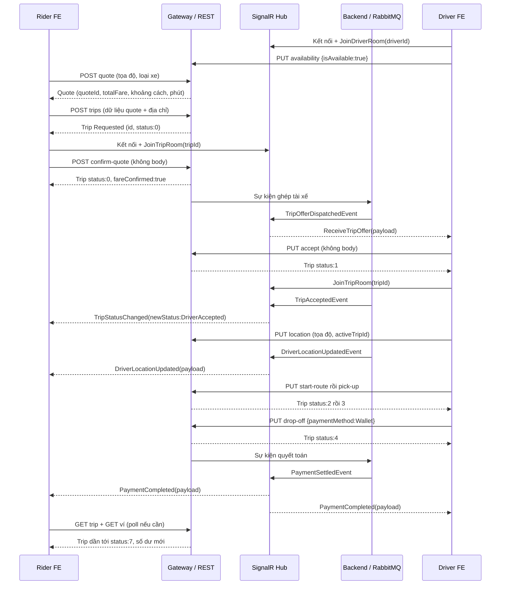

# Đặc tả dữ liệu API và realtime cho frontend SwiftRide

Tài liệu tập trung vào **gửi gì, nhận gì, gửi/nhận vào lúc nào** theo mã backend hiện tại. JSON bên dưới là ví dụ minh họa, không phải dữ liệu live; ID, thời gian, giá và token phải lấy từ response thực tế.

## 1. Quy ước chung

- Base URL local: `http://localhost:5000`. Các route REST nghiệp vụ dưới đây đều đi qua Gateway.
- Header **Auth** trong từng mục nghĩa là `Authorization: Bearer <accessToken>`. Login/refresh không cần header này.
- Request có JSON body gửi thêm `Content-Type: application/json`. Các API ghi rõ “không có body” không cần gửi `{}`.
- Không tự gửi `X-User-Id`, `X-User-Role`, `X-User-Email`: Gateway gắn chúng từ JWT.
- ID là chuỗi GUID. Tiền là number theo VND; tọa độ là number; thời gian là chuỗi ISO 8601.
- `Trip.status` trong REST là number; `newStatus` trong event realtime là string.
- Thông báo `message`, `traceId`, ID và timestamp có thể thay đổi. Dùng HTTP status và `errors[].code` để xử lý logic.
- Collection gọi tay: [APIs Only](../postman/SwiftRide.APIsOnly.postman_collection.json), dùng cùng [environment](../postman/SwiftRide.postman_environment.json).

### Envelope REST

Mỗi response minh họa trong phần REST đều có đầy đủ envelope. `data` có thể là object, array hoặc null. `meta`, `errors`, `traceId` thường null khi không có giá trị. Realtime **không** bọc envelope này.

```json
{
  "statusCode": 200,
  "message": "Success",
  "data": {
    "example": "dữ liệu của từng API"
  },
  "meta": null,
  "errors": null,
  "traceId": null
}
```

Ví dụ lỗi HTTP 403:
```json
{
  "statusCode": 403,
  "message": "Bạn không có quyền truy cập chuyến đi này.",
  "data": null,
  "meta": null,
  "errors": [
    {
      "code": "FORBIDDEN_TRIP_ACCESS",
      "message": "Bạn không có quyền truy cập chuyến đi này.",
      "field": null
    }
  ],
  "traceId": null
}
```

Không phải mọi lỗi đều có envelope: lỗi JWT/Gateway có thể trả body rỗng; lỗi JSON binding có thể trả plain text. FE kiểm tra HTTP status trước và không gọi JSON.parse vô điều kiện.

### Ý nghĩa các trường dùng lại

| Trường | Kiểu | Ý nghĩa |
|---|---|---|
| accessToken | string | JWT gửi trong Authorization |
| refreshToken | string | Dùng đổi token; refresh thành công làm token refresh cũ mất hiệu lực |
| expiresIn | number | Số giây access token có hiệu lực, không phải timestamp |
| user.id | GUID string | ID user đang đăng nhập; role Driver dùng ID này cho route vị trí của mình |
| quoteId | GUID string | ID báo giá, dùng khi tạo chuyến |
| tripId / Trip.id | GUID string | ID chuyến, dùng cho action và phòng realtime |
| transactionId | GUID string | ID giao dịch thanh toán; dùng cho hoàn tiền, khác tripId |
| paymentTokenId | GUID string | ID nguồn tiền đã liên kết, khác token/maskedToken |
| rowVersion | Base64 string | Concurrency token trả trong Trip; action hiện không yêu cầu FE gửi lại |
| excludedDriverIds | string hoặc null | Chuỗi chứa JSON array GUID, không phải array JSON trực tiếp |

## 2. Authentication — 3 API

### 01. Đăng nhập

**POST `/api/auth/login`**

Dùng chung endpoint cho Rider, Driver, Admin. Ví dụ dưới đăng nhập Rider.

**Header:** Không cần Auth + `Content-Type: application/json`.

**Path/query:** Không có path parameter hoặc query string.

**Dữ liệu gửi:**

| Trường | Kiểu / yêu cầu | Ý nghĩa |
|---|---|---|
| email | string, cần gửi | Email tài khoản |
| password | string, cần gửi | Mật khẩu tài khoản |
| role | string, tùy chọn | Rider / Driver / Admin; nếu gửi phải khớp tài khoản |

**Request body:**
```json
{
  "email": "rider@swiftride.vn",
  "password": "<mật khẩu demo được cấu hình trong .env>",
  "role": "Rider"
}
```

**Response HTTP 200:**
```json
{
  "statusCode": 200,
  "message": "Đăng nhập thành công",
  "data": {
    "accessToken": "<access_token>",
    "refreshToken": "<refresh_token>",
    "expiresIn": 900,
    "user": {
      "id": "11111111-1111-1111-1111-111111111111",
      "email": "rider@swiftride.vn",
      "role": "Rider",
      "fullName": "Nguyễn Văn Khách Hàng",
      "name": "Nguyễn Văn Khách Hàng"
    }
  },
  "meta": null,
  "errors": null,
  "traceId": null
}
```

**Lỗi cần xử lý:** 401 INVALID_CREDENTIALS; 403 FORBIDDEN nếu role không khớp; 429 khi vượt giới hạn.

**Sau khi nhận response:** Lưu accessToken, refreshToken và user. Với Driver, email mẫu là driver1@swiftride.vn và role Driver. expiresIn phụ thuộc cấu hình, 900 chỉ là ví dụ.

### 02. Làm mới token

**POST `/api/auth/refresh`**

Đổi refresh token còn hiệu lực lấy cặp token mới.

**Header:** Không cần Auth + `Content-Type: application/json`.

**Path/query:** Không có path parameter hoặc query string.

**Dữ liệu gửi:**

| Trường | Kiểu / yêu cầu | Ý nghĩa |
|---|---|---|
| refreshToken | string, cần gửi | Token lấy từ login hoặc refresh gần nhất |

**Request body:**
```json
{
  "refreshToken": "<refresh_token hiện tại>"
}
```

**Response HTTP 200:**
```json
{
  "statusCode": 200,
  "message": "Làm mới token thành công",
  "data": {
    "accessToken": "<access_token mới>",
    "refreshToken": "<refresh_token mới>",
    "expiresIn": 900,
    "user": {
      "id": "11111111-1111-1111-1111-111111111111",
      "email": "rider@swiftride.vn",
      "role": "Rider",
      "fullName": "Nguyễn Văn Khách Hàng",
      "name": "Nguyễn Văn Khách Hàng"
    }
  },
  "meta": null,
  "errors": null,
  "traceId": null
}
```

**Lỗi cần xử lý:** 401 UNAUTHORIZED nếu hết hạn, sai hoặc đã dùng.

**Sau khi nhận response:** Thay cả hai token trong state. Chỉ để một request refresh chạy tại cùng thời điểm; không dùng lại token refresh cũ.

### 03. Thông tin user hiện tại

**GET `/api/auth/me`**

Đọc danh tính gắn với JWT.

**Header:** Auth của user.

**Path/query:** Không có path parameter hoặc query string.

**Request body:**
Không có body.

**Response HTTP 200:**
```json
{
  "statusCode": 200,
  "message": "Lấy thông tin người dùng thành công",
  "data": {
    "id": "11111111-1111-1111-1111-111111111111",
    "email": "rider@swiftride.vn",
    "role": "Rider",
    "fullName": "Nguyễn Văn Khách Hàng",
    "name": "Nguyễn Văn Khách Hàng"
  },
  "meta": null,
  "errors": null,
  "traceId": null
}
```

**Lỗi cần xử lý:** 401 nếu JWT không hợp lệ; 404 USER_NOT_FOUND nếu không còn user.

## 3. Matching và vị trí tài xế — 5 API

### 04. Lấy báo giá

**POST `/api/matching/quote`**

Ước tính cước; chưa tạo Trip và chưa giữ tài xế.

**Header:** Auth của Rider + `Content-Type: application/json`.

**Path/query:** Không có path parameter hoặc query string.

**Dữ liệu gửi:**

| Trường | Kiểu / yêu cầu | Ý nghĩa |
|---|---|---|
| pickupLatitude / pickupLongitude | number, cần gửi | Vĩ độ [-90,90], kinh độ [-180,180] của điểm đón |
| dropoffLatitude / dropoffLongitude | number, cần gửi | Tọa độ điểm trả |
| vehicleType | string, cần gửi | Bike / Car4 / Car7 |

**Request body:**
```json
{
  "pickupLatitude": 10.7755,
  "pickupLongitude": 106.699,
  "dropoffLatitude": 10.785,
  "dropoffLongitude": 106.71,
  "vehicleType": "Bike"
}
```

**Response HTTP 200:**
```json
{
  "statusCode": 200,
  "message": "Quote generated successfully",
  "data": {
    "quoteId": "bbbbbbbb-bbbb-4bbb-8bbb-bbbbbbbbbbbb",
    "distanceKm": 2.079845808247298,
    "estimatedDurationMinutes": 6,
    "pricingBreakdown": {
      "distanceCost": 20798.45808247298,
      "timeCost": 6000,
      "surgeMultiplier": 1.3,
      "tollFee": 0,
      "discountRate": 1,
      "taxRate": 0.1
    },
    "totalFare": 38322,
    "expiresAt": "2026-11-09T16:10:00Z"
  },
  "meta": null,
  "errors": null,
  "traceId": null
}
```

**Lỗi cần xử lý:** 400 VALIDATION_ERROR; 404 PRICING_NOT_FOUND nếu không có cấu hình giá.

**Sau khi nhận response:** Giữ quoteId, distanceKm, estimatedDurationMinutes, totalFare để tạo chuyến. expiresAt thường sau khoảng 10 phút; đổi tuyến/loại xe hoặc hết hạn thì lấy báo giá mới. discountRate hiện là hệ số promo (1 nghĩa là giữ nguyên), không phải số phần trăm giảm.

### 05. Tìm tài xế quanh điểm đón

**POST `/api/matching/find-drivers`**

Chỉ đọc tài xế khả dụng; không đặt giữ xe.

**Header:** Auth của user + `Content-Type: application/json`.

**Path/query:** Không có path parameter hoặc query string.

**Dữ liệu gửi:**

| Trường | Kiểu / yêu cầu | Ý nghĩa |
|---|---|---|
| pickupLatitude / pickupLongitude | number, cần gửi | Tọa độ điểm đón |
| vehicleType | string hoặc null, tùy chọn | Lọc loại xe |
| radiusKm | number, mặc định 5 | Trong (0,100] |
| limit | integer, mặc định 5 | Trong [1,100] |

**Request body:**
```json
{
  "pickupLatitude": 10.7755,
  "pickupLongitude": 106.699,
  "vehicleType": "Bike",
  "radiusKm": 5,
  "limit": 5
}
```

**Response HTTP 200:**
```json
{
  "statusCode": 200,
  "message": "Nearby drivers fetched successfully",
  "data": [
    {
      "driverId": "22222222-2222-2222-2222-222222222222",
      "latitude": 10.7755,
      "longitude": 106.699,
      "distanceKm": 0,
      "rating": 5,
      "vehicleType": "Bike"
    }
  ],
  "meta": null,
  "errors": null,
  "traceId": null
}
```

**Lỗi cần xử lý:** 400 VALIDATION_ERROR.

**Sau khi nhận response:** data là array; không có xe thì data = [], không phải lỗi 404. Số lượng/vị trí xe trong ví dụ chỉ minh họa.

### 06. Đọc vị trí tài xế

**GET `/api/drivers/{id}/location`**

Path id là GUID tài xế.

**Header:** Auth của user.

**Path/query:** Không có query string; thay các `{...}` trong route bằng GUID thực tế.

**Request body:**
Không có body.

**Response HTTP 200:**
```json
{
  "statusCode": 200,
  "message": "Driver location fetched successfully",
  "data": {
    "driverId": "22222222-2222-2222-2222-222222222222",
    "latitude": 10.7755,
    "longitude": 106.699,
    "bearing": 90,
    "speed": 20,
    "lastLocationUpdatedAt": "2026-11-09T16:00:00Z"
  },
  "meta": null,
  "errors": null,
  "traceId": null
}
```

**Lỗi cần xử lý:** 400 INVALID_DRIVER_ID; 404 DRIVER_NOT_FOUND.

**Sau khi nhận response:** bearing/speed có thể null. lastLocationUpdatedAt khác tên updatedAt trong event realtime.

### 07. Cập nhật GPS của chính tài xế

**PUT `/api/drivers/{id}/location`**

Backend kiểm tra role Driver và ID; Rider hoặc tài xế khác bị từ chối.

**Header:** Auth của Driver có user.id trùng path id + `Content-Type: application/json`.

**Path/query:** Không có query string; thay các `{...}` trong route bằng GUID thực tế.

**Dữ liệu gửi:**

| Trường | Kiểu / yêu cầu | Ý nghĩa |
|---|---|---|
| latitude / longitude | number, cần gửi | Tọa độ hợp lệ |
| bearing | number hoặc null, tùy chọn | Hướng [0,360) |
| speed | number hoặc null, tùy chọn | Tốc độ >= 0; hợp đồng hiện không khai báo đơn vị |
| activeTripId | GUID hoặc null, tùy chọn | Chuyến cần nhận broadcast vị trí |

**Request body:**
```json
{
  "latitude": 10.7755,
  "longitude": 106.699,
  "bearing": 90,
  "speed": 20,
  "activeTripId": "aaaaaaaa-aaaa-4aaa-8aaa-aaaaaaaaaaaa"
}
```

**Response HTTP 200:**
```json
{
  "statusCode": 200,
  "message": "Location updated",
  "data": {
    "status": "Success"
  },
  "meta": null,
  "errors": null,
  "traceId": null
}
```

**Lỗi cần xử lý:** 400 INVALID_DRIVER_ID / VALIDATION_ERROR; 403 FORBIDDEN khi sai role/ID; 404 DRIVER_NOT_FOUND.

**Sau khi nhận response:** HTTP 200 là xác nhận cập nhật. Nếu activeTripId không null, backend phát DriverLocationUpdated vào phòng chuyến tương ứng. Không có activeTripId thì không có broadcast vào phòng chuyến.

### 08. Bật/tắt nhận chuyến

**PUT `/api/drivers/{id}/availability`**

Path id lấy từ tài khoản Driver đang đăng nhập.

**Header:** Auth của Driver trong luồng frontend + `Content-Type: application/json`.

**Path/query:** Không có query string; thay các `{...}` trong route bằng GUID thực tế.

**Dữ liệu gửi:**

| Trường | Kiểu / yêu cầu | Ý nghĩa |
|---|---|---|
| isAvailable | boolean, cần gửi | true: online nhận chuyến; false: ngừng nhận chuyến |

**Request body:**
```json
{
  "isAvailable": true
}
```

**Response HTTP 200:**
```json
{
  "statusCode": 200,
  "message": "Availability updated",
  "data": {
    "status": "Success"
  },
  "meta": null,
  "errors": null,
  "traceId": null
}
```

**Lỗi cần xử lý:** 400 INVALID_DRIVER_ID; 404 DRIVER_NOT_FOUND; 409 DRIVER_RESERVED khi bật mà tài xế đang được giữ cho chuyến.

**Sau khi nhận response:** Kết nối và JoinDriverRoom trước khi bật online để nhận đề nghị.

## 4. Chuyến đi — 10 API

Các endpoint trong mục này trả `data` là cùng một **Trip object** đầy đủ. Mỗi ví dụ dưới hiển thị toàn bộ object để FE đối chiếu; chỉ dữ liệu và trạng thái thay đổi.

| Trường Trip | Kiểu | Ý nghĩa |
|---|---|---|
| id, riderId | GUID string | ID chuyến và chủ chuyến |
| driverId, quoteId | GUID string hoặc null | Tài xế được gán và báo giá liên quan |
| status | integer | Bảng trạng thái ở cuối tài liệu |
| pickup*/dropoff* | number/string | Tọa độ và địa chỉ hai điểm |
| distanceKm, estimatedDurationMinutes | number/integer | Khoảng cách, phút dự kiến |
| estimatedFare, actualFare | number / number hoặc null | Giá dự kiến và giá quyết toán |
| fareConfirmed | boolean | Rider đã xác nhận giá hay chưa |
| vehicleType | string | Bike / Car4 / Car7 |
| driverRejectionCount | integer | Số lần tài xế từ chối |
| excludedDriverIds | string hoặc null | JSON array GUID được mã hóa thành chuỗi |
| createdAt | ISO string | Ngày tạo |
| updatedAt, acceptedAt, pickedUpAt, droppedOffAt, completedAt | ISO string hoặc null | Mốc vòng đời |
| cancellationReason | string hoặc null | Lý do hủy |
| rowVersion | Base64 string | Token version do server quản lý |

### 09. Tạo chuyến

**POST `/api/trips`**

Tạo Trip ở Requested; chưa bắt đầu ghép tài xế.

**Header:** Auth của Rider + `Content-Type: application/json`.

**Path/query:** Không có path parameter hoặc query string.

**Dữ liệu gửi:**

| Trường | Kiểu / yêu cầu | Ý nghĩa |
|---|---|---|
| quoteId | GUID hoặc null, tùy chọn | Nên dùng quoteId thực tế; không gửi chuỗi rỗng |
| pickupLatitude / pickupLongitude / pickupAddress | number / number / string | Tọa độ hợp lệ và địa chỉ đón không rỗng |
| dropoffLatitude / dropoffLongitude / dropoffAddress | number / number / string | Tọa độ hợp lệ và địa chỉ trả không rỗng |
| distanceKm | number >= 0 | Sao chép từ quote |
| estimatedDurationMinutes | integer > 0 | Sao chép từ quote |
| estimatedFare | number >= 0 | Lấy từ quote.totalFare |
| vehicleType | string, mặc định Bike | Bike / Car4 / Car7 |

**Request body:**
```json
{
  "quoteId": "bbbbbbbb-bbbb-4bbb-8bbb-bbbbbbbbbbbb",
  "pickupLatitude": 10.7755,
  "pickupLongitude": 106.699,
  "dropoffLatitude": 10.785,
  "dropoffLongitude": 106.71,
  "vehicleType": "Bike",
  "pickupAddress": "Điểm đón mẫu",
  "dropoffAddress": "Điểm trả mẫu",
  "distanceKm": 2.079845808247298,
  "estimatedDurationMinutes": 6,
  "estimatedFare": 38322
}
```

**Response HTTP 201:**
```json
{
  "statusCode": 201,
  "message": "Created",
  "data": {
    "id": "aaaaaaaa-aaaa-4aaa-8aaa-aaaaaaaaaaaa",
    "riderId": "11111111-1111-1111-1111-111111111111",
    "driverId": null,
    "quoteId": "bbbbbbbb-bbbb-4bbb-8bbb-bbbbbbbbbbbb",
    "status": 0,
    "pickupLatitude": 10.7755,
    "pickupLongitude": 106.699,
    "dropoffLatitude": 10.785,
    "dropoffLongitude": 106.71,
    "pickupAddress": "Điểm đón mẫu",
    "dropoffAddress": "Điểm trả mẫu",
    "distanceKm": 2.079845808247298,
    "estimatedDurationMinutes": 6,
    "estimatedFare": 38322,
    "actualFare": null,
    "fareConfirmed": false,
    "vehicleType": "Bike",
    "driverRejectionCount": 0,
    "excludedDriverIds": null,
    "createdAt": "2026-11-09T16:00:00Z",
    "updatedAt": null,
    "acceptedAt": null,
    "pickedUpAt": null,
    "droppedOffAt": null,
    "completedAt": null,
    "cancellationReason": null,
    "rowVersion": "AAAAAAAAB9Q="
  },
  "meta": null,
  "errors": null,
  "traceId": null
}
```

**Lỗi cần xử lý:** 400 với lỗi trường cụ thể như INVALID_PICKUP_ADDRESS, INVALID_DURATION, INVALID_FARE; GUID/JSON sai cũng có thể trả 400.

**Sau khi nhận response:** Lưu data.id làm tripId, join phòng chuyến rồi mới confirm. API hiện nhận giá/tuyến từ body, không nên suy ra rằng server đã đối chiếu tất cả dữ liệu với quoteId. Không tự retry tạo chuyến khi timeout; đọc active trip trước.

### 10. Chủ chuyến xác nhận giá

**POST `/api/trips/{id}/confirm-quote`**

Path id là tripId.

**Header:** Auth của chủ chuyến.

**Path/query:** Không có query string; thay các `{...}` trong route bằng GUID thực tế.

**Request body:**
Không có body.

**Response HTTP 200:**
```json
{
  "statusCode": 200,
  "message": "Success",
  "data": {
    "id": "aaaaaaaa-aaaa-4aaa-8aaa-aaaaaaaaaaaa",
    "riderId": "11111111-1111-1111-1111-111111111111",
    "driverId": null,
    "quoteId": "bbbbbbbb-bbbb-4bbb-8bbb-bbbbbbbbbbbb",
    "status": 0,
    "pickupLatitude": 10.7755,
    "pickupLongitude": 106.699,
    "dropoffLatitude": 10.785,
    "dropoffLongitude": 106.71,
    "pickupAddress": "Điểm đón mẫu",
    "dropoffAddress": "Điểm trả mẫu",
    "distanceKm": 2.079845808247298,
    "estimatedDurationMinutes": 6,
    "estimatedFare": 38322,
    "actualFare": null,
    "fareConfirmed": true,
    "vehicleType": "Bike",
    "driverRejectionCount": 0,
    "excludedDriverIds": null,
    "createdAt": "2026-11-09T16:00:00Z",
    "updatedAt": "2026-11-09T16:00:00Z",
    "acceptedAt": null,
    "pickedUpAt": null,
    "droppedOffAt": null,
    "completedAt": null,
    "cancellationReason": null,
    "rowVersion": "AAAAAAAAB9Q="
  },
  "meta": null,
  "errors": null,
  "traceId": null
}
```

**Lỗi cần xử lý:** 403 FORBIDDEN_TRIP_ACCESS; 404 TRIP_NOT_FOUND; 409 TRIP_INVALID_TRANSITION.

**Sau khi nhận response:** status vẫn là 0, fareConfirmed chuyển true. Ghép xe chạy bất đồng bộ sau response; Driver nhận ReceiveTripOffer. Không gửi body {quoteId}: endpoint hiện không đọc body này.

### 11. Lấy chuyến đang hoạt động

**GET `/api/trips/active`**

Server xác định user từ JWT; không truyền riderId bằng query.

**Header:** Auth của user.

**Path/query:** Không có path parameter hoặc query string.

**Request body:**
Không có body.

**Response HTTP 200:**
```json
{
  "statusCode": 200,
  "message": "Success",
  "data": {
    "id": "aaaaaaaa-aaaa-4aaa-8aaa-aaaaaaaaaaaa",
    "riderId": "11111111-1111-1111-1111-111111111111",
    "driverId": "22222222-2222-2222-2222-222222222222",
    "quoteId": "bbbbbbbb-bbbb-4bbb-8bbb-bbbbbbbbbbbb",
    "status": 1,
    "pickupLatitude": 10.7755,
    "pickupLongitude": 106.699,
    "dropoffLatitude": 10.785,
    "dropoffLongitude": 106.71,
    "pickupAddress": "Điểm đón mẫu",
    "dropoffAddress": "Điểm trả mẫu",
    "distanceKm": 2.079845808247298,
    "estimatedDurationMinutes": 6,
    "estimatedFare": 38322,
    "actualFare": null,
    "fareConfirmed": true,
    "vehicleType": "Bike",
    "driverRejectionCount": 0,
    "excludedDriverIds": null,
    "createdAt": "2026-11-09T16:00:00Z",
    "updatedAt": "2026-11-09T16:00:00Z",
    "acceptedAt": "2026-11-09T16:00:00Z",
    "pickedUpAt": null,
    "droppedOffAt": null,
    "completedAt": null,
    "cancellationReason": null,
    "rowVersion": "AAAAAAAAB9Q="
  },
  "meta": null,
  "errors": null,
  "traceId": null
}
```

**Lỗi cần xử lý:** 404 TRIP_NOT_FOUND khi không có chuyến hoạt động; đây là trạng thái bình thường của màn hình đặt xe.

**Sau khi nhận response:** data là một Trip, không phải danh sách. Dùng khôi phục màn hình sau đăng nhập/reload.

### 12. Đọc chi tiết chuyến

**GET `/api/trips/{id}`**

Path id là tripId.

**Header:** Auth của chủ chuyến hoặc tài xế được gán.

**Path/query:** Không có query string; thay các `{...}` trong route bằng GUID thực tế.

**Request body:**
Không có body.

**Response HTTP 200:**
```json
{
  "statusCode": 200,
  "message": "Success",
  "data": {
    "id": "aaaaaaaa-aaaa-4aaa-8aaa-aaaaaaaaaaaa",
    "riderId": "11111111-1111-1111-1111-111111111111",
    "driverId": "22222222-2222-2222-2222-222222222222",
    "quoteId": "bbbbbbbb-bbbb-4bbb-8bbb-bbbbbbbbbbbb",
    "status": 1,
    "pickupLatitude": 10.7755,
    "pickupLongitude": 106.699,
    "dropoffLatitude": 10.785,
    "dropoffLongitude": 106.71,
    "pickupAddress": "Điểm đón mẫu",
    "dropoffAddress": "Điểm trả mẫu",
    "distanceKm": 2.079845808247298,
    "estimatedDurationMinutes": 6,
    "estimatedFare": 38322,
    "actualFare": null,
    "fareConfirmed": true,
    "vehicleType": "Bike",
    "driverRejectionCount": 0,
    "excludedDriverIds": null,
    "createdAt": "2026-11-09T16:00:00Z",
    "updatedAt": "2026-11-09T16:00:00Z",
    "acceptedAt": "2026-11-09T16:00:00Z",
    "pickedUpAt": null,
    "droppedOffAt": null,
    "completedAt": null,
    "cancellationReason": null,
    "rowVersion": "AAAAAAAAB9Q="
  },
  "meta": null,
  "errors": null,
  "traceId": null
}
```

**Lỗi cần xử lý:** 403 FORBIDDEN_TRIP_ACCESS; 404 TRIP_NOT_FOUND.

**Sau khi nhận response:** Dùng polling hoặc đồng bộ lại sau realtime; tài xế chưa được gán không đọc được Trip chỉ vì biết tripId.

### 13. Tài xế nhận chuyến

**PUT `/api/trips/{id}/accept`**

Path id là tripId trong ReceiveTripOffer.

**Header:** Auth của Driver trong luồng nhận đề nghị.

**Path/query:** Không có query string; thay các `{...}` trong route bằng GUID thực tế.

**Request body:**
Không có body.

**Response HTTP 200:**
```json
{
  "statusCode": 200,
  "message": "Success",
  "data": {
    "id": "aaaaaaaa-aaaa-4aaa-8aaa-aaaaaaaaaaaa",
    "riderId": "11111111-1111-1111-1111-111111111111",
    "driverId": "22222222-2222-2222-2222-222222222222",
    "quoteId": "bbbbbbbb-bbbb-4bbb-8bbb-bbbbbbbbbbbb",
    "status": 1,
    "pickupLatitude": 10.7755,
    "pickupLongitude": 106.699,
    "dropoffLatitude": 10.785,
    "dropoffLongitude": 106.71,
    "pickupAddress": "Điểm đón mẫu",
    "dropoffAddress": "Điểm trả mẫu",
    "distanceKm": 2.079845808247298,
    "estimatedDurationMinutes": 6,
    "estimatedFare": 38322,
    "actualFare": null,
    "fareConfirmed": true,
    "vehicleType": "Bike",
    "driverRejectionCount": 0,
    "excludedDriverIds": null,
    "createdAt": "2026-11-09T16:00:00Z",
    "updatedAt": "2026-11-09T16:00:00Z",
    "acceptedAt": "2026-11-09T16:00:00Z",
    "pickedUpAt": null,
    "droppedOffAt": null,
    "completedAt": null,
    "cancellationReason": null,
    "rowVersion": "AAAAAAAAB9Q="
  },
  "meta": null,
  "errors": null,
  "traceId": null
}
```

**Lỗi cần xử lý:** 404 TRIP_NOT_FOUND; 409 TRIP_INVALID_TRANSITION hoặc TRIP_ALREADY_ACCEPTED.

**Sau khi nhận response:** driverId được lấy từ người gọi, status thành 1. Rider nhận TripStatusChanged với newStatus = DriverAccepted. FE không gửi driverId trong body.

### 14. Tài xế từ chối đề nghị

**PUT `/api/trips/{id}/reject`**

Nhánh thay thế cho accept; không gọi tiếp như bước bắt buộc sau accept.

**Header:** Auth của Driver trong luồng từ chối + `Content-Type: application/json`.

**Path/query:** Không có query string; thay các `{...}` trong route bằng GUID thực tế.

**Dữ liệu gửi:**

| Trường | Kiểu / yêu cầu | Ý nghĩa |
|---|---|---|
| reason | string hoặc null, tùy chọn | Lý do từ chối |

**Request body:**
```json
{
  "reason": "Tài xế đang bận"
}
```

**Response HTTP 200:**
```json
{
  "statusCode": 200,
  "message": "Success",
  "data": {
    "id": "aaaaaaaa-aaaa-4aaa-8aaa-aaaaaaaaaaaa",
    "riderId": "11111111-1111-1111-1111-111111111111",
    "driverId": null,
    "quoteId": "bbbbbbbb-bbbb-4bbb-8bbb-bbbbbbbbbbbb",
    "status": 0,
    "pickupLatitude": 10.7755,
    "pickupLongitude": 106.699,
    "dropoffLatitude": 10.785,
    "dropoffLongitude": 106.71,
    "pickupAddress": "Điểm đón mẫu",
    "dropoffAddress": "Điểm trả mẫu",
    "distanceKm": 2.079845808247298,
    "estimatedDurationMinutes": 6,
    "estimatedFare": 38322,
    "actualFare": null,
    "fareConfirmed": true,
    "vehicleType": "Bike",
    "driverRejectionCount": 1,
    "excludedDriverIds": "[\"22222222-2222-2222-2222-222222222222\"]",
    "createdAt": "2026-11-09T16:00:00Z",
    "updatedAt": "2026-11-09T16:00:00Z",
    "acceptedAt": null,
    "pickedUpAt": null,
    "droppedOffAt": null,
    "completedAt": null,
    "cancellationReason": null,
    "rowVersion": "AAAAAAAAB9Q="
  },
  "meta": null,
  "errors": null,
  "traceId": null
}
```

**Lỗi cần xử lý:** 404 TRIP_NOT_FOUND; 409 nếu chuyển trạng thái không hợp lệ.

**Sau khi nhận response:** Ví dụ là lần từ chối đầu: status vẫn 0, số lần tăng lên 1. Backend tìm tài xế khác; quá 3 lần từ chối có thể chuyển Failed (9).

### 15. Bắt đầu đến điểm đón

**PUT `/api/trips/{id}/start-route`**

Chỉ gọi sau accept.

**Header:** Auth của tài xế được gán.

**Path/query:** Không có query string; thay các `{...}` trong route bằng GUID thực tế.

**Request body:**
Không có body.

**Response HTTP 200:**
```json
{
  "statusCode": 200,
  "message": "Success",
  "data": {
    "id": "aaaaaaaa-aaaa-4aaa-8aaa-aaaaaaaaaaaa",
    "riderId": "11111111-1111-1111-1111-111111111111",
    "driverId": "22222222-2222-2222-2222-222222222222",
    "quoteId": "bbbbbbbb-bbbb-4bbb-8bbb-bbbbbbbbbbbb",
    "status": 2,
    "pickupLatitude": 10.7755,
    "pickupLongitude": 106.699,
    "dropoffLatitude": 10.785,
    "dropoffLongitude": 106.71,
    "pickupAddress": "Điểm đón mẫu",
    "dropoffAddress": "Điểm trả mẫu",
    "distanceKm": 2.079845808247298,
    "estimatedDurationMinutes": 6,
    "estimatedFare": 38322,
    "actualFare": null,
    "fareConfirmed": true,
    "vehicleType": "Bike",
    "driverRejectionCount": 0,
    "excludedDriverIds": null,
    "createdAt": "2026-11-09T16:00:00Z",
    "updatedAt": "2026-11-09T16:00:00Z",
    "acceptedAt": "2026-11-09T16:00:00Z",
    "pickedUpAt": null,
    "droppedOffAt": null,
    "completedAt": null,
    "cancellationReason": null,
    "rowVersion": "AAAAAAAAB9Q="
  },
  "meta": null,
  "errors": null,
  "traceId": null
}
```

**Lỗi cần xử lý:** 403 FORBIDDEN_TRIP_ACCESS; 404 TRIP_NOT_FOUND; 409 TRIP_INVALID_TRANSITION / TRIP_CONCURRENCY_CONFLICT.

**Sau khi nhận response:** REST trả status = 2. Hiện không có TripStatusChanged riêng cho bước này; dùng response để cập nhật UI.

### 16. Xác nhận đón khách

**PUT `/api/trips/{id}/pick-up`**

Chỉ gọi sau start-route.

**Header:** Auth của tài xế được gán.

**Path/query:** Không có query string; thay các `{...}` trong route bằng GUID thực tế.

**Request body:**
Không có body.

**Response HTTP 200:**
```json
{
  "statusCode": 200,
  "message": "Success",
  "data": {
    "id": "aaaaaaaa-aaaa-4aaa-8aaa-aaaaaaaaaaaa",
    "riderId": "11111111-1111-1111-1111-111111111111",
    "driverId": "22222222-2222-2222-2222-222222222222",
    "quoteId": "bbbbbbbb-bbbb-4bbb-8bbb-bbbbbbbbbbbb",
    "status": 3,
    "pickupLatitude": 10.7755,
    "pickupLongitude": 106.699,
    "dropoffLatitude": 10.785,
    "dropoffLongitude": 106.71,
    "pickupAddress": "Điểm đón mẫu",
    "dropoffAddress": "Điểm trả mẫu",
    "distanceKm": 2.079845808247298,
    "estimatedDurationMinutes": 6,
    "estimatedFare": 38322,
    "actualFare": null,
    "fareConfirmed": true,
    "vehicleType": "Bike",
    "driverRejectionCount": 0,
    "excludedDriverIds": null,
    "createdAt": "2026-11-09T16:00:00Z",
    "updatedAt": "2026-11-09T16:00:00Z",
    "acceptedAt": "2026-11-09T16:00:00Z",
    "pickedUpAt": "2026-11-09T16:00:00Z",
    "droppedOffAt": null,
    "completedAt": null,
    "cancellationReason": null,
    "rowVersion": "AAAAAAAAB9Q="
  },
  "meta": null,
  "errors": null,
  "traceId": null
}
```

**Lỗi cần xử lý:** 403 FORBIDDEN_TRIP_ACCESS; 404 TRIP_NOT_FOUND; 409 TRIP_INVALID_TRANSITION / TRIP_CONCURRENCY_CONFLICT.

**Sau khi nhận response:** status = 3, pickedUpAt có giá trị. Không mặc định có event đổi trạng thái cho bước này.

### 17. Trả khách và yêu cầu thanh toán tự động

**PUT `/api/trips/{id}/drop-off`**

Chỉ gọi sau pick-up.

**Header:** Auth của tài xế được gán + `Content-Type: application/json`.

**Path/query:** Không có query string; thay các `{...}` trong route bằng GUID thực tế.

**Dữ liệu gửi:**

| Trường | Kiểu / yêu cầu | Ý nghĩa |
|---|---|---|
| paymentMethod | string, mặc định Wallet | Wallet / Momo / VNPay / Stripe trong luồng thanh toán; FE gửi đúng phương thức đã chọn |

**Request body:**
```json
{
  "paymentMethod": "Wallet"
}
```

**Response HTTP 200:**
```json
{
  "statusCode": 200,
  "message": "Success",
  "data": {
    "id": "aaaaaaaa-aaaa-4aaa-8aaa-aaaaaaaaaaaa",
    "riderId": "11111111-1111-1111-1111-111111111111",
    "driverId": "22222222-2222-2222-2222-222222222222",
    "quoteId": "bbbbbbbb-bbbb-4bbb-8bbb-bbbbbbbbbbbb",
    "status": 4,
    "pickupLatitude": 10.7755,
    "pickupLongitude": 106.699,
    "dropoffLatitude": 10.785,
    "dropoffLongitude": 106.71,
    "pickupAddress": "Điểm đón mẫu",
    "dropoffAddress": "Điểm trả mẫu",
    "distanceKm": 2.079845808247298,
    "estimatedDurationMinutes": 6,
    "estimatedFare": 38322,
    "actualFare": 38322,
    "fareConfirmed": true,
    "vehicleType": "Bike",
    "driverRejectionCount": 0,
    "excludedDriverIds": null,
    "createdAt": "2026-11-09T16:00:00Z",
    "updatedAt": "2026-11-09T16:00:00Z",
    "acceptedAt": "2026-11-09T16:00:00Z",
    "pickedUpAt": "2026-11-09T16:00:00Z",
    "droppedOffAt": "2026-11-09T16:00:00Z",
    "completedAt": null,
    "cancellationReason": null,
    "rowVersion": "AAAAAAAAB9Q="
  },
  "meta": null,
  "errors": null,
  "traceId": null
}
```

**Lỗi cần xử lý:** 403 FORBIDDEN_TRIP_ACCESS; 404 TRIP_NOT_FOUND; 409 TRIP_INVALID_TRANSITION; 400 DRIVER_REQUIRED / INVALID_PAYMENT_METHOD khi thiếu dữ liệu cần thiết.

**Sau khi nhận response:** Response ban đầu là DroppedOff (4), không phải Completed. Server phát event thanh toán; sau đó FE nhận PaymentCompleted hoặc thấy PaymentPending qua REST. Không gọi process-payment đồng thời. Body không có paymentTokenId; thanh toán tự động dùng token phù hợp phía backend.

### 18. Hủy chuyến

**PUT `/api/trips/{id}/cancel`**

Nhánh hủy khi trạng thái còn cho phép; không chạy sau Completed.

**Header:** Auth của chủ chuyến hoặc tài xế được gán + `Content-Type: application/json`.

**Path/query:** Không có query string; thay các `{...}` trong route bằng GUID thực tế.

**Dữ liệu gửi:**

| Trường | Kiểu / yêu cầu | Ý nghĩa |
|---|---|---|
| reason | string hoặc null, tùy chọn | Lý do hủy |

**Request body:**
```json
{
  "reason": "Khách thay đổi kế hoạch"
}
```

**Response HTTP 200:**
```json
{
  "statusCode": 200,
  "message": "Success",
  "data": {
    "id": "aaaaaaaa-aaaa-4aaa-8aaa-aaaaaaaaaaaa",
    "riderId": "11111111-1111-1111-1111-111111111111",
    "driverId": null,
    "quoteId": "bbbbbbbb-bbbb-4bbb-8bbb-bbbbbbbbbbbb",
    "status": 8,
    "pickupLatitude": 10.7755,
    "pickupLongitude": 106.699,
    "dropoffLatitude": 10.785,
    "dropoffLongitude": 106.71,
    "pickupAddress": "Điểm đón mẫu",
    "dropoffAddress": "Điểm trả mẫu",
    "distanceKm": 2.079845808247298,
    "estimatedDurationMinutes": 6,
    "estimatedFare": 38322,
    "actualFare": null,
    "fareConfirmed": true,
    "vehicleType": "Bike",
    "driverRejectionCount": 0,
    "excludedDriverIds": null,
    "createdAt": "2026-11-09T16:00:00Z",
    "updatedAt": "2026-11-09T16:00:00Z",
    "acceptedAt": null,
    "pickedUpAt": null,
    "droppedOffAt": null,
    "completedAt": null,
    "cancellationReason": "Khách thay đổi kế hoạch",
    "rowVersion": "AAAAAAAAB9Q="
  },
  "meta": null,
  "errors": null,
  "traceId": null
}
```

**Lỗi cần xử lý:** 403 FORBIDDEN_TRIP_ACCESS; 404 TRIP_NOT_FOUND; 409 TRIP_INVALID_TRANSITION.

**Sau khi nhận response:** Ví dụ hủy trước khi có tài xế: driverId null. Nếu đã gán tài xế thì response vẫn giữ driverId. TripStatusChanged báo Cancelled; giải phóng xe và thông báo hủy offer chạy bất đồng bộ.

## 5. Gateway overview — 1 API

### 19. Tổng hợp chuyến và vị trí

**GET `/api/trips/{id}/overview`**

Path id là tripId. Gateway đọc Trip rồi ghép vị trí tài xế.

**Header:** Auth của người có quyền đọc Trip.

**Path/query:** Không có query string; thay các `{...}` trong route bằng GUID thực tế.

**Request body:**
Không có body.

**Response HTTP 200:**
```json
{
  "statusCode": 200,
  "message": "Aggregated trip overview fetched successfully",
  "data": {
    "trip": {
      "id": "aaaaaaaa-aaaa-4aaa-8aaa-aaaaaaaaaaaa",
      "riderId": "11111111-1111-1111-1111-111111111111",
      "driverId": "22222222-2222-2222-2222-222222222222",
      "quoteId": "bbbbbbbb-bbbb-4bbb-8bbb-bbbbbbbbbbbb",
      "status": 1,
      "pickupLatitude": 10.7755,
      "pickupLongitude": 106.699,
      "dropoffLatitude": 10.785,
      "dropoffLongitude": 106.71,
      "pickupAddress": "Điểm đón mẫu",
      "dropoffAddress": "Điểm trả mẫu",
      "distanceKm": 2.079845808247298,
      "estimatedDurationMinutes": 6,
      "estimatedFare": 38322,
      "actualFare": null,
      "fareConfirmed": true,
      "vehicleType": "Bike",
      "driverRejectionCount": 0,
      "excludedDriverIds": null,
      "createdAt": "2026-11-09T16:00:00Z",
      "updatedAt": "2026-11-09T16:00:00Z",
      "acceptedAt": "2026-11-09T16:00:00Z",
      "pickedUpAt": null,
      "droppedOffAt": null,
      "completedAt": null,
      "cancellationReason": null,
      "rowVersion": "AAAAAAAAB9Q="
    },
    "driverLocation": {
      "driverId": "22222222-2222-2222-2222-222222222222",
      "latitude": 10.7755,
      "longitude": 106.699,
      "bearing": 90,
      "speed": 20,
      "lastLocationUpdatedAt": "2026-11-09T16:00:00Z"
    }
  },
  "meta": null,
  "errors": null,
  "traceId": null
}
```

**Lỗi cần xử lý:** 401 nếu chưa đăng nhập; 403/404 từ TripService có thể được trả với body rỗng.

**Sau khi nhận response:** driverLocation có thể null khi chưa gán tài xế hoặc vị trí không sẵn sàng. data.trip là Trip object đầy đủ, không phải data trực tiếp của endpoint GET trip.

## 6. Thanh toán, nguồn tiền và ví — 5 API

### 20. Thanh toán thủ công

**POST `/api/payments/process`**

Dùng khi cần retry PaymentPending; không gọi ngay sau drop-off đang thanh toán tự động.

**Header:** Auth của user trong luồng thanh toán + `Content-Type: application/json`.

Header bổ sung:
```http
X-Idempotency-Key: manual_<tripId>_<id-thao-tac>
```

**Path/query:** Không có path parameter hoặc query string.

**Dữ liệu gửi:**

| Trường | Kiểu / yêu cầu | Ý nghĩa |
|---|---|---|
| tripId | GUID string | Chuyến cần thanh toán |
| riderId / driverId | GUID string | Lấy từ Trip, không tự thay chủ giao dịch |
| amount | number > 0 | Giá thanh toán, dùng actualFare |
| paymentMethod | string | Wallet / Momo / VNPay / Stripe |
| paymentTokenId | GUID hoặc null, tùy chọn | ID nguồn tiền, dùng khi thanh toán qua cổng ngoài |

**Request body:**
```json
{
  "tripId": "aaaaaaaa-aaaa-4aaa-8aaa-aaaaaaaaaaaa",
  "riderId": "11111111-1111-1111-1111-111111111111",
  "driverId": "22222222-2222-2222-2222-222222222222",
  "amount": 38322,
  "paymentMethod": "Wallet",
  "paymentTokenId": null
}
```

**Response HTTP 200:**
```json
{
  "statusCode": 200,
  "message": "Thanh toan thanh cong",
  "data": {
    "transactionId": "cccccccc-cccc-4ccc-8ccc-cccccccccccc",
    "tripId": "aaaaaaaa-aaaa-4aaa-8aaa-aaaaaaaaaaaa",
    "status": "Success",
    "paymentMethod": "Wallet",
    "totalAmount": 38322,
    "riderDebitAmount": 38322,
    "driverCreditAmount": 30657.6,
    "platformFeeAmount": 7664.4,
    "description": "Thanh toan chuyen di qua Wallet",
    "createdAt": "2026-11-09T16:00:00Z"
  },
  "meta": null,
  "errors": null,
  "traceId": null
}
```

**Lỗi cần xử lý:** 400 VALIDATION_ERROR nếu thiếu key; 422 INSUFFICIENT_BALANCE / VALIDATION_ERROR; 409 PAYMENT_DUPLICATE; 502 PAYMENT_GATEWAY_ERROR.

**Sau khi nhận response:** Giữ nguyên key và payload khi retry lỗi tạm thời; không sinh key mới mỗi lần nhấn retry. Lưu transactionId. 409 không trả lại PaymentResponse thành công một cách bảo đảm: có thể giao dịch đang chạy/đã chạy. Các cổng ngoài hiện là giả lập.

### 21. Hoàn tiền giao dịch

**POST `/api/payments/{transactionId}/refund`**

Path dùng transactionId từ Payment response hoặc PaymentCompleted, không dùng tripId.

**Header:** Auth của user trong luồng hoàn tiền + `Content-Type: application/json`.

**Path/query:** Không có query string; thay các `{...}` trong route bằng GUID thực tế.

**Dữ liệu gửi:**

| Trường | Kiểu / yêu cầu | Ý nghĩa |
|---|---|---|
| reason | string | Lý do hoàn tiền |

**Request body:**
```json
{
  "reason": "Hoàn tiền theo yêu cầu"
}
```

**Response HTTP 200:**
```json
{
  "statusCode": 200,
  "message": "Hoan tien thanh cong",
  "data": {
    "transactionId": "cccccccc-cccc-4ccc-8ccc-cccccccccccc",
    "refundAmount": 38322,
    "status": "Refunded",
    "refundedAt": "2026-11-09T16:00:00Z"
  },
  "meta": null,
  "errors": null,
  "traceId": null
}
```

**Lỗi cần xử lý:** 404 NOT_FOUND; 409 PAYMENT_DUPLICATE nếu không phải giao dịch có thể hoàn hoặc đã hoàn.

**Sau khi nhận response:** transactionId trong response là giao dịch gốc được hoàn, không phải ID bút toán hoàn mới. Đọc lại ví; không tự đổi Trip từ Completed về Requested.

### 22. Liên kết nguồn thanh toán

**POST `/api/payment-tokens`**

Server xác định user từ JWT.

**Header:** Auth của user sở hữu nguồn tiền + `Content-Type: application/json`.

**Path/query:** Không có path parameter hoặc query string.

**Dữ liệu gửi:**

| Trường | Kiểu / yêu cầu | Ý nghĩa |
|---|---|---|
| provider | string | Momo / VNPay / Stripe; Wallet không phải provider liên kết |
| token | string, dài 4–255 sau trim | Token do nhà cung cấp trả; không gửi PAN/CVV |
| isDefault | boolean hoặc null, tùy chọn | Nếu bỏ qua, nguồn đầu tiên có thể được đặt mặc định |

**Request body:**
```json
{
  "provider": "Momo",
  "token": "tok_momo_sample_1234",
  "isDefault": false
}
```

**Response HTTP 201:**
```json
{
  "statusCode": 201,
  "message": "Lien ket nguon tien thanh cong",
  "data": {
    "id": "dddddddd-dddd-4ddd-8ddd-dddddddddddd",
    "provider": "Momo",
    "maskedToken": "**** 1234",
    "isDefault": false,
    "createdAt": "2026-11-09T16:00:00Z"
  },
  "meta": null,
  "errors": null,
  "traceId": null
}
```

**Lỗi cần xử lý:** 422 VALIDATION_ERROR; 401 nếu không có danh tính hợp lệ.

**Sau khi nhận response:** Response không trả raw token. Header Location là /api/payment-tokens/{id}, nhưng backend hiện không cung cấp GET detail tại route đó. Dùng GET danh sách để đọc lại.

### 23. Danh sách nguồn thanh toán

**GET `/api/payment-tokens`**

Không truyền userId bằng query; server lấy từ JWT.

**Header:** Auth của user.

**Path/query:** Không có path parameter hoặc query string.

**Request body:**
Không có body.

**Response HTTP 200:**
```json
{
  "statusCode": 200,
  "message": "Success",
  "data": [
    {
      "id": "dddddddd-dddd-4ddd-8ddd-dddddddddddd",
      "provider": "Momo",
      "maskedToken": "**** 1234",
      "isDefault": false,
      "createdAt": "2026-11-09T16:00:00Z"
    }
  ],
  "meta": null,
  "errors": null,
  "traceId": null
}
```

**Lỗi cần xử lý:** 401 nếu không có danh tính hợp lệ.

**Sau khi nhận response:** data là array, có thể []. id của mỗi item dùng làm paymentTokenId; maskedToken chỉ để hiển thị.

### 24. Đọc số dư ví

**GET `/api/accounts/{ownerId}`**

Path ownerId là user.id của ví cần hiển thị.

**Header:** Auth của user trong luồng ví.

**Path/query:** Không có query string; thay các `{...}` trong route bằng GUID thực tế.

**Request body:**
Không có body.

**Response HTTP 200:**
```json
{
  "statusCode": 200,
  "message": "Success",
  "data": {
    "id": "eeeeeeee-eeee-4eee-8eee-eeeeeeeeeeee",
    "ownerId": "11111111-1111-1111-1111-111111111111",
    "ownerType": "Rider",
    "accountType": "WalletLiability",
    "currency": "VND",
    "balance": 500000,
    "updatedAt": "2026-11-09T16:00:00Z"
  },
  "meta": null,
  "errors": null,
  "traceId": null
}
```

**Lỗi cần xử lý:** 404 NOT_FOUND.

**Sau khi nhận response:** Ví Driver có ownerType Driver; accountType là chuỗi như WalletLiability/PlatformRevenue/EscrowHolding. Số dư ví là dữ liệu live, không mặc định luôn 500000. Refresh sau thanh toán/hoàn tiền.

## 7. Bảng trạng thái chuyến và thứ tự gọi REST

| REST status | Tên | Ý nghĩa |
|---|---|---|
| 0 | Requested | Chưa xác nhận giá hoặc đang ghép xe; xem fareConfirmed |
| 1 | DriverAccepted | Tài xế đã nhận |
| 2 | EnRoute | Tài xế đang đến điểm đón |
| 3 | PickedUp | Đã đón khách |
| 4 | DroppedOff | Đã trả khách, chờ quyết toán |
| 5 | PaymentPending | Cần xử lý thanh toán tiếp |
| 6 | Paid | Trung gian đã thanh toán |
| 7 | Completed | Hoàn tất |
| 8 | Cancelled | Đã hủy |
| 9 | Failed | Thất bại |

```text
Rider: login → quote → create trip → JoinTripRoom → confirm-quote
Driver: login → JoinDriverRoom → availability=true → nhận ReceiveTripOffer
Driver: accept → start-route → pick-up → drop-off
Backend: quyết toán tự động → PaymentCompleted và REST trip dần tới Completed
Nhánh thay thế: reject (tìm tài xế khác) hoặc cancel (khi còn được phép)
```

Không gọi accept rồi reject/cancel như các bước bắt buộc của cùng luồng. FE khóa nút khi request đang chạy; gặp 409 thì tải lại Trip. Không tự retry tạo chuyến khi kết quả mạng chưa rõ.

## 8. Realtime: kết nối và dữ liệu client gửi

### 8.1 Kết nối SignalR

- Hub URL: `http://localhost:5000/hubs/trips`.
- Dùng client SignalR với `accessTokenFactory` trả accessToken hiện tại. Client xử lý negotiate/transport; không gửi raw WebSocket JSON theo kiểu REST.
- Đăng ký handler nhận event trước khi kết nối/join phòng.
- Các lời gọi hub dưới đây nhận **một chuỗi GUID**, không nhận object `{driverId:...}` hoặc `{tripId:...}`.
- Hub method không trả ApiResponse hay Trip. Promise invoke hoàn tất nghĩa là lời gọi hub đã xử lý; nếu lỗi thì promise reject.
- Phòng hiện join theo ID client gửi; chỉ join phòng của user/chuyến liên quan, không coi cơ chế join hiện tại là bảo đảm ownership phía server.

```ts
const hub = new signalR.HubConnectionBuilder()
  .withUrl("http://localhost:5000/hubs/trips", {
    accessTokenFactory: () => accessTokenHienTai,
  })
  .withAutomaticReconnect()
  .build();
// signalR là client @microsoft/signalr đã import trong frontend.
// Đăng ký hub.on(...) trước start; xem payload ở phần 9.
await hub.start();
```

### 8.2 Bốn lời gọi client → server

| Method | Arguments client truyền | Phòng thực tế | Dùng lúc nào |
|---|---|---|---|
| JoinDriverRoom | `[driverId]` (string) | `driver_<driverId chữ thường>` | Driver trước khi bật availability |
| LeaveDriverRoom | `[driverId]` (string) | Như trên | Driver ngừng theo dõi/đăng xuất |
| JoinTripRoom | `[tripId]` (string) | `trip_<tripId chữ thường>` | Rider sau tạo chuyến; Driver sau nhận chuyến |
| LeaveTripRoom | `[tripId]` (string) | Như trên | Rời chuyến/màn hình không theo dõi nữa |

Ví dụ dữ liệu gửi bằng client SignalR:
```ts
await hub.invoke("JoinDriverRoom", "22222222-2222-2222-2222-222222222222");
await hub.invoke("JoinTripRoom", "aaaaaaaa-aaaa-4aaa-8aaa-aaaaaaaaaaaa");
await hub.invoke("LeaveTripRoom", "aaaaaaaa-aaaa-4aaa-8aaa-aaaaaaaaaaaa");
await hub.invoke("LeaveDriverRoom", "22222222-2222-2222-2222-222222222222");
```

Ví dụ **invocation frame** bên dưới chỉ để hiểu cấu trúc dữ liệu trên đường truyền; SDK tự tạo invocationId và ký tự phân cách, FE không cần tự ghép:

```json
{
  "type": 1,
  "invocationId": "1",
  "target": "JoinTripRoom",
  "arguments": [
    "aaaaaaaa-aaaa-4aaa-8aaa-aaaaaaaaaaaa"
  ]
}
```

Ví dụ server hoàn tất lời gọi không có kết quả:
```json
{
  "type": 3,
  "invocationId": "1"
}
```

## 9. Realtime: dữ liệu server gửi về

Server gửi một **payload object trực tiếp** vào callback `hub.on`. Không có `statusCode`, `data`, `errors` bọc ngoài. Tên event phân biệt đúng theo các mục bên dưới.

### 9.1 ReceiveTripOffer

**Người nhận:** Driver đã JoinDriverRoom(driverId).

**Khi nào gửi:** Matching tìm/giữ được tài xế và phát đề nghị.

**Payload callback nhận được:**
```json
{
  "tripId": "aaaaaaaa-aaaa-4aaa-8aaa-aaaaaaaaaaaa",
  "driverId": "22222222-2222-2222-2222-222222222222",
  "pickupAddress": "Điểm đón mẫu",
  "pickupLatitude": 10.7755,
  "pickupLongitude": 106.699,
  "dropoffAddress": "Điểm trả mẫu",
  "dropoffLatitude": 10.785,
  "dropoffLongitude": 106.71,
  "estimatedFare": 38322,
  "distanceKm": 2.079845808247298,
  "durationMinutes": 6,
  "countdownSeconds": 15,
  "expiresAt": "2026-11-09T16:00:15Z"
}
```

| Field | Kiểu / ý nghĩa |
|---|---|
| tripId / driverId | GUID string; chuyến được đề nghị và tài xế nhận đề nghị |
| pickup*/dropoff* | Địa chỉ string và tọa độ number |
| estimatedFare / distanceKm | number; giá và km dự kiến |
| durationMinutes | integer; khác tên estimatedDurationMinutes trong Quote/Trip |
| countdownSeconds | integer; khoảng thời gian nhận đề nghị |
| expiresAt | ISO string; thời điểm hết hiệu lực đề nghị |

**FE xử lý:** Hiển thị tuyến, giá, countdown theo expiresAt. Nhấn đồng ý gọi REST accept; từ chối gọi REST reject. Không invoke một method Accept trên hub vì backend không có method đó. Offer chứa dữ liệu tuyến để Driver xem trước khi được gán quyền đọc Trip.

### 9.2 TripOfferExpired

**Người nhận:** Driver trong phòng driverId.

**Khi nào gửi:** Backend phát sự kiện hủy/hết hiệu lực offer; hiện luồng hủy chuyến có phát event này.

**Payload callback nhận được:**
```json
{
  "tripId": "aaaaaaaa-aaaa-4aaa-8aaa-aaaaaaaaaaaa",
  "driverId": "22222222-2222-2222-2222-222222222222",
  "message": "Chuyến đi đã bị hủy"
}
```

| Field | Kiểu / ý nghĩa |
|---|---|
| tripId / driverId | GUID string; xác định popup cần đóng |
| message | string; thông báo từ backend |

**FE xử lý:** Đóng popup của đúng tripId. Tự đếm ngược theo expiresAt; không dựa vào giả định server chắc chắn gửi event đúng giây thứ 15.

### 9.3 DriverLocationUpdated

**Người nhận:** User đã JoinTripRoom(activeTripId).

**Khi nào gửi:** Driver PUT location với activeTripId không null; cập nhật được phát qua RabbitMQ.

**Payload callback nhận được:**
```json
{
  "driverId": "22222222-2222-2222-2222-222222222222",
  "latitude": 10.7755,
  "longitude": 106.699,
  "bearing": 90,
  "speed": 20,
  "updatedAt": "2026-11-09T16:00:00Z"
}
```

| Field | Kiểu / ý nghĩa |
|---|---|
| driverId | GUID string; tài xế vừa gửi vị trí |
| latitude / longitude | number; tọa độ mới |
| bearing / speed | number hoặc null; hướng/tốc độ |
| updatedAt | ISO string; không phải lastLocationUpdatedAt của REST |

**FE xử lý:** Di chuyển marker và lưu timestamp. Payload hiện không có tripId; frontend cần biết phòng/chuyến đang theo dõi và đối chiếu driverId. Không đăng ký cùng handler nhiều lần khi component render.

### 9.4 TripStatusChanged — tài xế nhận chuyến

**Người nhận:** User trong phòng tripId.

**Khi nào gửi:** Backend xử lý TripAcceptedEvent.

**Payload callback nhận được:**
```json
{
  "tripId": "aaaaaaaa-aaaa-4aaa-8aaa-aaaaaaaaaaaa",
  "newStatus": "DriverAccepted",
  "driverId": "22222222-2222-2222-2222-222222222222",
  "timestamp": "2026-11-09T16:00:00Z"
}
```

| Field | Kiểu / ý nghĩa |
|---|---|
| tripId | GUID string |
| newStatus | string DriverAccepted, khác REST status = 1 |
| driverId | GUID string; tài xế vừa nhận |
| timestamp | ISO string |

**FE xử lý:** Hiển thị đã có tài xế, đọc lại Trip/overview để đồng bộ. Event có thể tới trước khi các consumer khác hoàn tất.

### 9.5 TripStatusChanged — hủy chuyến

**Người nhận:** User trong phòng tripId.

**Khi nào gửi:** Backend xử lý TripCancelledEvent.

**Payload callback nhận được:**
```json
{
  "tripId": "aaaaaaaa-aaaa-4aaa-8aaa-aaaaaaaaaaaa",
  "newStatus": "Cancelled",
  "cancellationReason": "Khách thay đổi kế hoạch",
  "timestamp": "2026-11-09T16:00:00Z"
}
```

| Field | Kiểu / ý nghĩa |
|---|---|
| tripId | GUID string |
| newStatus | string Cancelled, REST = 8 |
| cancellationReason | string hoặc null; lý do hủy |
| timestamp | ISO string |

**FE xử lý:** Dừng theo dõi chuyến, cập nhật màn hình hủy và tải lại snapshot nếu cần. Biến thể này không có field driverId như biến thể DriverAccepted.

### 9.6 TripStatusChanged — không ghép được xe

**Người nhận:** User trong phòng tripId.

**Khi nào gửi:** Backend xử lý MatchingFailedEvent.

**Payload callback nhận được:**
```json
{
  "tripId": "aaaaaaaa-aaaa-4aaa-8aaa-aaaaaaaaaaaa",
  "newStatus": "Failed",
  "cancellationReason": "Không tìm thấy tài xế khả dụng quanh khu vực",
  "timestamp": "2026-11-09T16:00:00Z"
}
```

| Field | Kiểu / ý nghĩa |
|---|---|
| tripId | GUID string |
| newStatus | string Failed, REST = 9 |
| cancellationReason | string; field hiện dùng chung tên này cho lý do ghép thất bại |
| timestamp | ISO string |

**FE xử lý:** Thông báo tìm xe thất bại, đọc lại Trip. Đây là cùng tên event TripStatusChanged với hai mục trên, không phải tên event MatchingFailed cho frontend.

### 9.7 PaymentCompleted

**Người nhận:** User trong phòng tripId.

**Khi nào gửi:** Backend nhận PaymentSettledEvent sau giao dịch thanh toán thành công.

**Payload callback nhận được:**
```json
{
  "tripId": "aaaaaaaa-aaaa-4aaa-8aaa-aaaaaaaaaaaa",
  "transactionId": "cccccccc-cccc-4ccc-8ccc-cccccccccccc",
  "totalAmount": 38322,
  "paymentMethod": "Wallet",
  "netEarnings": 30657.6,
  "status": "Success",
  "completedAt": "2026-11-09T16:00:00Z"
}
```

| Field | Kiểu / ý nghĩa |
|---|---|
| tripId / transactionId | GUID string; ID chuyến và giao dịch gốc |
| totalAmount | number; tổng tiền thanh toán |
| paymentMethod | string; phương thức |
| netEarnings | number; phần tài xế, tương ứng driverCreditAmount trong REST |
| status | string Success; đây là status thanh toán, không phải Trip.status |
| completedAt | ISO string; thời điểm consumer realtime tạo thông báo, không bảo đảm bằng Trip.completedAt |

**FE xử lý:** Lưu transactionId, hiển thị thanh toán thành công, tải lại ví và Trip. Có thể nhận event trước khi Trip chuyển Completed trong SQL; tiếp tục poll ngắn có giới hạn thay vì coi response Trip còn DroppedOff là thất bại.

### 9.8 Ví dụ đăng ký nhận payload

```ts
hub.on("ReceiveTripOffer", payload => {
  // payload.tripId, payload.estimatedFare, payload.expiresAt
});
hub.on("DriverLocationUpdated", payload => {
  // payload.latitude, payload.longitude; KHÔNG phải payload.data.latitude
});
hub.on("TripStatusChanged", payload => {
  // payload.newStatus là string; tải REST snapshot để đồng bộ.
});
hub.on("PaymentCompleted", payload => {
  // payload.transactionId dùng cho hóa đơn/hoàn tiền.
});
hub.on("TripOfferExpired", payload => {
  // Đóng popup tương ứng payload.tripId.
});
```

## 10. Trình tự realtime từ đầu đến cuối



### Reconnect, bỏ lỡ event và lỗi

- Sau reconnect, gọi lại JoinDriverRoom/JoinTripRoom cho các phòng còn theo dõi; phòng không tự được khôi phục chỉ nhờ có accessToken.
- Sau reconnect hoặc khi nhận event quan trọng, GET lại Trip/overview. Không giả định event đến đúng thứ tự hoặc mỗi event chỉ xuất hiện một lần.
- Hiện backend không phát TripStatusChanged cho mọi bước start-route/pick-up/drop-off/Paid/Completed. PaymentPending cũng chưa có event frontend riêng trong các consumer realtime hiện tại.
- Khi chờ thanh toán hoặc mất realtime, có thể poll GET trip khoảng 2–3 giây với giới hạn thời gian; dừng khi Completed/Cancelled/Failed, rời màn hình hoặc logout. PaymentPending cần hiển thị nhánh xử lý riêng.
- availability/GPS/polling cùng chia sẻ hạn mức nghiệp vụ khoảng 100 request/phút/user; auth khoảng 10 request/phút. Tránh gửi chồng request và xử lý HTTP 429 bằng backoff.
- UI xử lý 401 bằng refresh một lần, 403 bằng dừng thao tác, 404 tùy ngữ cảnh, 409 bằng tải lại trạng thái. Không đổi idempotency key để vượt PAYMENT_DUPLICATE.

## 11. Endpoint tiện ích không thuộc luồng FE

`GET /` trả `{"service":"ApiGateway","status":"Running"}` để kiểm tra Gateway. Nó không dùng envelope nghiệp vụ.

`POST /dev/simulate-trip-requested` chỉ phục vụ Development, gọi trực tiếp MatchingService để publish event; không tạo Trip trong SQL và có thể giữ tài xế. Frontend không cần tích hợp endpoint này. Dùng REST tạo chuyến + confirm-quote trong luồng người dùng.
