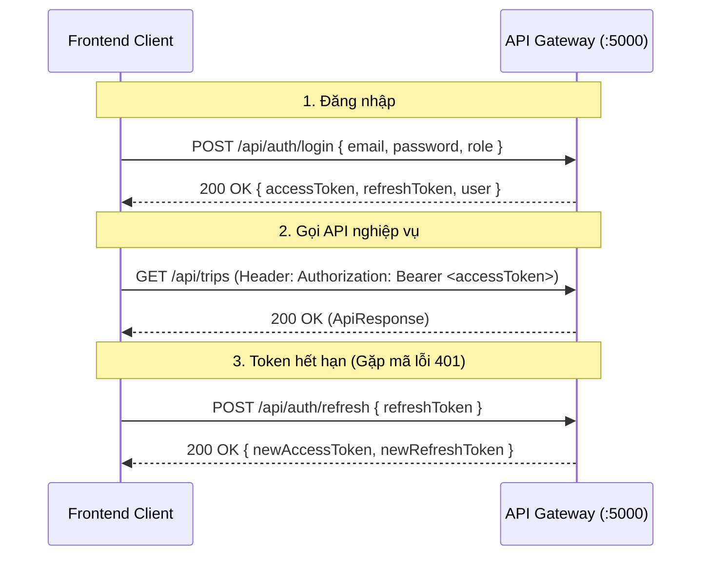
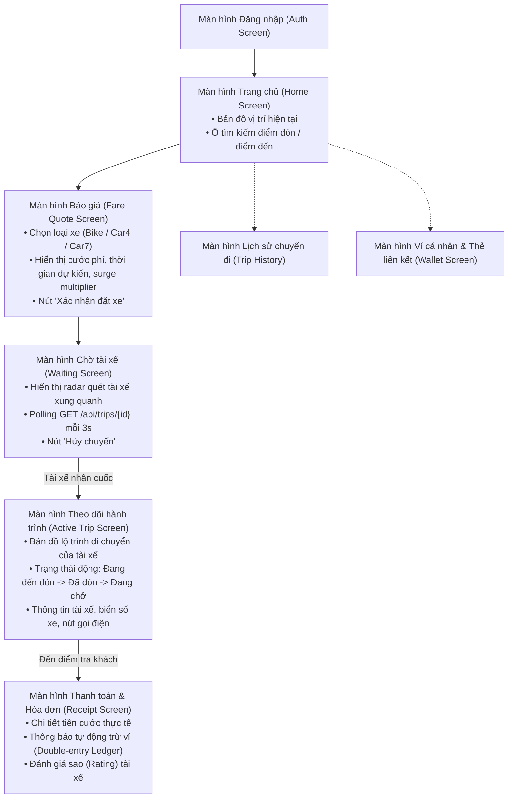
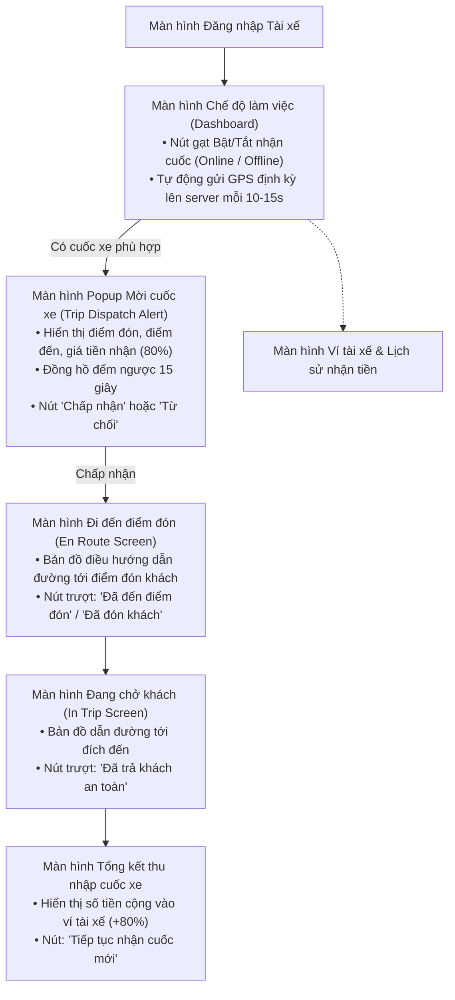

# 📱 SwiftRide - Cẩm Nang Toàn Diện Dành Cho Frontend (FE Handbook)

> **Dành cho:** Toàn bộ thành viên Frontend (Web App, Mobile Rider App, Mobile Driver App)  
> **Mục tiêu:** Cung cấp đầy đủ 100% thông tin kỹ thuật: Cổng kết nối Gateway, Schema DTOs, TypeScript Types, Sơ đồ luồng màn hình, Mã lỗi và Code mẫu Axios Client để FE có thể lập trình độc lập song song với BE ngay lập tức.  
> **Cổng vào API duy nhất (Gateway):** `http://localhost:5000`  
> **Tài liệu tham chiếu:** [`docs/DEVELOPMENT_PLAN.md`](DEVELOPMENT_PLAN.md), [`docs/API_CONTRACT_GUIDE.md`](API_CONTRACT_GUIDE.md) và [`docs/FUNCTIONAL_REQUIREMENTS_AND_DIAGRAMS.md`](FUNCTIONAL_REQUIREMENTS_AND_DIAGRAMS.md)

---

## 📑 MỤC LỤC

1. [Điểm Kết Nối & Môi Trường (Base URL & Gateway)](#1-điểm-kết-nối--môi-trường-base-url--gateway)
2. [Khung Phản Hồi Dữ Liệu Chuẩn Bắt Buộc (ApiResponse Wrapper)](#2-khung-phản-hồi-dữ-liệu-chuẩn-bắt-buộc-apiresponse-wrapper)
3. [Bộ Định Nghĩa TypeScript Types / Interfaces (Sẵn Sàng Copy)](#3-bộ-định-nghĩa-typescript-types--interfaces-sẵn-sàng-copy)
4. [Cơ Chế Xác Thực & Phân Quyền (Auth Flow & Session)](#4-cơ-chế-xác-thực--phân-quyền-auth-flow--session)
5. [Sơ Đồ Luồng Màn Hình Ứng Dụng (Screen Flow Architecture)](#5-sơ-đồ-luồng-màn-hình-ứng-dụng-screen-flow-architecture)
6. [Ánh Xạ Trạng Thái Backend Sang Giao Diện UI (State Machine Mapping)](#6-ánh-xạ-trạng-thái-backend-sang-giao-diện-ui-state-machine-mapping)
7. [Hai Quy Tắc Kỹ Thuật Bắt Buộc Của FE (Idempotency & Polling)](#7-hai-quy-tắc-kỹ-thuật-bắt-buộc-của-fe-idempotency--polling)
8. [Danh Mục Chi Tiết 16 API Endpoints (Kèm Payload Mẫu)](#8-danh-mục-chi-tiết-16-api-endpoints-kèm-payload-mẫu)
9. [Bảng Tra Cứu Mã Lỗi Nghiệp Vụ & Gợi Ý UI](#9-bảng-tra-cứu-mã-lỗi-nghiệp-vụ--gợi-ý-ui)
10. [Mẫu Cấu Hình Axios Client Chuẩn (Có Auto-Token & Refresh)](#10-mẫu-cấu-hình-axios-client-chuẩn-có-auto-token--refresh)

---

## 1. Điểm Kết Nối & Môi Trường (Base URL & Gateway)

FE **tuyệt đối không gọi trực tiếp** vào cổng riêng của các microservice (`5105`, `5248`, `5114`), mà **CHỈ GỌI QUA DUY NHẤT API GATEWAY**:

- **Base URL Gateway:** `http://localhost:5000`
- **Chính sách CORS:** Backend đã mở sẵn CORS cho mọi domain local của FE:
  - Web: `http://localhost:3000`, `http://localhost:5173`
  - Mobile Emulator: `http://10.0.2.2:5000` (Android Studio) hoặc `http://localhost:5000` (iOS Simulator)

### 📖 Trang Tra Cứu API Tương Tác Trực Tiếp (Scalar UI / OpenAPI)

FE có thể mở trình duyệt xem toàn bộ schema dữ liệu và bấm nút test API trực tiếp tại:

- **Module Chuyến đi (Trip Service):** `http://localhost:5105/scalar/v1`
- **Module Tìm xe & Báo giá (Matching Service):** `http://localhost:5248/scalar/v1`
- **Module Thanh toán & Ví (Payment Service):** `http://localhost:5114/scalar/v1`

---

## 2. Khung Phản Hồi Dữ Liệu Chuẩn Bắt Buộc (ApiResponse Wrapper)

Mọi phản hồi từ Backend (dù thành công hay thất bại) đều tuân thủ **một cấu trúc JSON duy nhất**:

### 2.1. Phản hồi thành công cho một đối tượng (200 OK / 201 Created)

```json
{
  "statusCode": 200,
  "message": "Thành công",
  "data": {
    "id": "c1f7b7d8-21d4-4e2b-a48e-2e457e5b1234",
    "status": "DriverAccepted",
    "estimatedFare": 65000.0
  },
  "meta": null,
  "errors": null,
  "traceId": "00-4bf92f3577b34da6a3ce929d0e0e4736-00"
}
```

### 2.2. Phản hồi danh sách có phân trang (Pagination)

```json
{
  "statusCode": 200,
  "message": "Lấy danh sách thành công",
  "data": [ ... ],
  "meta": {
    "page": 1,
    "pageSize": 10,
    "totalCount": 42,
    "totalPages": 5,
    "hasPreviousPage": false,
    "hasNextPage": true
  },
  "errors": null,
  "traceId": "00-4bf92f3577b34da6a3ce929d0e0e4736-00"
}
```

### 2.3. Phản hồi lỗi nghiệp vụ hoặc dữ liệu không hợp lệ (400, 404, 409, 422, 500)

```json
{
  "statusCode": 422,
  "message": "Dữ liệu yêu cầu không hợp lệ",
  "data": null,
  "meta": null,
  "errors": [
    {
      "field": "pickupLatitude",
      "code": "VALIDATION_ERROR",
      "message": "Tọa độ điểm đón nằm ngoài phạm vi phục vụ"
    }
  ],
  "traceId": "00-4bf92f3577b34da6a3ce929d0e0e4736-00"
}
```

_(FE dựa vào mảng `errors` và trường `field` để hiển thị dòng chữ đỏ báo lỗi ngay dưới ô input tương ứng)._

---

## 3. Bộ Định Nghĩa TypeScript Types / Interfaces (Sẵn Sàng Copy)

Team FE có thể copy trực tiếp đoạn mã TypeScript dưới đây vào thư mục `src/types/` của dự án Frontend:

```typescript
// ==================== KHUNG DỮ LIỆU CHUNG (COMMON) ====================
export interface ApiResponse<T> {
  statusCode: number;
  message: string;
  data: T | null;
  meta: PaginatedMeta | null;
  errors: ApiError[] | null;
  traceId?: string;
}

export interface PaginatedMeta {
  page: number;
  pageSize: number;
  totalCount: number;
  totalPages: number;
  hasPreviousPage: boolean;
  hasNextPage: boolean;
}

export interface ApiError {
  field?: string;
  code: string;
  message: string;
}

// ==================== XÁC THỰC (AUTH) ====================
export interface UserInfo {
  id: string;
  email: string;
  role: "Rider" | "Driver";
  fullName: string;
}

export interface LoginResponse {
  accessToken: string;
  refreshToken: string;
  expiresIn: number;
  user: UserInfo;
}

// ==================== CHUYẾN ĐI (TRIP) ====================
export type TripStatus =
  | "Requested"
  | "DriverAccepted"
  | "EnRoute"
  | "PickedUp"
  | "DroppedOff"
  | "PaymentPending"
  | "Paid"
  | "Completed"
  | "Cancelled"
  | "Failed";

export interface TripDto {
  id: string;
  riderId: string;
  driverId: string | null;
  status: TripStatus;
  pickupLatitude: number;
  pickupLongitude: number;
  pickupAddress: string;
  dropoffLatitude: number;
  dropoffLongitude: number;
  dropoffAddress: string;
  distanceKm: number;
  estimatedDurationMinutes: number;
  estimatedFare: number;
  actualFare: number | null;
  createdAt: string;
  acceptedAt?: string | null;
  pickedUpAt?: string | null;
  droppedOffAt?: string | null;
  completedAt?: string | null;
  cancellationReason?: string | null;
}

export interface CreateTripRequest {
  riderId: string;
  pickupLatitude: number;
  pickupLongitude: number;
  pickupAddress: string;
  dropoffLatitude: number;
  dropoffLongitude: number;
  dropoffAddress: string;
  distanceKm: number;
  estimatedDurationMinutes: number;
  estimatedFare: number;
}

export interface TripStatusHistoryDto {
  id: number;
  tripId: string;
  fromStatus: string | null;
  toStatus: TripStatus;
  reason: string | null;
  changedAt: string;
}

// ==================== TÌM XE & TÍNH GIÁ (MATCHING & PRICING) ====================
export type VehicleType = "Bike" | "Car4" | "Car7";

export interface TripQuoteRequest {
  riderId: string;
  pickupLatitude: number;
  pickupLongitude: number;
  dropoffLatitude: number;
  dropoffLongitude: number;
  vehicleType: VehicleType;
}

export interface TripQuoteResponse {
  quoteId: string;
  riderId: string;
  distanceKm: number;
  estimatedDurationMinutes: number;
  surgeMultiplier: number;
  tollFee: number;
  discountRate: number;
  taxRate: number;
  totalFare: number;
  createdAt: string;
  expiresAt: string;
}

export interface NearbyDriverDto {
  driverId: string;
  name: string;
  phone: string;
  vehicleType: VehicleType;
  licensePlate: string;
  vehicleModel: string;
  rating: number;
  distanceMeters: number;
  latitude: number;
  longitude: number;
}

export interface DriverDto {
  driverId: string;
  name: string;
  phone: string;
  vehicleType: VehicleType;
  licensePlate: string;
  vehicleModel: string;
  rating: number;
  isActive: boolean;
  isAvailable: boolean;
  latitude: number;
  longitude: number;
  lastLocationUpdatedAt: string;
}

// ==================== THANH TOÁN & VÍ (PAYMENT & ACCOUNT) ====================
export interface ProcessPaymentRequest {
  tripId: string;
  riderId: string;
  driverId: string;
  amount: number;
  paymentMethod: "Wallet" | "Momo" | "VNPay" | "Card";
  paymentTokenId?: string;
}

export interface PaymentResponse {
  transactionId: string;
  tripId: string;
  status: "Success" | "Pending" | "Failed";
  totalAmount: number;
  riderDebitAmount: number;
  driverCreditAmount: number;
  platformFeeAmount: number;
  description: string;
  createdAt: string;
}

export interface AccountDto {
  id: string;
  ownerId: string;
  ownerType: "Rider" | "Driver" | "Platform";
  accountType: string;
  currency: string;
  balance: number;
  createdAt: string;
}

export interface PaymentTokenDto {
  id: string;
  userId: string;
  provider: "Momo" | "VNPay" | "Stripe";
  maskedToken: string;
  isDefault: boolean;
  createdAt: string;
}
```

---

## 4. Cơ Chế Xác Thực & Phân Quyền (Auth Flow & Session)



### Các Bước FE Triển Khai:

1. **Lưu trữ Token:** Sau khi gọi `POST /api/auth/login`, lưu `accessToken` và `refreshToken` vào Storage.
2. **Gửi Token:** Tất cả các request sau đó đều phải kèm header:
   ```http
   Authorization: Bearer <accessToken>
   ```
3. **Phân quyền theo Role:** Trả về trong object `user.role`:
   - `'Rider'`: Điều hướng sang màn hình Đặt xe của Khách hàng.
   - `'Driver'`: Điều hướng sang màn hình Nhận cuốc của Tài xế.
4. **Mock Auth có sẵn:** BE Gateway đã cung cấp sẵn API Login trả token giả định để FE test luồng ngay:
   - Rider: `{"email": "rider@swiftride.vn", "password": "123", "role": "Rider"}`
   - Driver: `{"email": "driver@swiftride.vn", "password": "123", "role": "Driver"}`

---

## 5. Sơ Đồ Luồng Màn Hình Ứng Dụng (Screen Flow Architecture)

### 📱 5.1. Luồng Màn Hình Ứng Dụng Khách Hàng (Rider App)



---

### 🏍️ 5.2. Luồng Màn Hình Ứng Dụng Tài Xế (Driver App)



---

## 6. Ánh Xạ Trạng Thái Backend Sang Giao Diện UI (State Machine Mapping)

Khi FE thực hiện polling `GET /api/trips/{id}`, trường `status` nhận về sẽ quyết định giao diện hiển thị:

| Trạng thái Backend (`status`) | Màn hình Rider App hiển thị                           | Màn hình Driver App hiển thị                 | Hành động khả dụng                      |
| :---------------------------- | :---------------------------------------------------- | :------------------------------------------- | :-------------------------------------- |
| `Requested`                   | Màn hình radar quét tìm tài xế gần bạn                | Popup chuông reo báo cuốc xe mới             | Rider có thể bấm "Hủy chuyến"           |
| `DriverAccepted`              | Hiển thị: "Tài xế đã nhận cuốc và chuẩn bị xuất phát" | Hiển thị: "Đã nhận cuốc! Vui lòng khởi hành" | Hiển thị thông tin tài xế và biển số xe |
| `EnRoute`                     | Bản đồ hiển thị tài xế đang chạy đến điểm đón         | Bản đồ GPS dẫn đường đến vị trí khách        | Tài xế bấm "Đã đón khách"               |
| `PickedUp`                    | Hiển thị: "Chúc bạn chuyến đi an toàn!"               | Bản đồ GPS dẫn đường đến điểm trả khách      | Tài xế bấm "Đã trả khách"               |
| `DroppedOff`                  | Hiển thị: "Đã đến nơi. Đang xử lý thanh toán..."      | Hiển thị: "Đã trả khách thành công"          | Hệ thống tự động chuyển sang thanh toán |
| `PaymentPending`              | Hiển thị vòng xoay đang trừ tiền ví                   | Hiển thị đang đối soát doanh thu             | Khóa màn hình chờ kết quả trừ ví        |
| `Paid` / `Completed`          | Màn hình Hóa đơn cuốc xe & Đánh giá 5 sao             | Màn hình chúc mừng thu nhập + tiền vào ví    | Bấm "Hoàn tất" quay về trang chủ        |
| `Cancelled`                   | Thông báo: "Chuyến đi đã bị hủy" kèm lý do            | Thông báo: "Khách hàng đã hủy chuyến đi"     | Quay về màn hình chính                  |
| `Failed`                      | Thông báo: "Không tìm thấy tài xế" (sau k lần thử)    | Mất popup mời chuyến                         | Cho phép khách bấm "Tìm lại tài xế"     |

---

## 7. Hai Quy Tắc Kỹ Thuật Bắt Buộc Của FE (Idempotency & Polling)

### Quy Tắc 1: Gửi Header `X-Idempotency-Key` Khi Thanh Toán

- **Mục đích:** Ngăn ngừa việc người dùng nhấn nút thanh toán 2 lần liên tiếp dẫn đến bị trừ tiền 2 lần.
- **Cách FE làm:** Trước khi gửi request `POST /api/payments/process`, sinh một UUID v4 ngẫu nhiên:
  ```javascript
  const idempotencyKey = crypto.randomUUID();
  // Gửi kèm trong headers:
  headers: {
    'Authorization': `Bearer ${token}`,
    'X-Idempotency-Key': idempotencyKey
  }
  ```
- Nếu request gặp lỗi mạng timeout và phải thử lại (retry), **phải gửi lại đúng cùng một `idempotencyKey` cũ**. Backend sẽ tự động trả về kết quả đã xử lý trước đó mà không trừ tiền thêm.

### Quy Tắc 2: Cơ Chế Polling Trạng Thái Cuốc Xe (Ở Sprint 1)

- Ở Sprint 1, để đẩy nhanh tiến độ và đơn giản hóa, FE dùng hàm `setInterval` gọi lặp lại:
  ```javascript
  // Polling mỗi 3 giây
  const pollInterval = setInterval(async () => {
    const res = await api.get(`/api/trips/${currentTripId}`);
    const trip = res.data.data;

    if (trip.status === "DriverAccepted") {
      clearInterval(pollInterval);
      navigateToScreen("ActiveTripScreen", { trip });
    }
  }, 3000);
  ```

---

## 8. Danh Mục Chi Tiết 16 API Endpoints (Kèm Payload Mẫu)

### 8.1. Nhóm Xác Thực (Auth)

#### 1. Đăng nhập (`POST /api/auth/login`)

- **Body:**
  ```json
  {
    "email": "rider@swiftride.vn",
    "password": "Password123!",
    "role": "Rider"
  }
  ```
- **Response (200 OK):**
  ```json
  {
    "statusCode": 200,
    "message": "Login successful",
    "data": {
      "accessToken": "mock-jwt-token-xyz",
      "refreshToken": "mock-refresh-token-abc",
      "expiresIn": 1800,
      "user": {
        "id": "11111111-1111-1111-1111-111111111111",
        "email": "rider@swiftride.vn",
        "role": "Rider",
        "fullName": "Trần Thị Khách Hàng"
      }
    }
  }
  ```

#### 2. Làm mới Token (`POST /api/auth/refresh`)

- **Body:** `{"refreshToken": "mock-refresh-token-abc"}`
- **Response (200 OK):** Trả về `accessToken` và `refreshToken` mới.

---

### 8.2. Nhóm Tìm Xe & Báo Giá (Matching & Pricing Service)

#### 3. Báo giá ước tính (`POST /api/matching/quote`)

- **Body:**
  ```json
  {
    "riderId": "11111111-1111-1111-1111-111111111111",
    "pickupLatitude": 10.776889,
    "pickupLongitude": 106.700806,
    "dropoffLatitude": 10.762887,
    "dropoffLongitude": 106.682145,
    "vehicleType": "Bike"
  }
  ```
- **Response (200 OK):**
  ```json
  {
    "statusCode": 200,
    "message": "Quote generated successfully",
    "data": {
      "quoteId": "6a9e1e3e-4fa0-459f-bb24-9b2f6efc8721",
      "distanceKm": 4.8,
      "estimatedDurationMinutes": 14,
      "surgeMultiplier": 1.2,
      "totalFare": 65000.0,
      "expiresAt": "2026-10-15T08:40:00Z"
    }
  }
  ```

#### 4. Tìm tài xế xung quanh (`POST /api/matching/find-drivers`)

- **Body:** `{"latitude": 10.776889, "longitude": 106.700806, "radiusKm": 3.0, "vehicleType": "Bike", "limit": 5}`
- **Response (200 OK):** Mảng danh sách tài xế gần nhất kèm khoảng cách (`distanceMeters`).

#### 5. Cập nhật vị trí GPS tài xế (`PUT /api/drivers/{driverId}/location`)

- **Body:** `{"latitude": 10.762887, "longitude": 106.682145}`

#### 6. Bật/tắt trạng thái nhận cuốc (`PUT /api/drivers/{driverId}/availability`)

- **Body:** `{"isAvailable": true}`

#### 7. Lấy biểu phí hiện hành (`GET /api/pricing/configs`)

---

### 8.3. Nhóm Quản Lý Chuyến Đi (Trip Service)

#### 8. Tạo yêu cầu đặt xe (`POST /api/trips`)

- **Body:**
  ```json
  {
    "riderId": "11111111-1111-1111-1111-111111111111",
    "pickupLatitude": 10.776889,
    "pickupLongitude": 106.700806,
    "pickupAddress": "Chợ Bến Thành, Quận 1",
    "dropoffLatitude": 10.762887,
    "dropoffLongitude": 106.682145,
    "dropoffAddress": "280 An Dương Vương, Quận 5",
    "distanceKm": 4.8,
    "estimatedDurationMinutes": 14,
    "estimatedFare": 65000.0
  }
  ```
- **Response (201 Created):** `TripDto` với `status = "Requested"`.

#### 9. Lấy chi tiết chuyến đi (`GET /api/trips/{id}`)

- Phục vụ cơ chế polling theo dõi trạng thái.

#### 10. Lịch sử chuyến đi (`GET /api/trips?riderId={id}&page=1&pageSize=10`)

#### 11. Tài xế nhận cuốc (`PUT /api/trips/{id}/accept`)

- **Body:** `{"driverId": "22222222-2222-2222-2222-222222222222"}`

#### 12. Tiến độ cuốc xe:

- Bắt đầu đi đón: `PUT /api/trips/{id}/start-route`
- Đã đón khách: `PUT /api/trips/{id}/pick-up`
- Đã trả khách: `PUT /api/trips/{id}/drop-off`

#### 13. Hủy chuyến đi (`PUT /api/trips/{id}/cancel`)

- **Body:** `{"reason": "Chờ tài xế quá 15 phút"}`

---

### 8.4. Nhóm Thanh Toán & Ví (Payment Service)

#### 14. Xử lý thanh toán (`POST /api/payments/process`)

- **Headers:** `X-Idempotency-Key: <UUID>`
- **Body:**
  ```json
  {
    "tripId": "c1f7b7d8-21d4-4e2b-a48e-2e457e5b1234",
    "riderId": "11111111-1111-1111-1111-111111111111",
    "driverId": "22222222-2222-2222-2222-222222222222",
    "amount": 65000.0,
    "paymentMethod": "Wallet"
  }
  ```

#### 15. Xem số dư ví (`GET /api/accounts/{ownerId}`)

- Trả về số dư tài khoản `balance` (VNĐ).

#### 16. Quản lý thẻ/ví Momo (`POST /api/payment-tokens` & `GET /api/payment-tokens?userId={id}`)

---

## 9. Bảng Tra Cứu Mã Lỗi Nghiệp Vụ & Gợi Ý UI

Khi API trả về lỗi (mã status ≥ 400), FE trích xuất `errors[0].code` để hiển thị Toast thông báo:

| Mã Lỗi (`code`)           | HTTP Status | Thông Báo Gợi Ý Cho FE Hiển Thị (Toast / Dialog)                            |
| :------------------------ | :---------: | :-------------------------------------------------------------------------- |
| `VALIDATION_ERROR`        |     422     | "Dữ liệu không hợp lệ. Vui lòng kiểm tra lại thông tin đã nhập."            |
| `UNAUTHORIZED`            |     401     | "Phiên đăng nhập đã hết hạn. Hệ thống đang tự động đăng nhập lại..."        |
| `FORBIDDEN`               |     403     | "Bạn không có quyền thực hiện thao tác này."                                |
| `TRIP_NOT_FOUND`          |     404     | "Không tìm thấy thông tin chuyến đi này."                                   |
| `TRIP_INVALID_TRANSITION` |     409     | "Thao tác không hợp lệ với trạng thái hiện tại của chuyến đi."              |
| `TRIP_ALREADY_ACCEPTED`   |     409     | "Cuốc xe đã được một tài xế khác nhận trước đó."                            |
| `NO_DRIVERS_NEARBY`       |     404     | "Hiện không có tài xế nào quanh khu vực này. Vui lòng thử lại sau ít phút." |
| `DRIVER_NOT_AVAILABLE`    |     422     | "Tài xế hiện đang bận hoặc đã tắt nhận cuốc."                               |
| `QUOTE_EXPIRED`           |     410     | "Báo giá cước đã hết hạn (quá 10 phút). Vui lòng tải lại báo giá mới."      |
| `ACCOUNT_NOT_FOUND`       |     404     | "Không tìm thấy tài khoản ví của bạn."                                      |
| `INSUFFICIENT_BALANCE`    |     422     | "Số dư trong ví không đủ để thanh toán. Vui lòng nạp thêm tiền."            |
| `PAYMENT_DUPLICATE`       |     409     | "Giao dịch này đang được xử lý, vui lòng không nhấn thanh toán nhiều lần."  |

---

## 10. Mẫu Cấu Hình Axios Client Chuẩn (Có Auto-Token & Refresh)

FE có thể copy file cấu hình `src/services/apiClient.ts` này để dùng ngay:

```typescript
import axios from "axios";

const apiClient = axios.create({
  baseURL: "http://localhost:5000", // API Gateway URL
  timeout: 10000,
  headers: {
    "Content-Type": "application/json",
  },
});

// 1. Request Interceptor: Tự động đính kèm JWT Bearer Token
apiClient.interceptors.request.use(
  (config) => {
    const token = localStorage.getItem("accessToken");
    if (token) {
      config.headers.Authorization = `Bearer ${token}`;
    }
    return config;
  },
  (error) => Promise.reject(error),
);

// 2. Response Interceptor: Tự động bắt lỗi 401 để Refresh Token
apiClient.interceptors.response.use(
  (response) => response,
  async (error) => {
    const originalRequest = error.config;

    if (error.response?.status === 401 && !originalRequest._retry) {
      originalRequest._retry = true;
      try {
        const refreshToken = localStorage.getItem("refreshToken");
        if (!refreshToken) throw new Error("No refresh token");

        // Gọi API cấp token mới
        const res = await axios.post("http://localhost:5000/api/auth/refresh", {
          refreshToken,
        });
        const { accessToken, refreshToken: newRefreshToken } = res.data.data;

        localStorage.setItem("accessToken", accessToken);
        localStorage.setItem("refreshToken", newRefreshToken);

        // Thử lại request ban đầu với token mới
        originalRequest.headers.Authorization = `Bearer ${accessToken}`;
        return apiClient(originalRequest);
      } catch (refreshErr) {
        // Refresh token cũng hết hạn -> chuyển về trang Login
        localStorage.clear();
        window.location.href = "/login";
        return Promise.reject(refreshErr);
      }
    }

    return Promise.reject(error);
  },
);

export default apiClient;
```

---

> [!TIP]
> **Cam kết từ Backend Team:** Toàn bộ Mock API đúng theo các JSON payload trên sẽ hoạt động trên cổng `http://localhost:5000` trong vòng 24–48 giờ đầu tiên. Team FE hoàn toàn có thể an tâm ghép màn hình ngay từ hôm nay!
