# 🗺️ SwiftRide - Sơ Đồ Phân Rã Chức Năng & Các Sơ Đồ Trình Tự Chi Tiết (Functional Decomposition & Sequence Diagrams)

> **Căn cứ tài liệu kiến trúc:** [`docs/RideLite-KienTrucPhanMem.pdf`](RideLite-KienTrucPhanMem.pdf) (Tài liệu gốc: Bài toán SwiftRide, Kịch bản end-to-end Mục 2.2, Công thức tính giá Mục 2.3, Flowchart vòng đời chuyến đi Mục 4, Chi tiết 3 microservices Mục 5).  
> **Tài liệu liên quan:**  
> - Bảng điều phối tổng quan: [`docs/README.md`](README.md)  
> - Thiết kế CSDL chi tiết: [`docs/DATABASE_DESIGN.md`](DATABASE_DESIGN.md)  
> - Hợp đồng API & Bàn giao Frontend: [`docs/API_CONTRACT_AND_FE_INTEGRATION.md`](API_CONTRACT_AND_FE_INTEGRATION.md)  
> - Kế hoạch triển khai Sprint 10 ngày: [`docs/DEVELOPMENT_PLAN.md`](DEVELOPMENT_PLAN.md)  

---

## 📑 MỤC LỤC
1. [Sơ Đồ Cây Phân Rã Chức Năng Hệ Thống (Functional Decomposition Tree)](#1-sơ-đồ-cây-phân-rã-chức-năng-hệ-thống-functional-decomposition-tree)
2. [Chi Tiết 15 Sơ Đồ Trình Tự (Sequence Diagrams) Cho Từng Chức Năng](#2-chi-tiết-15-sơ-đồ-trình-tự-sequence-diagrams-cho-từng-chức-năng)
   - **Phân Hệ 1: Cổng Vào API Gateway (Edge Routing & Security)**
     - [SD 01: F1.1 - Xác thực & Đăng nhập (Auth & JWT Token Issuance)](#sd-01-f11---xác-thực--đăng-nhập-auth--jwt-token-issuance)
     - [SD 02: F1.2 - Làm mới phiên đăng nhập (Refresh Token)](#sd-02-f12---làm-mới-phiên-đăng-nhập-refresh-token)
   - **Phân Hệ 2: Quản Lý Vòng Đời Chuyến Đi (Trip Service - SQL Server `TripDB`)**
     - [SD 03: F2.1 - Khởi tạo yêu cầu chuyến xe (Trip Creation & Transactional Outbox)](#sd-03-f21---khởi-tạo-yêu-cầu-chuyến-xe-trip-creation--transactional-outbox)
     - [SD 04: F2.2 - Khách hàng xác nhận hoặc từ chối báo giá (Fare Quote Confirmation / Rejection)](#sd-04-f22---khách-hàng-xác-nhận-hoặc-từ-chối-báo-giá-fare-quote-confirmation--rejection)
     - [SD 05: F2.3 - Tài xế chấp nhận cuốc xe (Driver Acceptance & Concurrency Control)](#sd-05-f23---tài-xế-chấp-nhận-cuốc-xe-driver-acceptance--concurrency-control)
     - [SD 06: F2.4 - Tiến trình đón & trả khách (Journey Progression: EnRoute -> PickedUp -> DroppedOff)](#sd-06-f24---tiến-trình-đón--trả-khách-journey-progression-enroute---pickedup---droppedoff)
     - [SD 07: F2.5 - Hủy chuyến đi trước khi đón (Trip Cancellation)](#sd-07-f25---hủy-chuyến-đi-trước-khi-đón-trip-cancellation)
     - [SD 08: F2.6 - Đóng chuyến đi hoàn tất sau thanh toán (Trip Completion)](#sd-08-f26---đóng-chuyến-đi-hoàn-tất-sau-thanh-toán-trip-completion)
   - **Phân Hệ 3: Tìm Xe, Định Vị & Tính Giá Động (Matching & Pricing Service - MongoDB `MatchDB`)**
     - [SD 09: F3.1 - Ước lượng cước phí động (Dynamic Pricing & Strategy Pattern)](#sd-09-f31---ước-lượng-cước-phí-động-dynamic-pricing--strategy-pattern)
     - [SD 10: F3.2 - Cập nhật vị trí GPS & Trạng thái tài xế (Driver GPS & Availability Tracking)](#sd-10-f32---cập-nhật-vị-trí-gps--trạng-thái-tài-xế-driver-gps--availability-tracking)
     - [SD 11: F3.3 - Tìm kiếm & Điều phối tài xế với vòng lặp thử giới hạn <= k lần (Driver Matching Engine)](#sd-11-f33---tìm-kiếm--điều-phối-tài-xế-với-vòng-lặp-thử-giới-hạn--k-lần-driver-matching-engine)
   - **Phân Hệ 4: Thanh Toán, Sổ Cái Kép & Bồi Thường (Payment Service - PostgreSQL `PayDB`)**
     - [SD 12: F4.1 - Tự động trừ tiền & Ghi sổ cái kép (Double-entry Ledger Settlement)](#sd-12-f41---tự-động-trừ-tiền--ghi-sổ-cái-kép-double-entry-ledger-settlement)
     - [SD 13: F4.2 - Xử lý lỗi thanh toán tạm thời & Retry có giới hạn với Idempotency Key](#sd-13-f42---xử-lý-lỗi-thanh-toán-tạm-thời--retry-có-giới-hạn-với-idempotency-key)
     - [SD 14: F4.3 - Hoàn tiền & Giao dịch bồi thường Saga (Refund & Compensating Transaction)](#sd-14-f43---hoàn-tiền--giao-dịch-bồi-thường-saga-refund--compensating-transaction)
     - [SD 15: F4.4 - Token hóa phương thức thanh toán (PCI-DSS Payment Tokenization)](#sd-15-f44---token-hóa-phương-thức-thanh-toán-pci-dss-payment-tokenization)

---

## 1. Sơ Đồ Cây Phân Rã Chức Năng Hệ Thống (Functional Decomposition Tree)

Bám sát đặc tả kiến trúc tại tài liệu gốc [`docs/RideLite-KienTrucPhanMem.pdf`](RideLite-KienTrucPhanMem.pdf), hệ thống SwiftRide gồm **1 Cổng vào API Gateway (YARP)** và **3 Microservices cốt lõi**. Toàn bộ 15 chức năng nghiệp vụ được phân rã rành mạch theo sơ đồ cây dưới đây:

```mermaid
flowchart TD
    Root["Hệ Thống Đặt Xe SwiftRide Platform"]

    %% Nhóm 1: Gateway
    Root --> G1["1. Cổng Vào API Gateway (YARP)"]
    G1 --> F11["F1.1: Xác thực & Đăng nhập (Auth & JWT Token)"]
    G1 --> F12["F1.2: Làm mới phiên đăng nhập (Refresh Token)"]

    %% Nhóm 2: Trip Service
    Root --> G2["2. Quản Lý Vòng Đời Chuyến Đi (Trip Service - SQL Server)"]
    G2 --> F21["F2.1: Khởi tạo yêu cầu chuyến xe (Trip Creation & Outbox)"]
    G2 --> F22["F2.2: Khách hàng xác nhận / từ chối báo giá (Quote Confirm/Reject)"]
    G2 --> F23["F2.3: Tài xế chấp nhận cuốc xe (Driver Acceptance & RowVersion)"]
    G2 --> F24["F2.4: Tiến trình hành trình đón & trả khách (EnRoute -> PickedUp -> DroppedOff)"]
    G2 --> F25["F2.5: Hủy chuyến đi trước khi đón (Trip Cancellation)"]
    G2 --> F26["F2.6: Đóng chuyến đi hoàn tất sau thanh toán (Trip Completion)"]

    %% Nhóm 3: Matching & Pricing Service
    Root --> G3["3. Tìm Xe, Định Vị & Định Giá (Matching Service - MongoDB)"]
    G3 --> F31["F3.1: Ước lượng cước phí động (Dynamic Pricing: Standard / Surge / Promo)"]
    G3 --> F32["F3.2: Cập nhật vị trí GPS & Trạng thái tài xế (MongoDB 2dsphere)"]
    G3 --> F33["F3.3: Tìm kiếm & Điều phối tài xế với vòng lặp thử <= k lần"]

    %% Nhóm 4: Payment Service
    Root --> G4["4. Thanh Toán & Sổ Cái Kép (Payment Service - PostgreSQL)"]
    G4 --> F41["F4.1: Tự động trừ tiền & Ghi sổ cái kép (Double-entry Ledger)"]
    G4 --> F42["F4.2: Xử lý lỗi tạm thời & Retry với Idempotency Key"]
    G4 --> F43["F4.3: Hoàn tiền & Giao dịch bồi thường Saga (Compensating Transaction)"]
    G4 --> F44["F4.4: Token hóa phương thức thanh toán (PCI-DSS Tokenization)"]
```

---

## 2. Chi Tiết 15 Sơ Đồ Trình Tự (Sequence Diagrams) Cho Từng Chức Năng

Mỗi chức năng trong cây phân rã trên đều có một sơ đồ trình tự tương ứng thể hiện chính xác luồng tương tác giữa Client, API Gateway, Microservice nghiệp vụ, CSDL riêng biệt và RabbitMQ Event Bus.

---

### PHÂN HỆ 1: CỔNG VÀO API GATEWAY (EDGE ROUTING & SECURITY)

#### SD 01: F1.1 - Xác thực & Đăng nhập (Auth & JWT Token Issuance)
*Căn cứ tài liệu kiến trúc:* Mục 3.1 & Mục 3.2 (API Gateway YARP đảm nhận xác thực JWT và chuyển tiếp định tuyến).

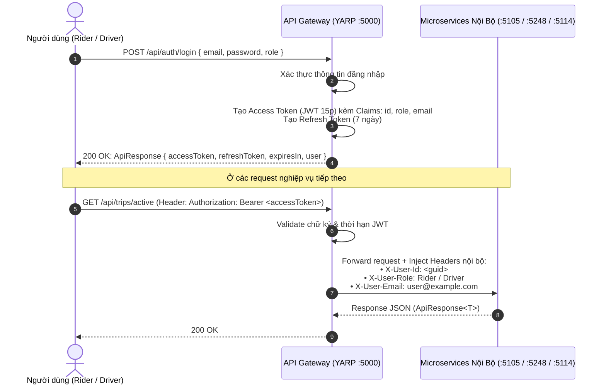

---

#### SD 02: F1.2 - Làm mới phiên đăng nhập (Refresh Token)
*Căn cứ tài liệu kiến trúc:* Mục 3.2 (Duy trì phiên làm việc liên tục cho Rider App và Driver App).

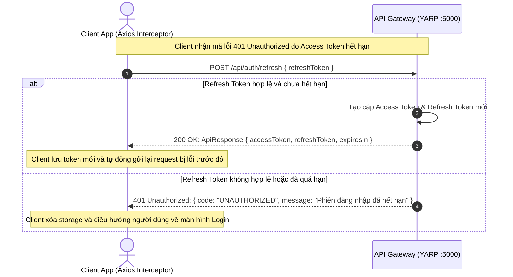

---

### PHÂN HỆ 2: QUẢN LÝ VÒNG ĐỜI CHUYẾN ĐI (TRIP SERVICE - SQL SERVER `TripDB`)

#### SD 03: F2.1 - Khởi tạo yêu cầu chuyến xe (Trip Creation & Transactional Outbox)
*Căn cứ tài liệu kiến trúc:* Mục 2.2 (Bước 1 & 2), Mục 3.3 (SQL Server đảm bảo ACID) & Mục 9.2 (Mẫu Transactional Outbox ghi dữ liệu và event tin cậy trong cùng transaction).

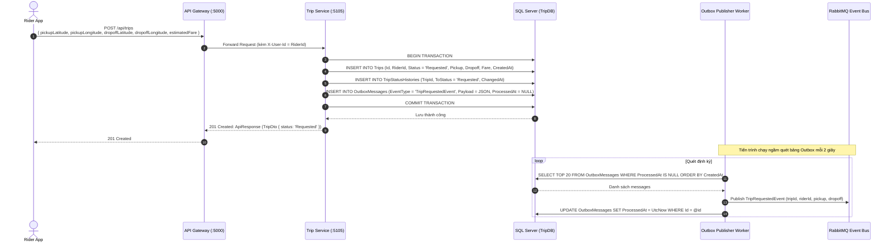

---

#### SD 04: F2.2 - Khách hàng xác nhận hoặc từ chối báo giá (Fare Quote Confirmation / Rejection)
*Căn cứ tài liệu kiến trúc:* Mục 2.2 (Bước 4) & Mục 4 (Flowchart vòng đời chuyến đi: Rider đồng ý -> chuyển bước kế; Rider từ chối -> Hủy chuyến).

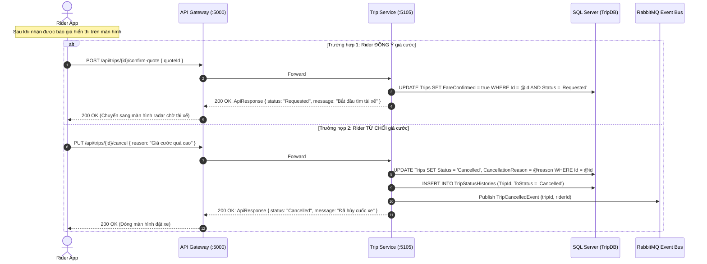

---

#### SD 05: F2.3 - Tài xế chấp nhận cuốc xe (Driver Acceptance & Concurrency Control)
*Căn cứ tài liệu kiến trúc:* Mục 2.2 (Bước 5), Mục 6.5 (DIP), Mục 7 (State Pattern) & Xử lý Optimistic Locking bằng `RowVersion` chống tranh chấp 1 cuốc xe giữa nhiều tài xế.

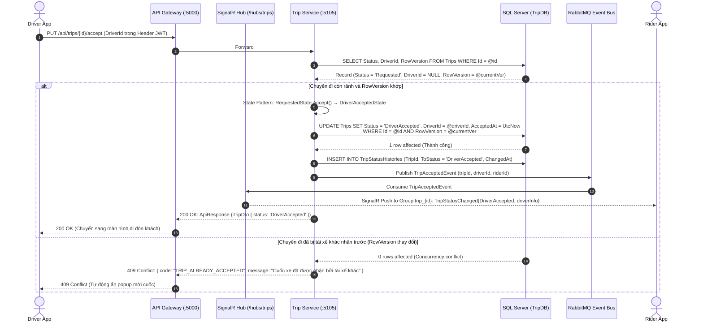

---

#### SD 06: F2.4 - Tiến trình đón & trả khách (Journey Progression: EnRoute -> PickedUp -> DroppedOff)
*Căn cứ tài liệu kiến trúc:* Mục 2.2 (Bước 6) & Mục 4 (Flowchart: Tài xế đang đến -> Đã đón khách -> Đã trả khách; State Pattern quản lý chuyển đổi trạng thái hợp lệ).

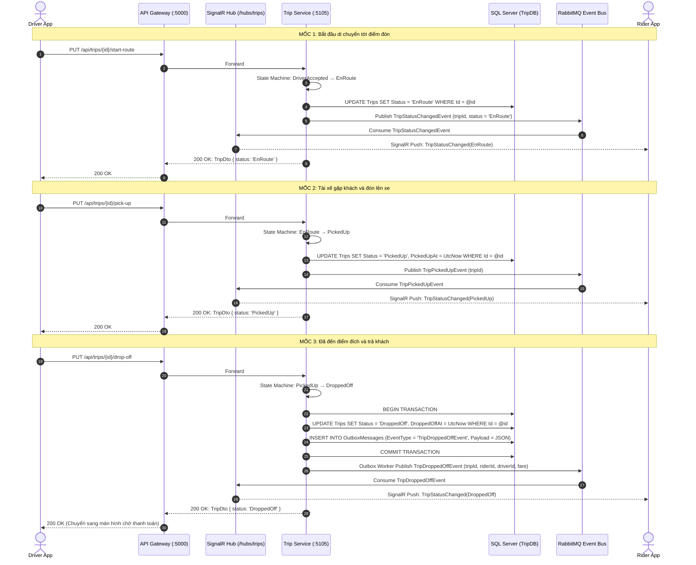

---

#### SD 07: F2.5 - Hủy chuyến đi trước khi đón (Trip Cancellation)
*Căn cứ tài liệu kiến trúc:* Mục 4 (Flowchart: Nhánh kết thúc - Hủy chuyến) & Mục 7 (Listing 6: Vòng đời chuyến đi).

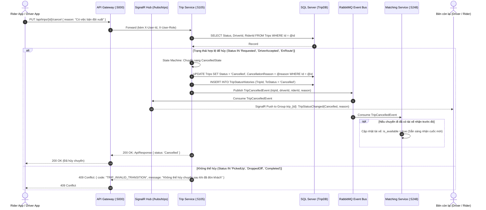

---

#### SD 08: F2.6 - Đóng chuyến đi hoàn tất sau thanh toán (Trip Completion)
*Căn cứ tài liệu kiến trúc:* Mục 2.2 (Bước 8: Khi thanh toán hoàn tất, chuyến đi đóng lại ở trạng thái cuối) & Mục 7 (Listing 6: `CompletedState`).

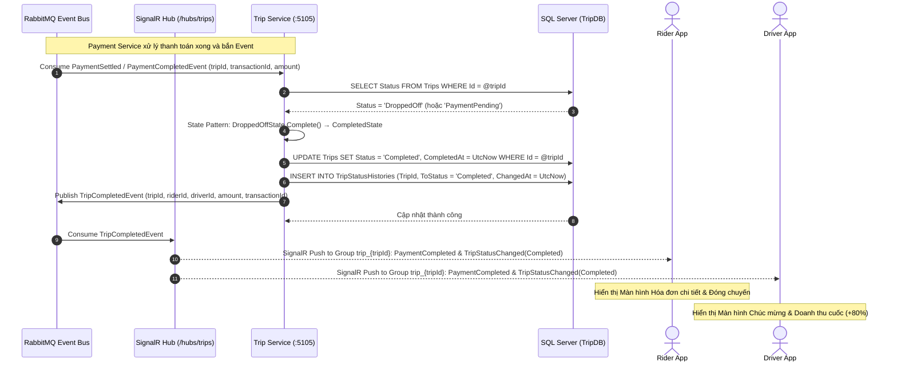

---

### PHÂN HỆ 3: TÌM XE, ĐỊNH VỊ & TÍNH GIÁ ĐỘNG (MATCHING & PRICING SERVICE - MONGODB `MatchDB`)

#### SD 09: F3.1 - Ước lượng cước phí động (Dynamic Pricing & Strategy Pattern)
*Căn cứ tài liệu kiến trúc:* Mục 2.3 (Công thức tính giá), Mục 5.2, Mục 6.1 (SRP), Mục 6.2 (OCP - Listing 2: `IPricingStrategy`), Mục 6.3 (LSP - Listing 3: Giá không âm) & Mục 7 (Strategy Pattern).

$$\text{Công thức gốc trong PDF: } p = \big((c_d \cdot d + c_t \cdot t) \cdot s + c_m\big) \cdot \eta \cdot (1 + T)$$

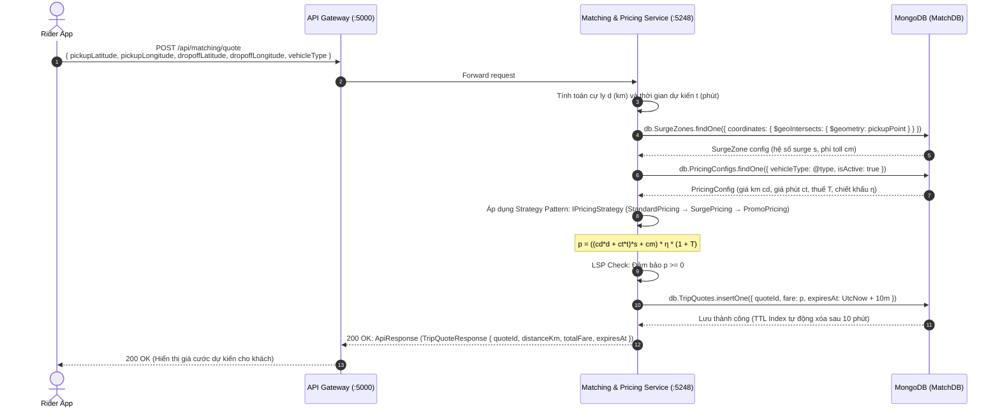

---

#### SD 10: F3.2 - Cập nhật vị trí GPS & Trạng thái tài xế (Driver GPS & Availability Tracking)
*Căn cứ tài liệu kiến trúc:* Mục 3.3 (MongoDB tối ưu cho dữ liệu vị trí động với geo-spatial index `2dsphere`) & Mục 5.2.

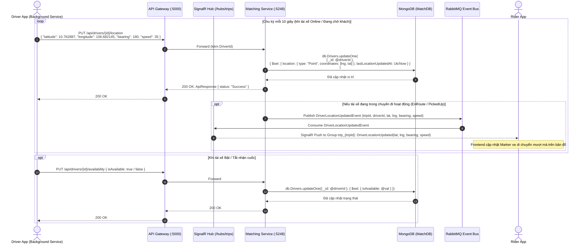

---

#### SD 11: F3.3 - Tìm kiếm & Điều phối tài xế với vòng lặp thử giới hạn <= k lần (Driver Matching Engine)
*Căn cứ tài liệu kiến trúc:* Mục 2.2 (Bước 5), Mục 4 (Flowchart: Đề xuất cho tài xế -> từ chối, $\le k$ lần -> thử lại; $> k$ lần -> Không thành công) & Mục 5.2 (Truy vấn vị trí trên MongoDB).

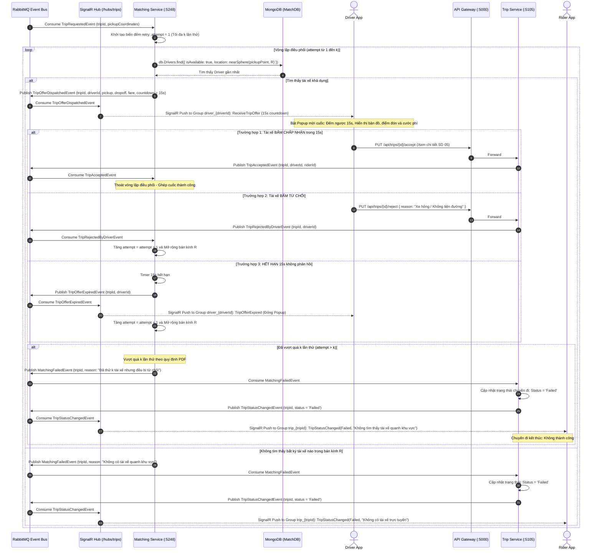

---

### PHÂN HỆ 4: THANH TOÁN, SỔ CÁI KÉP & BỒI THƯỜNG (PAYMENT SERVICE - POSTGRESQL `PayDB`)

#### SD 12: F4.1 - Tự động trừ tiền & Ghi sổ cái kép (Double-entry Ledger Settlement)
*Căn cứ tài liệu kiến trúc:* Mục 2.2 (Bước 7), Mục 3.3 (PostgreSQL đảm bảo sổ cái giao dịch kiểu double-entry, kiểm toán và nhất quán tiền bạc) & Mục 5.3 (Payment Service bắt buộc).

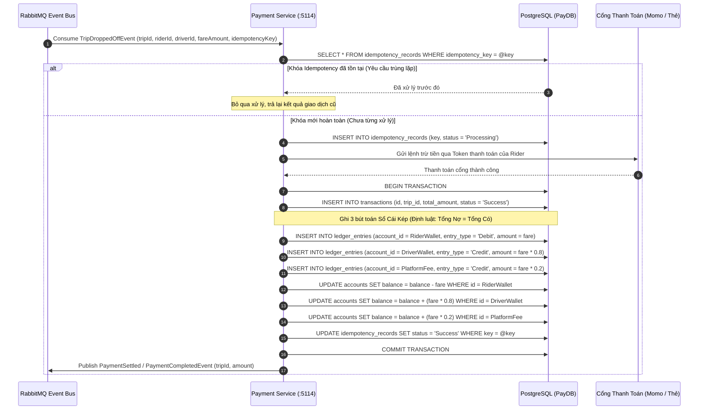

---

#### SD 13: F4.2 - Xử lý lỗi thanh toán tạm thời & Retry có giới hạn với Idempotency Key
*Căn cứ tài liệu kiến trúc:* Mục 4 (Flowchart: Thanh toán lỗi / chờ xử lý $\to$ retry có giới hạn với cùng một idempotency key; nếu vẫn lỗi thì giữ trạng thái chờ xử lý thay vì trừ lặp hoặc báo thành công sai) & Mục 9.2 (Consumer idempotent).

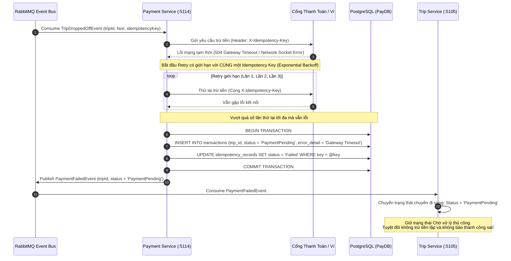

---

#### SD 14: F4.3 - Hoàn tiền & Giao dịch bồi thường Saga (Refund & Compensating Transaction)
*Căn cứ tài liệu kiến trúc:* Mục 5.3 (Payment Service xử lý hoàn tiền và bồi thường khi một Saga thất bại) & Mục 9.2 (Saga điều phối nhiều bước và định nghĩa hành động bồi thường).

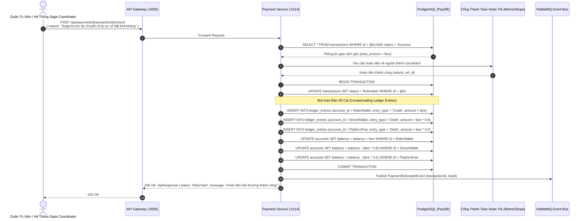

---

#### SD 15: F4.4 - Token hóa phương thức thanh toán (PCI-DSS Payment Tokenization)
*Căn cứ tài liệu kiến trúc:* Mục 5.3 (Payment Service chỉ lưu token do cổng thanh toán cấp, không lưu số thẻ/CVV để đạt chuẩn an toàn bảo mật PCI-DSS).

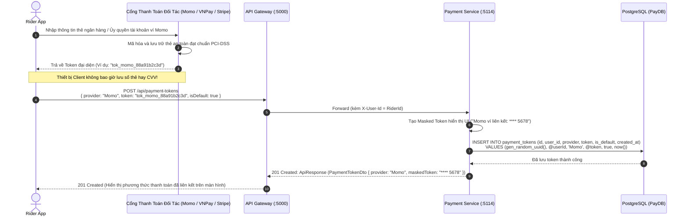
