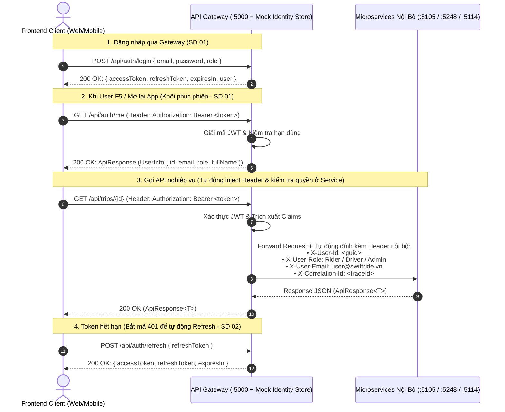
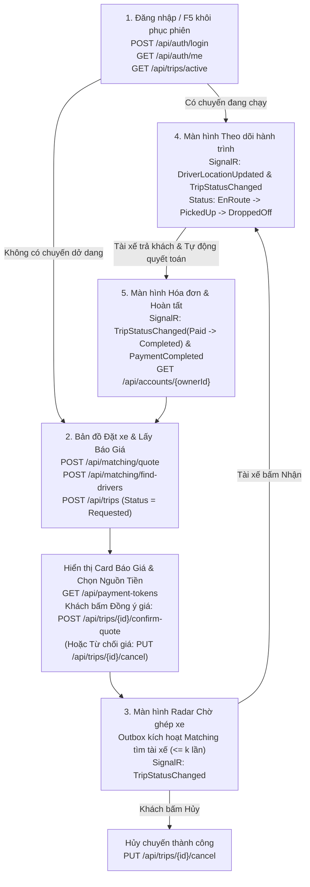
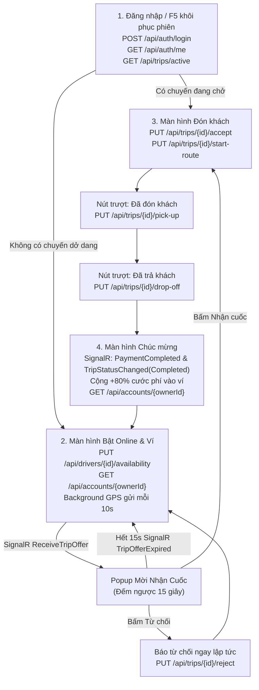

# 📡 SwiftRide - Hợp Đồng Giao Tiếp API & Cẩm Nang Tích Hợp Frontend (API Contract & FE Integration Guide)

> **Căn cứ tài liệu kiến trúc gốc:** `RideLite-KienTrucPhanMem.pdf` (Kịch bản cốt lõi Mục 2.2, Sơ đồ kiến trúc logic & YARP Gateway Mục 3.1–3.2, Flowchart vòng đời chuyến đi Mục 4, Chi tiết 3 microservices Mục 5).  
> **Bộ tài liệu thiết kế đồng bộ:**  
> - `FUNCTIONAL_DECOMPOSITION_AND_SEQUENCE_DIAGRAMS.md` (Sơ đồ phân rã chức năng & 15 Sơ đồ trình tự)  
> - `DATABASE_DESIGN.md` (Thiết kế chi tiết 3 CSDL: SQL Server `TripDB`, MongoDB `MatchDB`, PostgreSQL `PayDB`)  
> - `API_CONTRACT_AND_FE_INTEGRATION.md` (Hợp đồng giao tiếp REST API, YARP Route Alias & SignalR Realtime)  
> **Cổng vào API duy nhất (Gateway):** `http://localhost:5000`

## 📑 Cấu Trúc Tài Liệu
1. **Điểm Kết Nối Gateway (:5000), YARP Route Alias & Scalar UI (/scalar/v1)**
2. **Khung Phản Hồi Dữ Liệu Chuẩn Bắt Buộc (`ApiResponse<T>`)**
3. **Cơ Chế Xác Thực JWT & Chuyển Tiếp Header Tại Gateway**
4. **Bảng Tra Cứu Core API Endpoints & Kênh Realtime SignalR**
   - 4.1. Bảng Tra Cứu Nhanh 23 Core REST Endpoints (Kèm Route Alias khớp PDF Mục 5)
   - 4.2. Bảng Tra Cứu 5 Sự Kiện Realtime SignalR Hub (`/hubs/trips`)
5. **Bộ Định Nghĩa TypeScript Types / Interfaces (Đồng Bộ 100% C# & CSDL)**
6. **Sơ Đồ Luồng Màn Hình Ứng Dụng (Screen Flow Architecture)**
7. **Ánh Xạ 10 Trạng Thái Backend Sang Giao Diện UI (State Machine Mapping)**
8. **Hai Quy Tắc Kỹ Thuật Bắt Buộc Cho FE (Idempotency Key & Realtime Hub)**
9. **Chi Tiết Danh Mục 23 API Endpoints Kèm Payload Mẫu**
10. **Từ Điển Mã Lỗi Nghiệp Vụ Chuẩn Hóa (`ErrorCodes` & Gợi Ý UI)**
11. **Mẫu Cấu Hình Axios Client Chuẩn (Có Auto-Token & Refresh 401)**
12. **Đặc Tả Tích Hợp Realtime Với ASP.NET Core SignalR Hub (`/hubs/trips`)**

## 1. Điểm Kết Nối Gateway (:5000), YARP Route Alias & Scalar UI (/scalar/v1)

Theo nguyên tắc Client Architecture trong tài liệu kiến trúc PDF (Mục 3.1 & 3.2), ứng dụng Client (Web App, Mobile Rider App, Mobile Driver App) **tuyệt đối không gọi trực tiếp** vào cổng nội bộ của các microservice (`5105`, `5248`, `5114`), mà **CHỈ GỌI QUA DUY NHẤT API GATEWAY**:

- **Base URL API Gateway:** `http://localhost:5000`
- **WebSocket SignalR Proxy:** `http://localhost:5000/hubs/trips` (YARP tự động proxy WebSocket vào `TripHub` đặt tại `Trip Service :5105`)
- **Cấu hình CORS:** Mở sẵn cho `http://localhost:3000`, `http://localhost:5173`, `http://10.0.2.2:5000` (Android Emulator).

### 🔄 Bảng Ánh Xạ YARP Route Alias (Tương Thích Song Song Với PDF Mục 5)
Để vừa đảm bảo chuẩn RESTful hiện đại cho Frontend, vừa tương thích 100% với các đường dẫn gợi ý ngắn gọn trong Mục 5.1, 5.2, 5.3 của `RideLite-KienTrucPhanMem.pdf`, YARP Gateway cấu hình Route Transforms hỗ trợ song song cả 2 bộ đường dẫn:

| Đường Dẫn Gợi Ý Trong PDF (Mục 5) | Đường Dẫn Chuẩn Hóa RESTful Trên Gateway | Microservice Đích |
| :--- | :--- | :--- |
| `POST /trips` | `POST /api/trips` | `Trip Service (:5105)` |
| `POST /trips/{id}/driver-accept` | `PUT /api/trips/{id}/accept` | `Trip Service (:5105)` |
| `POST /trips/{id}/pickup` | `PUT /api/trips/{id}/pick-up` | `Trip Service (:5105)` |
| `POST /trips/{id}/dropoff` | `PUT /api/trips/{id}/drop-off` | `Trip Service (:5105)` |
| `POST /match` | `POST /api/matching/find-drivers` | `Matching Service (:5248)` |
| `POST /quote` | `POST /api/matching/quote` | `Matching Service (:5248)` |
| `POST /payments` | `POST /api/payments/process` | `Payment Service (:5114)` |
| `POST /payments/{id}/refund` | `POST /api/payments/{transactionId}/refund` | `Payment Service (:5114)` |

### 📖 Trang Tra Cứu OpenAPI / Scalar UI Trực Tiếp
- **Module Chuyến đi (Trip Service):** `http://localhost:5105/scalar/v1`
- **Module Tìm xe & Báo giá (Matching Service):** `http://localhost:5248/scalar/v1`
- **Module Thanh toán & Ví (Payment Service):** `http://localhost:5114/scalar/v1`

## 2. Khung Phản Hồi Dữ Liệu Chuẩn Bắt Buộc (`ApiResponse<T>`)

Mọi phản hồi HTTP từ Gateway và các Microservices đều được bao bọc bởi cấu trúc JSON generic thống nhất (đính kèm `traceId` phục vụ OpenTelemetry theo Mục 9.3 PDF):

### 2.1. Phản hồi thành công (200 OK / 201 Created)
```json
{
  "statusCode": 200,
  "message": "Success",
  "data": {
    "id": "c1f7b7d8-21d4-4e2b-a48e-2e457e5b1234",
    "status": "DriverAccepted",
    "estimatedFare": 65000.0
  },
  "meta": null,
  "errors": null,
  "traceId": "00-4bf92f3577b34da6a3ce929d0e0e4736-00"
}
```

### 2.2. Phản hồi lỗi nghiệp vụ hoặc validation (400, 401, 404, 409, 410, 422, 500)
```json
{
  "statusCode": 422,
  "message": "Dữ liệu yêu cầu không hợp lệ",
  "data": null,
  "meta": null,
  "errors": [
    {
      "field": "pickupLatitude",
      "code": "VALIDATION_ERROR",
      "message": "Tọa độ điểm đón nằm ngoài phạm vi phục vụ"
    }
  ],
  "traceId": "00-4bf92f3577b34da6a3ce929d0e0e4736-00"
}
```

## 3. Cơ Chế Xác Thực JWT & Chuyển Tiếp Header Tại Gateway

Bám sát **SD 01 (F1.1)** và **SD 02 (F1.2)** trong tài liệu Phân rã chức năng:



## 4. Bảng Tra Cứu Core API Endpoints & Kênh Realtime SignalR

### 4.1. Bảng Tra Cứu Nhanh 23 Core REST Endpoints

| STT | Phân Hệ | Method | Endpoint Route (Kèm Alias PDF) | Service Phụ Trách & CSDL | Mã Chức Năng | Sơ Đồ Trình Tự | Mục Đích Nghiệp Vụ Cốt Lõi |
| :-: | :--- | :-: | :--- | :--- | :-: | :-: | :--- |
| **1** | Auth | `POST` | `/api/auth/login` | API Gateway (In-Memory Store) | **F1.1** | **SD 01** | Đăng nhập tài khoản mẫu & nhận JWT token |
| **2** | Auth | `POST` | `/api/auth/refresh` | API Gateway (In-Memory Store) | **F1.2** | **SD 02** | Cấp mới Access Token khi token cũ hết hạn |
| **3** | Auth | `GET` | `/api/auth/me` | API Gateway (In-Memory Store) | **F1.1** | **SD 01** | Lấy profile user hiện tại (Khôi phục Auth State khi F5) |
| **4** | Pricing | `POST` | `/api/matching/quote` (`POST /quote`) | Matching (MongoDB) | **F3.1** | **SD 09** | Ước lượng cước phí động theo công thức kèm TTL 10m |
| **5** | Matching | `POST` | `/api/matching/find-drivers` (`POST /match`) | Matching (MongoDB) | **F3.3** | **SD 11** | Quét tìm danh sách tài xế khả dụng quanh tọa độ đón |
| **6** | Driver | `GET` | `/api/drivers/{id}/location` | Matching (MongoDB) | **F3.2** | **SD 10** | Rider lấy tọa độ GPS mới nhất của xe tài xế đang đến đón |
| **7** | Driver | `PUT` | `/api/drivers/{id}/location` | Matching (MongoDB) | **F3.2** | **SD 10** | Driver gửi GPS (`lat`, `lng`, `bearing`, `speed`) mỗi 10s |
| **8** | Driver | `PUT` | `/api/drivers/{id}/availability` | Matching (MongoDB) | **F3.2** | **SD 10** | Driver bật / tắt trạng thái nhận chuyến (`is_available`) |
| **9** | Trip | `POST` | `/api/trips` (`POST /trips`) | TripService (SQL Server) | **F2.1** | **SD 03** | Khách tạo chuyến mới ở trạng thái `Requested` (`FareConfirmed = false`) |
| **10** | Trip | `POST` | `/api/trips/{id}/confirm-quote` | TripService (SQL Server) | **F2.2** | **SD 04** | Khách xác nhận đồng ý báo giá -> Ghi Outbox `TripRequestedEvent` |
| **11** | Trip | `GET` | `/api/trips/active` | TripService (SQL Server) | **F1.1, F2.6** | **SD 01, SD 06** | Lấy chuyến đi đang chạy dở của User (F5 khôi phục hành trình) |
| **12** | Trip | `GET` | `/api/trips/{id}` | TripService (SQL Server) | **F2.4, F2.6** | **SD 06, SD 08** | Tra cứu chi tiết và Fallback Polling trạng thái cuốc xe (mỗi 3s) |
| **13** | Trip | `PUT` | `/api/trips/{id}/accept` (`POST /trips/{id}/driver-accept`) | TripService (SQL Server) | **F2.3** | **SD 05** | Tài xế nhận cuốc xe (khóa lạc quan `RowVersion`) |
| **14** | Trip | `PUT` | `/api/trips/{id}/reject` | TripService (SQL Server) | **F2.3, F3.3** | **SD 05, SD 11** | Tài xế từ chối cuốc xe (tăng biến đếm, thêm vào `ExcludedDriverIds`) |
| **15** | Trip | `PUT` | `/api/trips/{id}/start-route` | TripService (SQL Server) | **F2.4** | **SD 06** | Tài xế bắt đầu đi tới điểm đón (chuyển `EnRoute`) |
| **16** | Trip | `PUT` | `/api/trips/{id}/pick-up` (`POST /trips/{id}/pickup`) | TripService (SQL Server) | **F2.4** | **SD 06** | Xác nhận đã đón khách lên xe (chuyển `PickedUp`) |
| **17** | Trip | `PUT` | `/api/trips/{id}/drop-off` (`POST /trips/{id}/dropoff`) | TripService (SQL Server) | **F2.4** | **SD 06** | Trả khách tại đích (`DroppedOff` + Outbox Event thanh toán tự động) |
| **18** | Trip | `PUT` | `/api/trips/{id}/cancel` | TripService (SQL Server) | **F2.5** | **SD 04, SD 07** | Hủy chuyến trước khi đón (`Cancelled` + hoàn lại tài xế) |
| **19** | Payment | `POST` | `/api/payments/process` (`POST /payments`) | Payment (PostgreSQL) | **F4.1, F4.2** | **SD 12, SD 13** | Thanh toán lại thủ công khi `PaymentPending` (Sổ cái kép + Idempotency) |
| **20** | Payment | `POST` | `/api/payments/{transactionId}/refund` (`POST /payments/{id}/refund`) | Payment (PostgreSQL) | **F4.3** | **SD 14** | Hoàn tiền & Giao dịch bồi thường Saga (Đảo sổ cái kép) |
| **21** | Payment | `POST` | `/api/payment-tokens` | Payment (PostgreSQL) | **F4.4** | **SD 15** | Liên kết nguồn tiền (`Momo`/`VNPay`/`Stripe`) chuẩn PCI-DSS |
| **22** | Payment | `GET` | `/api/payment-tokens` | Payment (PostgreSQL) | **F4.4** | **SD 15** | Lấy danh sách thẻ/ví đã liên kết của người dùng |
| **23** | Payment | `GET` | `/api/accounts/{ownerId}` | Payment (PostgreSQL) | **F4.1** | **SD 12, SD 13** | Tra cứu số dư tài khoản ví Khách hàng / Tài xế |

### 4.2. Bảng Tra Cứu 5 Sự Kiện Realtime SignalR Hub (`/hubs/trips`)

SignalR Hub được đặt tại `Trip Service (:5105)` và kết nối qua YARP Gateway tại `http://localhost:5000/hubs/trips`:

| STT | Tên Sự Kiện (Event Name) | Chiều Truyền | Group / Kênh Nhận | Trigger Nghiệp Vụ Phát Sinh | Sơ Đồ Trình Tự | Dữ Liệu Payload Chính | Hành Vi & Phản Ứng Phía Frontend Client |
| :-: | :--- | :-: | :--- | :--- | :-: | :--- | :--- |
| **1** | `ReceiveTripOffer` | Server -> Client | `driver_{driverId}` | Matching Service quét trúng tài xế phù hợp | **SD 11** | `tripId`, `pickupAddress`, `dropoffAddress`, `estimatedFare`, `countdownSeconds: 15` | **Driver App:** Bật Modal đếm ngược 15s kèm âm thanh cảnh báo, hiển thị nút "Nhận cuốc" và "Từ chối". |
| **2** | `TripOfferExpired` | Server -> Client | `driver_{driverId}` | Quá hạn 15s mà tài xế không bấm Nhận | **SD 11** | `tripId`, `message: "Cuốc xe đã hết thời gian phản hồi"` | **Driver App:** Tự động đóng popup mời cuốc, đưa app về lại trạng thái chờ cuốc xe mới. |
| **3** | `TripStatusChanged` | Server -> Client | `trip_{tripId}` | Trạng thái chuyến đi thay đổi (`DriverAccepted`, `EnRoute`, `PickedUp`, `DroppedOff`, `PaymentPending`, `Paid`, `Completed`, `Cancelled`, `Failed`) | **SD 05, 06, 07, 08, 11, 13** | `tripId`, `newStatus`, `driverInfo`, `cancellationReason`, `timestamp` | **Rider & Driver App:** Chuyển đổi màn hình lập tức theo State Machine (Mục 7). |
| **4** | `DriverLocationUpdated` | Server -> Client | `trip_{tripId}` | Driver App gửi GPS định kỳ 10s khi đang đi đón / chở khách | **SD 10** | `driverId`, `latitude`, `longitude`, `bearing`, `speed`, `updatedAt` | **Rider App:** Di chuyển mượt mà (smooth animation interpolation) icon xe tài xế trên bản đồ và tính lại ETA. |
| **5** | `PaymentCompleted` | Server -> Client | `trip_{tripId}` | Payment Service thanh toán qua Sổ cái kép thành công | **SD 08, SD 12** | `tripId`, `transactionId`, `totalAmount`, `paymentMethod`, `netEarnings`, `status: "Success"` | **Rider:** Hiển thị Màn hình Hóa đơn;<br/>**Driver:** Hiển thị Doanh thu cuốc xe thực nhận (+80%). |

## 5. Bộ Định Nghĩa TypeScript Types / Interfaces (Đồng Bộ 100% C# & CSDL)

Bộ interfaces dưới đây đã được kiểm tra tính tương thích biên dịch 100% với React Hooks và Schema CSDL trong `DATABASE_DESIGN.md`:

```typescript
// ==================== 1. KHUNG DỮ LIỆU CHUNG (COMMON) ====================
export interface ApiResponse<T> {
  statusCode: number;
  message: string;
  data: T | null;
  meta: null;
  errors: ApiError[] | null;
  traceId?: string;
}

export interface ApiError {
  field?: string;
  code: string;
  message: string;
}

// ==================== 2. XÁC THỰC (AUTH) ====================
export interface UserInfo {
  id: string;
  email: string;
  role: "Rider" | "Driver" | "Admin";
  fullName: string;
}

export interface LoginResponse {
  accessToken: string;
  refreshToken: string;
  expiresIn: number;
  user: UserInfo;
}

// ==================== 3. VÒNG ĐỜI CHUYẾN ĐI (10 TRẠNG THÁI) ====================
export type TripStatus =
  | "Requested" // 0: Khách vừa tạo yêu cầu
  | "DriverAccepted" // 1: Tài xế đã bấm nhận
  | "EnRoute" // 2: Tài xế đang đến điểm đón
  | "PickedUp" // 3: Khách đã lên xe
  | "DroppedOff" // 4: Đã trả khách tại đích đến
  | "PaymentPending" // 5: Lỗi trừ tiền tạm thời, chờ xử lý
  | "Paid" // 6: Đã trừ tiền thành công
  | "Completed" // 7: Kết thúc hoàn tất toàn bộ cuốc xe
  | "Cancelled" // 8: Khách hoặc tài xế hủy trước khi đón
  | "Failed"; // 9: Tài xế từ chối vượt quá k lần thử

export type VehicleType = "Bike" | "Car4" | "Car7";

export interface TripDto {
  id: string;
  riderId: string;
  driverId: string | null;
  quoteId?: string | null;
  vehicleType: VehicleType;
  status: TripStatus;
  pickupLatitude: number;
  pickupLongitude: number;
  pickupAddress: string;
  dropoffLatitude: number;
  dropoffLongitude: number;
  dropoffAddress: string;
  distanceKm: number;
  estimatedDurationMinutes: number;
  estimatedFare: number;
  actualFare: number | null;
  fareConfirmed: boolean;
  driverRejectionCount: number;
  createdAt: string;
  acceptedAt?: string | null;
  pickedUpAt?: string | null;
  droppedOffAt?: string | null;
  completedAt?: string | null;
  cancellationReason?: string | null;
}

export interface CreateTripRequest {
  quoteId?: string;
  vehicleType: VehicleType;
  pickupLatitude: number;
  pickupLongitude: number;
  pickupAddress: string;
  dropoffLatitude: number;
  dropoffLongitude: number;
  dropoffAddress: string;
  distanceKm: number;
  estimatedDurationMinutes: number;
  estimatedFare: number;
}

export interface ConfirmQuoteRequest {
  quoteId: string;
}

export interface RejectTripRequest {
  reason?: string;
}

export interface CancelTripRequest {
  reason: string;
}

// ==================== 4. BÁO GIÁ & ĐỊNH VỊ (MATCHING & PRICING) ====================
export interface TripQuoteRequest {
  pickupLatitude: number;
  pickupLongitude: number;
  dropoffLatitude: number;
  dropoffLongitude: number;
  vehicleType: VehicleType;
}

export interface PricingBreakdown {
  distanceCost: number; // cd * d
  timeCost: number; // ct * t
  surgeMultiplier: number; // s
  tollFee: number; // cm
  discountRate: number; // η
  taxRate: number; // T
}

export interface TripQuoteResponse {
  quoteId: string;
  distanceKm: number;
  estimatedDurationMinutes: number;
  pricingBreakdown: PricingBreakdown;
  totalFare: number; // p = ((cd*d + ct*t)*s + cm) * η * (1 + T)
  expiresAt: string; // Hết hạn sau 10 phút (TTL)
}

export interface FindNearbyDriversRequest {
  pickupLatitude: number;
  pickupLongitude: number;
  vehicleType?: VehicleType;
  radiusKm?: number;
  limit?: number;
}

export interface NearbyDriverDto {
  driverId: string;
  latitude: number;
  longitude: number;
  distanceKm: number;
  rating: number;
  vehicleType: VehicleType;
}

export interface DriverLocationDto {
  driverId: string;
  latitude: number;
  longitude: number;
  bearing?: number;
  speed?: number;
  lastLocationUpdatedAt: string;
}

export interface DriverLocationUpdateRequest {
  latitude: number;
  longitude: number;
  bearing?: number;
  speed?: number;
  activeTripId?: string | null;
}

export interface DriverAvailabilityUpdateRequest {
  isAvailable: boolean;
}

// ==================== 5. THANH TOÁN & SỔ CÁI (PAYMENT & LEDGER) ====================
export type PaymentProvider = "Momo" | "VNPay" | "Stripe";
export type PaymentMethodType = "Wallet" | PaymentProvider;

export interface ProcessPaymentRequest {
  tripId: string;
  riderId: string;
  driverId: string;
  amount: number;
  paymentMethod: PaymentMethodType;
  paymentTokenId?: string;
}

export interface PaymentResponse {
  transactionId: string;
  tripId: string;
  status: "Success" | "PaymentPending" | "Failed" | "Refunded";
  paymentMethod: PaymentMethodType;
  totalAmount: number;
  riderDebitAmount: number; // 100% cước (Debit từ RiderWallet hoặc EscrowHolding)
  driverCreditAmount: number; // 80% cước
  platformFeeAmount: number; // 20% phí sàn
  description: string;
  createdAt: string;
}

export interface RefundPaymentRequest {
  reason: string;
}

export interface RefundPaymentResponse {
  transactionId: string;
  refundAmount: number;
  status: "Refunded";
  refundedAt: string;
}

export interface CreatePaymentTokenRequest {
  provider: PaymentProvider;
  token: string;
  isDefault?: boolean;
}

export interface PaymentTokenDto {
  id: string;
  provider: PaymentProvider;
  maskedToken: string;
  isDefault: boolean;
  createdAt: string;
}

export interface AccountDto {
  id: string;
  ownerId: string;
  ownerType: "Rider" | "Driver" | "Platform";
  accountType: "WalletLiability" | "PlatformRevenue" | "EscrowHolding";
  currency: string;
  balance: number;
  updatedAt?: string | null;
}

// ==================== 6. DỮ LIỆU REALTIME SIGNALR HUB (/hubs/trips) ====================
export interface TripOfferEventPayload {
  tripId: string;
  pickupAddress: string;
  pickupLatitude: number;
  pickupLongitude: number;
  dropoffAddress: string;
  dropoffLatitude: number;
  dropoffLongitude: number;
  estimatedFare: number;
  distanceKm: number;
  durationMinutes: number;
  countdownSeconds: number; // 15 giây
  expiresAt: string;
}

export interface TripOfferExpiredPayload {
  tripId: string;
  message: string;
}

export interface TripStatusChangedPayload {
  tripId: string;
  newStatus: TripStatus;
  driverInfo?: DriverLocationDto | null;
  cancellationReason?: string | null;
  timestamp: string;
}

export interface DriverLocationUpdatedPayload {
  driverId: string;
  latitude: number;
  longitude: number;
  bearing?: number;
  speed?: number;
  updatedAt: string;
}

export interface PaymentCompletedPayload {
  tripId: string;
  transactionId: string;
  totalAmount: number;
  paymentMethod: PaymentMethodType;
  netEarnings?: number; // Dành cho Driver (+80% cước phí)
  status: "Success";
  completedAt: string;
}
```

## 6. Sơ Đồ Luồng Màn Hình Ứng Dụng (Screen Flow Architecture)

### 📱 6.1. Luồng Màn Hình Khách Hàng (Rider App)



### 🏍️ 6.2. Luồng Màn Hình Tài Xế (Driver App)



## 7. Ánh Xạ 10 Trạng Thái Backend Sang Giao Diện UI (State Machine Mapping)

| `TripStatus` | Giao Diện Khách Hàng (Rider App) | Giao Diện Tài Xế (Driver App) | Nút Thao Tác Hợp Lệ (Action Buttons) |
| :--- | :--- | :--- | :--- |
| `Requested` | Khi `fareConfirmed=false`: Hiện bảng xác nhận giá.<br/>Khi `fareConfirmed=true`: Radar xoay tìm xe. | Nhận thông báo mời cuốc (`ReceiveTripOffer`) | Khách bấm **[Xác nhận giá]** hoặc **[Hủy chuyến]** |
| `DriverAccepted` | Card tài xế: Tên, Biển số, Loại xe | Màn hình bản đồ: _"Đang tới điểm đón"_ | Tài xế bấm **[Bắt đầu đi đón]** |
| `EnRoute` | Xe tài xế di chuyển trên bản đồ tới điểm đón | Điều hướng GPS tới điểm đón | Tài xế bấm **[Đã đón khách]** |
| `PickedUp` | Bản đồ lộ trình di chuyển về điểm đích | Điều hướng GPS đưa khách về điểm trả | Tài xế bấm **[Đã trả khách]** |
| `DroppedOff` | Màn hình khóa: _"Đang tự động quyết toán cước..."_ | Màn hình: _"Đang chờ kết toán..."_ | Hệ thống tự động trừ tiền qua RabbitMQ Outbox |
| `PaymentPending` | Thông báo: _"Thanh toán tạm gián đoạn, vui lòng thử lại"_ | Thông báo: _"Chờ khách xác nhận lại thanh toán"_ | Khách bấm **[Thanh toán lại]** (`POST /api/payments/process`) |
| `Paid` | Thông báo: _"Đã thanh toán thành công, đang đóng chuyến"_ | Thông báo: _"Đã cộng doanh thu vào ví"_ | Tự động chuyển tiếp sang `Completed` |
| `Completed` | Màn hình Hóa đơn chi tiết & Cảm ơn | Màn hình Doanh thu cuốc xe (+80%) | Nút **[Về trang chủ]** |
| `Cancelled` | Thông báo: _"Cuốc xe đã được hủy"_ | Thông báo: _"Cuốc xe đã bị hủy"_ | Nút **[Đặt chuyến mới]** |
| `Failed` | Thông báo: _"Không tìm thấy tài xế sau k lần thử"_ | Ẩn popup mời cuốc xe | Nút **[Thử tìm lại]** |

## 8. Hai Quy Tắc Kỹ Thuật Bắt Buộc Cho FE (Idempotency Key & Realtime Hub)

### Quy Tắc 1: Phân Định Thanh Toán Tự Động (Outbox) & Thanh Toán Thủ Công (`X-Idempotency-Key`)
- **Luồng chính (Tự động 100%):** Khi tài xế bấm `PUT /api/trips/{id}/drop-off`, Backend tự động bắn `TripDroppedOffEvent` kèm khóa `idempotencyKey = "pay_trip_" + tripId` để trừ tiền mà Frontend **không cần** gọi thêm API thanh toán.
- **Luồng dự phòng (Chỉ khi `status === "PaymentPending"`):** Nếu cổng thanh toán lỗi tạm thời khiến chuyến đi dừng ở `PaymentPending` (SD 13), giao diện Rider mới hiển thị nút **[Thanh toán lại]** gọi `POST /api/payments/process`. Khi gọi API này, FE bắt buộc gắn Header `X-Idempotency-Key` định danh theo `tripId`:
  ```typescript
  const idempotencyKey = `pay_trip_${tripId}_manual`;
  headers: {
    'Authorization': `Bearer ${accessToken}`,
    'X-Idempotency-Key': idempotencyKey
  }
  ```
- Nhờ khóa `pay_trip_${tripId}_manual` và Unique Filtered Index trên bảng `transactions(trip_id)`, hệ thống cam kết không bao giờ trừ tiền 2 lần cho cùng một chuyến đi.

### Quy Tắc 2: Cơ Chế Realtime SignalR Hub (`/hubs/trips`) Kết Hợp Fallback Polling
- **Phương thức chính (Primary - Full Realtime):** Kết nối WebSocket tới `http://localhost:5000/hubs/trips` (YARP proxy vào `Trip Service`).
- **Phương thức dự phòng (Fallback Graceful Degradation):** Nếu kết nối WebSocket bị gián đoạn mạng, Frontend tự động kích hoạt Polling `GET /api/trips/{currentTripId}` mỗi 3 giây.

## 9. Chi Tiết Danh Mục 23 API Endpoints Kèm Payload Mẫu

### 9.1. Nhóm Xác Thực (Auth - Gateway)

#### 1. Đăng nhập (`POST /api/auth/login`) - SD 01
- **Request Body:**
  ```json
  {
    "email": "rider@swiftride.vn",
    "password": "Password123!",
    "role": "Rider"
  }
  ```
- **Response (200 OK):**
  ```json
  {
    "statusCode": 200,
    "message": "Login successful",
    "data": {
      "accessToken": "eyJhbGciOiJIUzI1NiIsInR5cCI6IkpXVCJ9...",
      "refreshToken": "7c9e6679-7425-40de-944b-e07fc1f90ae7",
      "expiresIn": 900,
      "user": {
        "id": "11111111-1111-1111-1111-111111111111",
        "email": "rider@swiftride.vn",
        "role": "Rider",
        "fullName": "Nguyễn Văn Khách Hàng"
      }
    }
  }
  ```

#### 2. Làm mới Access Token (`POST /api/auth/refresh`) - SD 02
- **Request Body:** `{"refreshToken": "7c9e6679-7425-40de-944b-e07fc1f90ae7"}`
- **Response (200 OK):** Trả về cặp `accessToken` và `refreshToken` mới.

#### 3. Lấy thông tin tài khoản hiện tại (`GET /api/auth/me`) - SD 01
- **Headers:** `Authorization: Bearer <accessToken>`
- **Response (200 OK):** Trả về `UserInfo` để khôi phục phiên khi F5.

### 9.2. Nhóm Báo Giá & Định Vị (Matching & Pricing Service)

#### 4. Ước lượng cước phí động (`POST /api/matching/quote` | Alias: `POST /quote`) - SD 09
- **Request Body:**
  ```json
  {
    "pickupLatitude": 10.776889,
    "pickupLongitude": 106.700806,
    "dropoffLatitude": 10.762887,
    "dropoffLongitude": 106.682145,
    "vehicleType": "Bike"
  }
  ```
- **Response (200 OK):**
  ```json
  {
    "statusCode": 200,
    "message": "Quote generated successfully",
    "data": {
      "quoteId": "6a9e1e3e-4fa0-459f-bb24-9b2f6efc8721",
      "distanceKm": 4.8,
      "estimatedDurationMinutes": 14,
      "pricingBreakdown": {
        "distanceCost": 48000.0,
        "timeCost": 14000.0,
        "surgeMultiplier": 1.3,
        "tollFee": 0.0,
        "discountRate": 1.0,
        "taxRate": 0.1
      },
      "totalFare": 65000.0,
      "expiresAt": "2026-10-18T12:40:00Z"
    }
  }
  ```

#### 5. Quét tìm tài xế lân cận trên bản đồ (`POST /api/matching/find-drivers` | Alias: `POST /match`) - SD 11
- **Request Body:**
  ```json
  {
    "pickupLatitude": 10.776889,
    "pickupLongitude": 106.700806,
    "vehicleType": "Bike",
    "radiusKm": 5.0,
    "limit": 5
  }
  ```
- **Response (200 OK):** Danh sách `NearbyDriverDto[]`.

#### 6. Rider tra cứu tọa độ trực tiếp của tài xế (`GET /api/drivers/{id}/location`) - SD 10
- **Response (200 OK):**
  ```json
  {
    "statusCode": 200,
    "message": "Driver location fetched successfully",
    "data": {
      "driverId": "22222222-2222-2222-2222-222222222222",
      "latitude": 10.7755,
      "longitude": 106.699,
      "bearing": 180.0,
      "speed": 35.0,
      "lastLocationUpdatedAt": "2026-10-18T12:44:30Z"
    }
  }
  ```

#### 7. Driver gửi GPS định kỳ 10s (`PUT /api/drivers/{id}/location`) - SD 10
- **Request Body:**
  ```json
  {
    "latitude": 10.762887,
    "longitude": 106.682145,
    "bearing": 180.0,
    "speed": 35.0,
    "activeTripId": "f47ac10b-58cc-4372-a567-0e02b2c3d479"
  }
  ```
- **Response (200 OK):** `{"statusCode": 200, "message": "Location updated"}`

#### 8. Driver bật/tắt nhận chuyến (`PUT /api/drivers/{id}/availability`) - SD 10
- **Request Body:** `{"isAvailable": true}`
- **Response (200 OK):** `{"statusCode": 200, "message": "Availability updated"}`

### 9.3. Nhóm Quản Lý Vòng Đời Chuyến Đi (Trip Service)

#### 9. Tạo yêu cầu cuốc xe mới (`POST /api/trips` | Alias: `POST /trips`) - SD 03
- **Request Body:**
  ```json
  {
    "quoteId": "6a9e1e3e-4fa0-459f-bb24-9b2f6efc8721",
    "vehicleType": "Bike",
    "pickupLatitude": 10.776889,
    "pickupLongitude": 106.700806,
    "pickupAddress": "Chợ Bến Thành, Quận 1",
    "dropoffLatitude": 10.762887,
    "dropoffLongitude": 106.682145,
    "dropoffAddress": "280 An Dương Vương, Quận 5",
    "distanceKm": 4.8,
    "estimatedDurationMinutes": 14,
    "estimatedFare": 65000.0
  }
  ```
- **Response (201 Created):** `TripDto` với `status: "Requested"`, `fareConfirmed: false`.

#### 10. Khách xác nhận báo giá (`POST /api/trips/{id}/confirm-quote`) - SD 04
- **Request Body:** `{"quoteId": "6a9e1e3e-4fa0-459f-bb24-9b2f6efc8721"}`
- **Response (200 OK):** `TripDto` với `fareConfirmed: true`, kích hoạt Outbox `TripRequestedEvent` để Matching điều phối tìm tài xế.

#### 11. Lấy chuyến đi đang hoạt động của User (`GET /api/trips/active`) - SD 01, SD 06
- **Response (200 OK):** Trả về `TripDto` đang chạy dở (hoặc `null` nếu không có).

#### 12. Tra cứu chi tiết & Polling trạng thái (`GET /api/trips/{id}`) - SD 06, SD 08
- **Response (200 OK):** `TripDto` hiện hành.

#### 13. Tài xế nhận cuốc xe (`PUT /api/trips/{id}/accept` | Alias: `POST /trips/{id}/driver-accept`) - SD 05
- **Response (200 OK):** `TripDto` chuyển sang `status: "DriverAccepted"`.

#### 14. Tài xế từ chối cuốc xe (`PUT /api/trips/{id}/reject`) - SD 05, SD 11
- **Request Body:** `{"reason": "Tài xế đang bận không tiện đường"}`
- **Response (200 OK):** Tăng `driverRejectionCount += 1`, thêm tài xế vào `ExcludedDriverIds` và tìm tài xế kế tiếp nếu $\le k$ lần.

#### 15. Tài xế bắt đầu đi đón (`PUT /api/trips/{id}/start-route`) - SD 06
- **Response (200 OK):** `TripDto` chuyển sang `status: "EnRoute"`.

#### 16. Xác nhận đã đón khách lên xe (`PUT /api/trips/{id}/pick-up` | Alias: `POST /trips/{id}/pickup`) - SD 06
- **Response (200 OK):** `TripDto` chuyển sang `status: "PickedUp"`.

#### 17. Xác nhận đã trả khách tại đích (`PUT /api/trips/{id}/drop-off` | Alias: `POST /trips/{id}/dropoff`) - SD 06
- **Response (200 OK):** `TripDto` chuyển sang `status: "DroppedOff"`, kích hoạt Outbox phát `TripDroppedOffEvent` sang Payment Service.

#### 18. Hủy chuyến đi (`PUT /api/trips/{id}/cancel`) - SD 04, SD 07
- **Request Body:** `{"reason": "Thay đổi lịch trình đột xuất"}`
- **Response (200 OK):** `TripDto` chuyển sang `status: "Cancelled"`.

### 9.4. Nhóm Quyết Toán & Sổ Cái Kép (Payment Service)

#### 19. Xử lý thanh toán lại khi `PaymentPending` (`POST /api/payments/process` | Alias: `POST /payments`) - SD 12, SD 13
- **Headers:** `X-Idempotency-Key: pay_trip_f47ac10b-58cc-4372-a567-0e02b2c3d479_manual`
- **Request Body:**
  ```json
  {
    "tripId": "f47ac10b-58cc-4372-a567-0e02b2c3d479",
    "riderId": "11111111-1111-1111-1111-111111111111",
    "driverId": "22222222-2222-2222-2222-222222222222",
    "amount": 65000.0,
    "paymentMethod": "Momo",
    "paymentTokenId": "e7b0a708-3bb8-4fc1-a589-cf7320b7a8a1"
  }
  ```
- **Response (200 OK):** `PaymentResponse` với `status: "Success"`.

#### 20. Hoàn tiền bồi thường Saga (`POST /api/payments/{transactionId}/refund` | Alias: `POST /payments/{id}/refund`) - SD 14
- **Request Body:** `{"reason": "Saga bù trừ do chuyến đi gặp sự cố bất khả kháng"}`
- **Response (200 OK):** `RefundPaymentResponse` với `status: "Refunded"`.

#### 21. Liên kết thẻ & Token hóa thanh toán PCI-DSS (`POST /api/payment-tokens`) - SD 15
- **Request Body:**
  ```json
  {
    "provider": "Momo",
    "token": "tok_momo_88a91b2c3d",
    "isDefault": true
  }
  ```
- **Response (201 Created):** `PaymentTokenDto` với `maskedToken: "**** 5678"`.

#### 22. Lấy danh sách phương thức thanh toán đã liên kết (`GET /api/payment-tokens`) - SD 15
- **Response (200 OK):** Danh sách `PaymentTokenDto[]`.

#### 23. Tra cứu số dư tài khoản ví (`GET /api/accounts/{ownerId}`) - SD 12, SD 13
- **Response (200 OK):** `AccountDto`.

## 10. Từ Điển Mã Lỗi Nghiệp Vụ Chuẩn Hóa (`ErrorCodes` & Gợi Ý UI)

| Mã Lỗi (`code`) | HTTP Status | Giải Thích Ngữ Cảnh & Gợi Ý UI (Toast / Dialog) |
| :--- | :-: | :--- |
| `VALIDATION_ERROR` | 422 | "Dữ liệu không hợp lệ. Vui lòng kiểm tra lại thông tin đã nhập." |
| `UNAUTHORIZED` | 401 | "Phiên đăng nhập đã hết hạn. Hệ thống đang tự động kết nối lại..." |
| `FORBIDDEN` | 403 | "Bạn không có quyền thực hiện thao tác này." |
| `TRIP_NOT_FOUND` | 404 | "Không tìm thấy thông tin chuyến đi này." |
| `TRIP_INVALID_TRANSITION` | 409 | "Thao tác không hợp lệ với trạng thái hiện tại của chuyến đi." |
| `TRIP_ALREADY_ACCEPTED` | 409 | "Cuốc xe đã được một tài xế khác nhận trước đó." |
| `TRIP_CONCURRENCY_CONFLICT` | 409 | "Dữ liệu bị thay đổi bởi phiên khác, vui lòng thử lại." |
| `NO_DRIVERS_NEARBY` | 404 | "Hiện không có tài xế nào quanh khu vực này. Vui lòng thử lại sau ít phút." |
| `DRIVER_NOT_AVAILABLE` | 422 | "Tài xế hiện đang bận hoặc đã tắt nhận cuốc." |
| `QUOTE_EXPIRED` | 410 | "Báo giá cước đã hết hạn (quá 10 phút). Vui lòng tải lại báo giá mới." |
| `INSUFFICIENT_BALANCE` | 422 | "Số dư trong ví không đủ để thanh toán. Vui lòng nạp thêm tiền." |
| `PAYMENT_DUPLICATE` | 409 | "Giao dịch của chuyến đi này đã được xử lý, không thể trừ tiền lặp." |
| `LEDGER_UNBALANCED` | 500 | "Lỗi kế toán hệ thống: Bút toán không cân bằng. Vui lòng liên hệ CSKH." |

## 11. Mẫu Cấu Hình Axios Client Chuẩn (Có Auto-Token & Refresh 401)

```typescript
import axios from "axios";

const apiClient = axios.create({
  baseURL: "http://localhost:5000", // API Gateway YARP
  timeout: 10000,
  headers: {
    "Content-Type": "application/json",
  },
});

// 1. Request Interceptor: Tự động đính kèm JWT Bearer Token
apiClient.interceptors.request.use(
  (config) => {
    const token = localStorage.getItem("accessToken");
    if (token) {
      config.headers.Authorization = `Bearer ${token}`;
    }
    return config;
  },
  (error) => Promise.reject(error),
);

// 2. Response Interceptor: Tự động bắt mã lỗi 401 để Refresh Token
apiClient.interceptors.response.use(
  (response) => response,
  async (error) => {
    const originalRequest = error.config;

    if (error.response?.status === 401 && !originalRequest._retry) {
      originalRequest._retry = true;
      try {
        const refreshToken = localStorage.getItem("refreshToken");
        if (!refreshToken) throw new Error("No refresh token");

        const res = await axios.post("http://localhost:5000/api/auth/refresh", {
          refreshToken,
        });
        const { accessToken, refreshToken: newRefreshToken } = res.data.data;

        localStorage.setItem("accessToken", accessToken);
        localStorage.setItem("refreshToken", newRefreshToken);

        originalRequest.headers.Authorization = `Bearer ${accessToken}`;
        return apiClient(originalRequest);
      } catch (refreshErr) {
        localStorage.clear();
        window.location.href = "/login";
        return Promise.reject(refreshErr);
      }
    }

    return Promise.reject(error);
  },
);

export default apiClient;
```

## 12. Đặc Tả Tích Hợp Realtime Với ASP.NET Core SignalR Hub (`/hubs/trips`)

### 12.1. Quản Lý Rooms / Groups Trong SignalR Hub (`TripHub` tại `Trip Service`)

| Tên Nhóm (Group Name) | Thành Viên Tham Gia | Thời Điểm Gia Nhập (Join) | Thời Điểm Rời Nhóm (Leave) | Các Sự Kiện Đẩy Vào Nhóm |
| :--- | :--- | :--- | :--- | :--- |
| `driver_{driverId}` | Tài xế cụ thể | Khi tài xế bật Online (`is_available = true`) | Khi tài xế tắt Online hoặc Đăng xuất | `ReceiveTripOffer`, `TripOfferExpired` |
| `trip_{tripId}` | Khách & Tài xế cuốc | Ngay khi cuốc xe được tạo (`Requested`) hoặc tài xế bấm `accept` | Khi chuyến đi hoàn tất (`Completed`) hoặc bị hủy (`Cancelled`/`Failed`) | `TripStatusChanged`, `DriverLocationUpdated`, `PaymentCompleted` |

### 12.2. Mã Nguồn Mẫu React Hook Quản Lý Realtime (`useTripRealtime.ts` - Đã Đồng Bộ TypeScript)

```typescript
// src/hooks/useTripRealtime.ts
import { useEffect, useState, useRef } from "react";
import signalRService from "../services/signalrService";
import apiClient from "../services/apiClient";
import {
  TripStatus,
  TripDto,
  DriverLocationDto,
  PaymentCompletedPayload,
  ApiResponse,
} from "../types";

export function useTripRealtime(tripId: string | null) {
  const [tripStatus, setTripStatus] = useState<TripStatus | null>(null);
  const [driverLocation, setDriverLocation] = useState<DriverLocationDto | null>(null);
  const [paymentResult, setPaymentResult] = useState<PaymentCompletedPayload | null>(null);
  const pollingRef = useRef<ReturnType<typeof setInterval> | null>(null);

  useEffect(() => {
    if (!tripId) return;

    let isSubscribed = true;

    async function initRealtime() {
      await signalRService.startConnection();
      await signalRService.joinTripRoom(tripId);

      // 1. Lắng nghe cập nhật trạng thái cuốc xe (Requested -> DriverAccepted -> EnRoute -> PickedUp -> DroppedOff -> Paid -> Completed)
      signalRService.onTripStatusChanged((payload) => {
        if (!isSubscribed || payload.tripId !== tripId) return;
        setTripStatus(payload.newStatus);
        if (payload.driverInfo) {
          setDriverLocation(payload.driverInfo);
        }
      });

      // 2. Lắng nghe tọa độ GPS xe di chuyển (khớp 100% DriverLocationDto)
      signalRService.onDriverLocationUpdated((payload) => {
        if (!isSubscribed) return;
        setDriverLocation({
          driverId: payload.driverId,
          latitude: payload.latitude,
          longitude: payload.longitude,
          bearing: payload.bearing,
          speed: payload.speed,
          lastLocationUpdatedAt: payload.updatedAt,
        });
      });

      // 3. Lắng nghe kết quả thanh toán hoàn tất
      signalRService.onPaymentCompleted((payload) => {
        if (!isSubscribed || payload.tripId !== tripId) return;
        setPaymentResult(payload);
      });

      // 4. Fallback Polling nếu mạng rớt (Graceful Degradation)
      if (signalRService.getConnectionState() !== "Connected") {
        pollingRef.current = setInterval(async () => {
          try {
            const res = await apiClient.get<ApiResponse<TripDto>>(`/api/trips/${tripId}`);
            if (isSubscribed && res.data.data) {
              setTripStatus(res.data.data.status);
            }
          } catch (err) {
            console.error("Lỗi polling:", err);
          }
        }, 3000);
      }
    }

    initRealtime();

    return () => {
      isSubscribed = false;
      if (pollingRef.current) {
        clearInterval(pollingRef.current);
      }
      signalRService.leaveTripRoom(tripId);
      signalRService.offTripEvents();
    };
  }, [tripId]);

  return { tripStatus, driverLocation, paymentResult };
}
```
