# 🗺️ SwiftRide - Sơ Đồ Phân Rã Chức Năng & Các Sơ Đồ Trình Tự Chi Tiết (Functional Decomposition & Sequence Diagrams)

> **Căn cứ tài liệu kiến trúc gốc:** `RideLite-KienTrucPhanMem.pdf` (Bài toán SwiftRide, Kịch bản end-to-end Mục 2.2, Công thức tính giá Mục 2.3, Flowchart vòng đời chuyến đi Mục 4, Chi tiết 3 microservices Mục 5, Nguyên tắc SOLID & Design Patterns Mục 6–7, Trade-off & Yêu cầu chất lượng Mục 9).  
> **Bộ tài liệu thiết kế đồng bộ:**  
> - `FUNCTIONAL_DECOMPOSITION_AND_SEQUENCE_DIAGRAMS.md` (Phân rã chức năng & 15 Sơ đồ trình tự)  
> - `DATABASE_DESIGN.md` (Thiết kế chi tiết 3 CSDL: SQL Server `TripDB`, MongoDB `MatchDB`, PostgreSQL `PayDB`)  
> - `API_CONTRACT_AND_FE_INTEGRATION.md` (Hợp đồng giao tiếp REST API, YARP Route Alias & SignalR Realtime)

## 📑 Cấu Trúc Tài Liệu
1. **Sơ Đồ Cây Phân Rã Chức Năng Hệ Thống (Functional Decomposition Tree)**
2. **Kiến Trúc Triển Khai SignalR Hub & Mock Identity Store (Quy Ước Chung)**
3. **Chi Tiết 15 Sơ Đồ Trình Tự (Sequence Diagrams) Cho Từng Chức Năng**
   - **Phân Hệ 1: Cổng Vào API Gateway (Edge Routing, WebSocket Proxy & Security)**
     - SD 01: F1.1 - Xác thực & Đăng nhập (Auth & JWT Token Issuance)
     - SD 02: F1.2 - Làm mới phiên đăng nhập (Refresh Token)
   - **Phân Hệ 2: Quản Lý Vòng Đời Chuyến Đi (Trip Service - SQL Server `TripDB`)**
     - SD 03: F2.1 - Khởi tạo yêu cầu chuyến xe ở trạng thái `Requested`
     - SD 04: F2.2 - Khách hàng xác nhận hoặc từ chối báo giá (Kích hoạt Transactional Outbox tìm xe)
     - SD 05: F2.3 - Tài xế chấp nhận cuốc xe (Optimistic Concurrency Control với `RowVersion`)
     - SD 06: F2.4 - Tiến trình đón & trả khách (`EnRoute` -> `PickedUp` -> `DroppedOff` & Outbox Thanh toán)
     - SD 07: F2.5 - Hủy chuyến đi trước khi đón (`Cancelled` & Giải phóng tài xế)
     - SD 08: F2.6 - Chuyển trạng thái `Paid` và đóng chuyến đi hoàn tất `Completed` sau thanh toán
   - **Phân Hệ 3: Tìm Xe, Định Vị & Tính Giá Động (Matching & Pricing Service - MongoDB `MatchDB`)**
     - SD 09: F3.1 - Ước lượng cước phí động (Dynamic Pricing & Strategy Pattern)
     - SD 10: F3.2 - Cập nhật vị trí GPS & Trạng thái tài xế (MongoDB `2dsphere` & Stream GPS)
     - SD 11: F3.3 - Tìm kiếm & Điều phối tài xế với vòng lặp thử giới hạn $\le k$ lần (Loại trừ tài xế đã từ chối)
   - **Phân Hệ 4: Thanh Toán, Sổ Cái Kép & Bồi Thường (Payment Service - PostgreSQL `PayDB`)**
     - SD 12: F4.1 - Tự động trừ tiền & Ghi sổ cái kép (Double-entry Ledger Settlement & Outbox)
     - SD 13: F4.2 - Xử lý lỗi thanh toán tạm thời & Retry có giới hạn với Idempotency Key
     - SD 14: F4.3 - Hoàn tiền & Giao dịch bồi thường Saga (Refund & Compensating Transaction)
     - SD 15: F4.4 - Token hóa phương thức thanh toán (PCI-DSS Payment Tokenization)

## 1. Sơ Đồ Cây Phân Rã Chức Năng Hệ Thống (Functional Decomposition Tree)

Bám sát đặc tả kiến trúc tại tài liệu gốc `RideLite-KienTrucPhanMem.pdf`, hệ thống SwiftRide gồm **1 Cổng vào API Gateway (YARP)** và **3 Microservices cốt lõi** với **3 CSDL độc lập (Database-per-Service)**. Toàn bộ 15 chức năng nghiệp vụ được phân rã theo sơ đồ cây dưới đây:

```mermaid
flowchart TD
    Root["Hệ Thống Đặt Xe SwiftRide Platform"]

    %% Nhóm 1: Gateway
    Root --> G1["1. Cổng Vào API Gateway (YARP :5000)"]
    G1 --> F11["F1.1: Xác thực & Đăng nhập (OAuth2 / JWT Bearer)"]
    G1 --> F12["F1.2: Làm mới phiên đăng nhập (Refresh Token)"]

    %% Nhóm 2: Trip Service
    Root --> G2["2. Quản Lý Vòng Đời Chuyến Đi (Trip Service :5105 - SQL Server TripDB)"]
    G2 --> F21["F2.1: Khởi tạo yêu cầu chuyến xe (Status = Requested)"]
    G2 --> F22["F2.2: Khách hàng xác nhận / từ chối báo giá (Kích hoạt Outbox tìm xe)"]
    G2 --> F23["F2.3: Tài xế chấp nhận cuốc xe (State Pattern & RowVersion)"]
    G2 --> F24["F2.4: Tiến trình đón & trả khách (EnRoute -> PickedUp -> DroppedOff)"]
    G2 --> F25["F2.5: Hủy chuyến đi trước khi đón (Trip Cancellation)"]
    G2 --> F26["F2.6: Xác nhận Paid & Đóng chuyến hoàn tất (Completed)"]

    %% Nhóm 3: Matching & Pricing Service
    Root --> G3["3. Tìm Xe, Định Vị & Định Giá (Matching Service :5248 - MongoDB MatchDB)"]
    G3 --> F31["F3.1: Ước lượng cước phí động (Strategy: Standard / Surge / Promo)"]
    G3 --> F32["F3.2: Cập nhật vị trí GPS & Trạng thái tài xế (MongoDB 2dsphere)"]
    G3 --> F33["F3.3: Tìm kiếm & Điều phối tài xế với vòng lặp thử <= k lần"]

    %% Nhóm 4: Payment Service
    Root --> G4["4. Thanh Toán & Sổ Cái Kép (Payment Service :5114 - PostgreSQL PayDB)"]
    G4 --> F41["F4.1: Tự động trừ tiền & Ghi sổ cái kép (Double-entry Ledger)"]
    G4 --> F42["F4.2: Xử lý lỗi tạm thời & Retry có giới hạn với Idempotency Key"]
    G4 --> F43["F4.3: Hoàn tiền & Giao dịch bồi thường Saga (Compensating Transaction)"]
    G4 --> F44["F4.4: Token hóa phương thức thanh toán (PCI-DSS Tokenization)"]
```

## 2. Kiến Trúc Triển Khai SignalR Hub & Mock Identity Store (Quy Ước Chung)

Để tuân thủ nghiêm ngặt giới hạn **tối đa 3 microservices và 3 CSDL** trong Mục 1 và Mục 8.1 của tài liệu PDF, hai thành phần bổ trợ sau được quy ước rõ ràng:

1. **Vị trí của SignalR Hub (`/hubs/trips`):**
   - `TripHub` được đặt bên trong **`Trip Service (:5105)`** (nơi nắm giữ máy trạng thái chuyến đi).
   - **`API Gateway (YARP :5000)`** chỉ đảm nhận vai trò Reverse Proxy chuyển tiếp kết nối WebSocket từ `http://localhost:5000/hubs/trips` vào `http://localhost:5105/hubs/trips` (Gateway hoàn toàn stateless, không kết nối tới RabbitMQ).
   - Khi `Trip Service` cập nhật trạng thái nội bộ hoặc nhận sự kiện tích hợp từ `Matching Service` / `Payment Service` qua RabbitMQ, `Trip Service` sử dụng `IHubContext<TripHub>` để đẩy thông báo realtime qua YARP tới ứng dụng Client.
2. **Cơ chế Xác thực tại Gateway (Mock Identity Store):**
   - Phục vụ phạm vi bài tập lớn mà không phát sinh microservice thứ 4 hay CSDL thứ 4, `API Gateway` tích hợp sẵn một `InMemoryIdentityStore` lưu tập tài khoản mẫu (`Rider`, `Driver`, `Admin`) và danh sách `RefreshToken` đang hoạt động để cấp phát, xác thực JWT Bearer theo chuẩn Mục 8 & Mục 9.3 của PDF.

## 3. Chi Tiết 15 Sơ Đồ Trình Tự (Sequence Diagrams) Cho Từng Chức Năng

### PHÂN HỆ 1: CỔNG VÀO API GATEWAY (EDGE ROUTING & SECURITY)

#### SD 01: F1.1 - Xác thực & Đăng nhập (Auth & JWT Token Issuance)
*Căn cứ tài liệu kiến trúc:* Mục 3.1, Mục 3.2 & Mục 9.3 (API Gateway YARP xác thực OAuth 2.0 / JWT Bearer, định tuyến và chuyển tiếp ngữ cảnh người dùng).

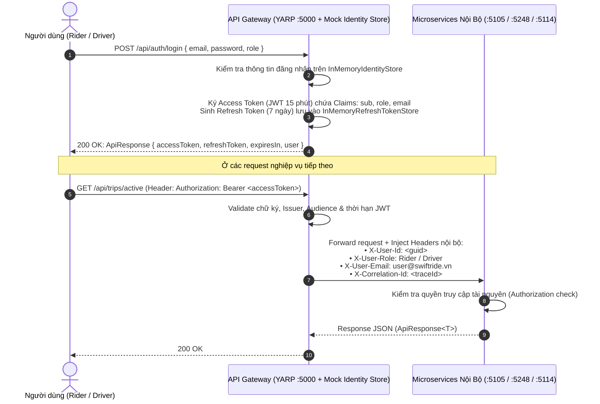

#### SD 02: F1.2 - Làm mới phiên đăng nhập (Refresh Token)
*Căn cứ tài liệu kiến trúc:* Mục 3.2 & Mục 9.3 (Duy trì phiên làm việc an toàn cho Rider App và Driver App).

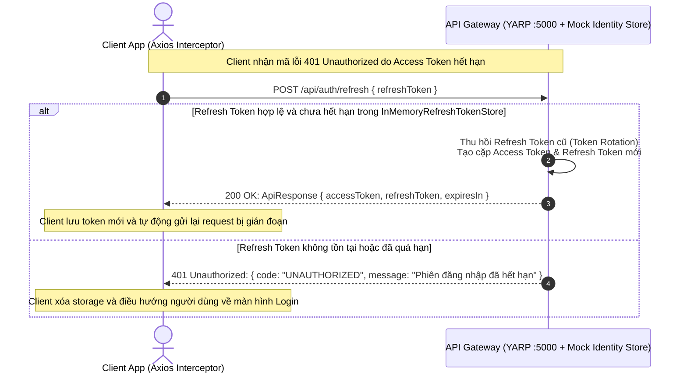

### PHÂN HỆ 2: QUẢN LÝ VÒNG ĐỜI CHUYẾN ĐI (TRIP SERVICE - SQL SERVER `TripDB`)

#### SD 03: F2.1 - Khởi tạo yêu cầu chuyến xe (Trip Creation)
*Căn cứ tài liệu kiến trúc:* Mục 2.2 (Bước 1, 2, 3: Rider chọn điểm đón/đến -> Trip Service tạo chuyến ở trạng thái `Requested` trong SQL Server và lấy báo giá từ Matching & Pricing Service) & Mục 4 (Flowchart).

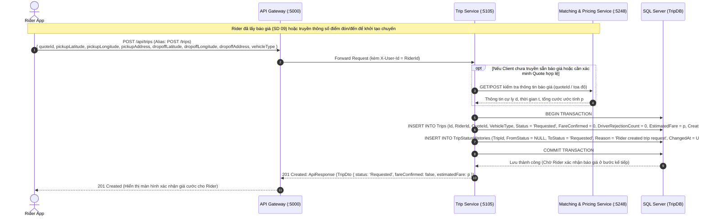

#### SD 04: F2.2 - Khách hàng xác nhận hoặc từ chối báo giá (Fare Quote Confirmation / Rejection & Outbox)
*Căn cứ tài liệu kiến trúc:* Mục 2.2 (Bước 4: Giá hiển thị cho Rider. Nếu từ chối -> hủy chuyến; nếu đồng ý -> chuyển sang bước đề xuất cho tài xế), Mục 4 (Flowchart) & Mục 9.2 (Transactional Outbox).

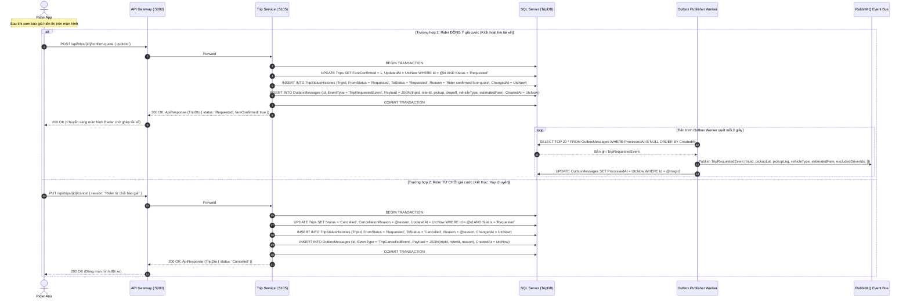

#### SD 05: F2.3 - Tài xế chấp nhận cuốc xe (Driver Acceptance & Concurrency Control)
*Căn cứ tài liệu kiến trúc:* Mục 2.2 (Bước 5), Mục 6.5 (DIP), Mục 7 (State Pattern & Transactional Outbox) & Kiểm soát đồng thời lạc quan bằng `RowVersion`.

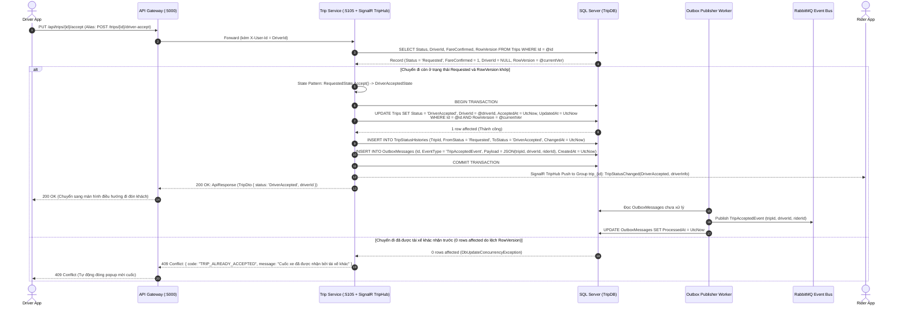

#### SD 06: F2.4 - Tiến trình đón & trả khách (Journey Progression: EnRoute -> PickedUp -> DroppedOff)
*Căn cứ tài liệu kiến trúc:* Mục 2.2 (Bước 6 & Bước 7), Mục 4 (Flowchart: Tài xế đang đến -> Đã đón khách -> Đã trả khách) & Mục 5.1.

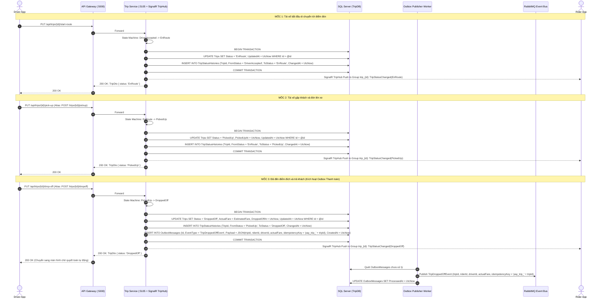

#### SD 07: F2.5 - Hủy chuyến đi trước khi đón (Trip Cancellation)
*Căn cứ tài liệu kiến trúc:* Mục 4 (Flowchart: Nhánh kết thúc - Hủy chuyến) & Mục 7 (Listing 6: Vòng đời chuyến đi).

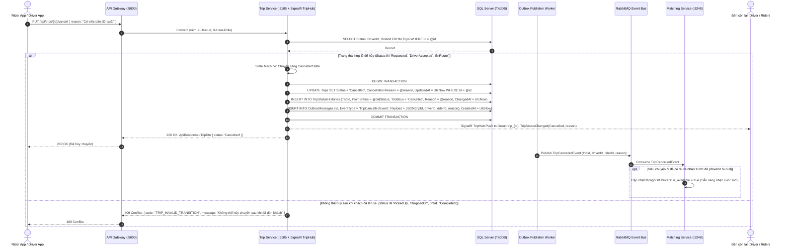

#### SD 08: F2.6 - Xác nhận `Paid` và đóng chuyến đi hoàn tất `Completed` sau thanh toán
*Căn cứ tài liệu kiến trúc:* Mục 2.2 (Bước 8: Khi thanh toán hoàn tất, chuyến đi đóng lại ở trạng thái cuối) & Mục 7 (Listing 6: Chuỗi trạng thái đầy đủ `DroppedOff` / `PaymentPending` -> `Paid` -> `Completed`).

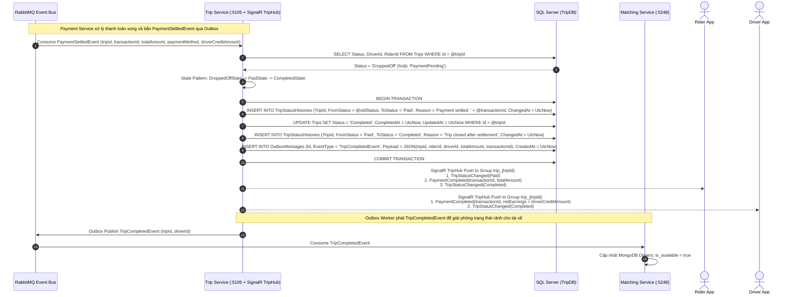

### PHÂN HỆ 3: TÌM XE, ĐỊNH VỊ & TÍNH GIÁ ĐỘNG (MATCHING & PRICING SERVICE - MONGODB `MatchDB`)

#### SD 09: F3.1 - Ước lượng cước phí động (Dynamic Pricing & Strategy Pattern)
*Căn cứ tài liệu kiến trúc:* Mục 2.3 (Công thức tính giá), Mục 5.2, Mục 6.1 (SRP), Mục 6.2 (OCP - Listing 2: `IPricingStrategy`), Mục 6.3 (LSP - Listing 3: Giá không âm) & Mục 7 (Strategy Pattern).

$$\text{Công thức gốc trong PDF: } p = \big((c_d \cdot d + c_t \cdot t) \cdot s + c_m\big) \cdot \eta \cdot (1 + T)$$

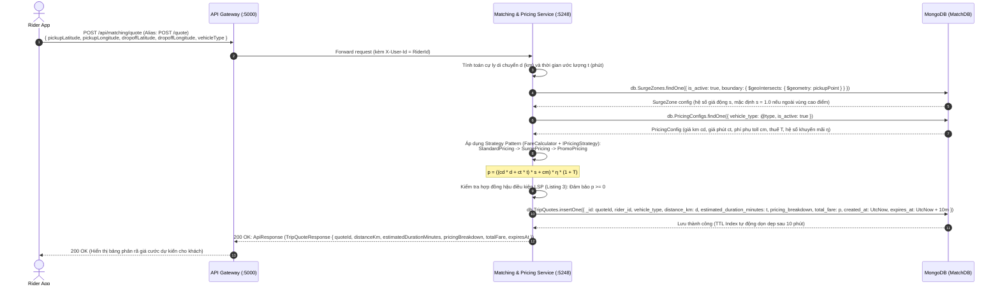

#### SD 10: F3.2 - Cập nhật vị trí GPS & Trạng thái tài xế (Driver GPS & Availability Tracking)
*Căn cứ tài liệu kiến trúc:* Mục 3.3 (MongoDB tối ưu cho dữ liệu vị trí động với geo-spatial index `2dsphere`) & Mục 5.2.

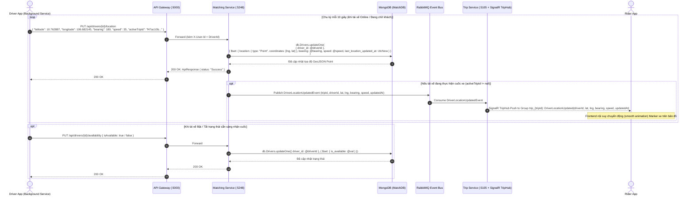

#### SD 11: F3.3 - Tìm kiếm & Điều phối tài xế với vòng lặp thử giới hạn $\le k$ lần (Driver Matching Engine)
*Căn cứ tài liệu kiến trúc:* Mục 2.2 (Bước 5: Nếu tài xế từ chối và chưa quá $k$ lần thử $\Rightarrow$ quay lại tìm tài xế khác; nếu vượt quá $k$ lần $\Rightarrow$ chuyến không thành công), Mục 4 (Flowchart) & Mục 5.2 (Truy vấn `2dsphere` trên MongoDB).

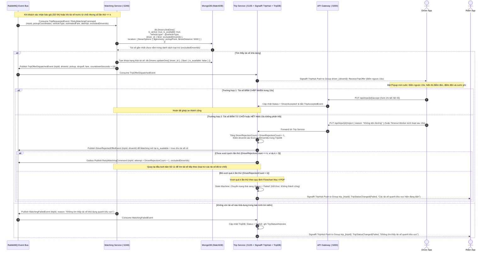

### PHÂN HỆ 4: THANH TOÁN, SỔ CÁI KÉP & BỒI THƯỜNG (PAYMENT SERVICE - POSTGRESQL `PayDB`)

#### SD 12: F4.1 - Tự động trừ tiền & Ghi sổ cái kép (Double-entry Ledger Settlement)
*Căn cứ tài liệu kiến trúc:* Mục 2.2 (Bước 7), Mục 3.3 (PostgreSQL đảm bảo sổ cái giao dịch kiểu double-entry, kiểm toán và nhất quán tiền bạc), Mục 5.3 (Payment Service bắt buộc) & Mục 9.2 (Transactional Outbox & Idempotent Consumer).

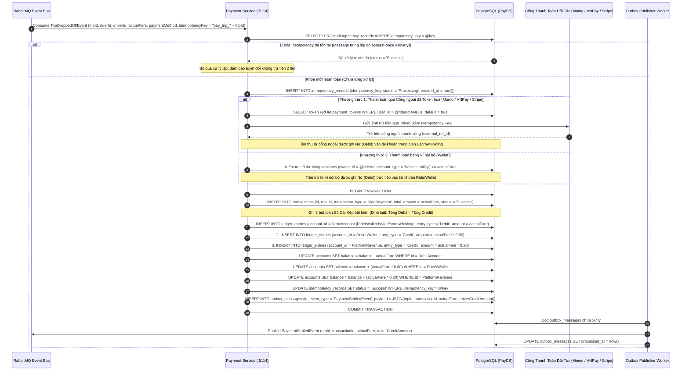

#### SD 13: F4.2 - Xử lý lỗi thanh toán tạm thời & Retry có giới hạn với Idempotency Key
*Căn cứ tài liệu kiến trúc:* Mục 4 (Flowchart: Thanh toán lỗi / chờ xử lý $\to$ retry có giới hạn với cùng một idempotency key; nếu vẫn lỗi thì giữ trạng thái chờ xử lý thay vì trừ tiền lặp hoặc báo thành công sai) & Mục 9.2 (Exponential backoff + jitter).

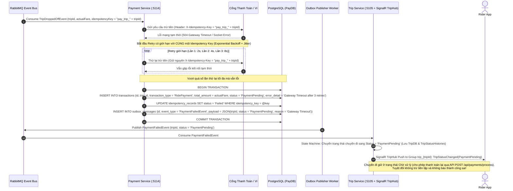

#### SD 14: F4.3 - Hoàn tiền & Giao dịch bồi thường Saga (Refund & Compensating Transaction)
*Căn cứ tài liệu kiến trúc:* Mục 5.3 (Payment Service xử lý hoàn tiền và bồi thường khi một Saga thất bại) & Mục 9.2 (Saga điều phối nhiều bước, định nghĩa hành động bồi thường và kết hợp Outbox).

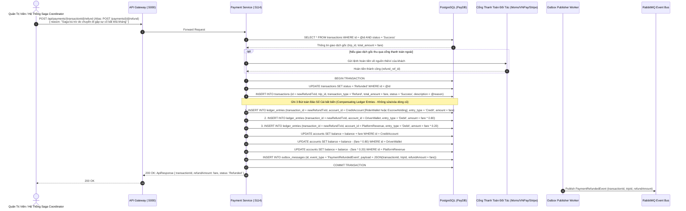

#### SD 15: F4.4 - Token hóa phương thức thanh toán (PCI-DSS Payment Tokenization)
*Căn cứ tài liệu kiến trúc:* Mục 5.3 & Mục 9.3 (Payment Service chỉ lưu token do cổng thanh toán cấp, tuyệt đối không lưu hay log số thẻ/CVV để đạt chuẩn an toàn bảo mật PCI-DSS).

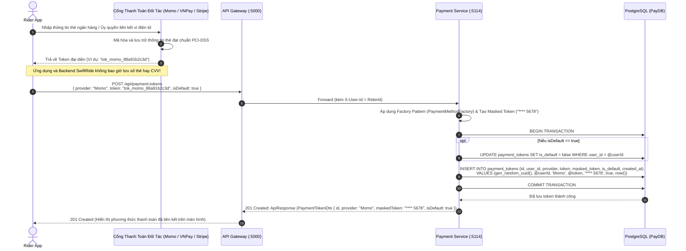
